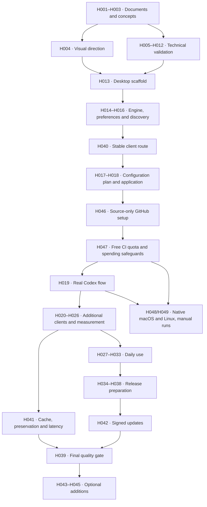

# PennyPinch task list

**Status date** 25 November 2026

**Scope** [Product specification 0.6](HEADROOM_DESKTOP_SPEC.md)\
**Targets** Windows 10 22H2 x64 and Windows 11 x64 for Codex, Claude Code and OpenCode.

**First-use priority** PennyPinch v0.1.1 is available for Windows 10 22H2 x64. The full installer includes Headroom 0.45.0. [Windows stable release](https://github.com/yukselbuilds/PennyPinch/releases/tag/v0.1.1) · [Publication evidence](docs/proofs/pennypinch-windows10-stable-release.json)

**47 of 54 main tasks are complete.** H001–H036, H038–H040, H043 and H045–H051 meet their recorded acceptance criteria. H042 passed for Windows 10. The Windows 11 installed app and update remain open.

| Open work | Condition for proceeding |
| --- | --- |
| H041 · Windows 10 evidence | Headroom 0.45.0 passed the 300-second load plan. The team also recorded retrieval of original content in chunks and an initial live Learn comparison. [Current load test](docs/validation/optimization-benefit.md#timed-load-with-headroom-0450) |
| H041 · Additional acceptance | The macOS 26 ARM64 package passed a controlled Codex Desktop turn with local usage. Live Anthropic, live API-key use, and actual billing need separate evidence. Windows 11 engine traffic still needs verification. Broader Learn acceptance remains open. Experimental e3 is on hold. Experimental e4 depends on e3 acceptance. [Open criteria](docs/validation/optimization-benefit.md#open-h041-acceptance-criteria) |
| H006, H037 and H042 · Clean Windows environments | The clean Windows 10 x64 installer and WebView2 prerequisite passed. The installed window opened on clean Windows 10. The portable package, window, and engine passed on clean Windows 10. The current full installer passed engine start and stop on clean Windows 10. The installed app connected OpenCode and completed a local request. Undo restored its settings. The native tray flow also passed. The installed app routed one live Codex turn on clean Windows 10. The portable engine also passed on clean Windows 11 x64. [Evidence](docs/proofs/pennypinch-windows11-portable-engine.json) The Windows 11 installer and engine lifecycle passed. [Evidence](docs/proofs/pennypinch-windows11-installed-lifecycle.json) H042 still needs Windows 11 x64 update and rollback. [Windows procedure](docs/validation/windows-preview-check.md) |
| H044 · Ripgrep candidate | On Headroom 0.45.0, RTK saved two more tokens on the first request. Full readback required two additional calls. Installation remains deferred. [Evidence](docs/proofs/rtk-1.2.1-rg-045.json) |
| H052–H054 · Deferred from the first release | The first release measures savings locally. Resume provider and privacy checks before enabling remote reporting. [Scope decision](docs/decisions/032-usage-sharing-privacy.md#25-november--first-release-scope) |

Windows development and the public Windows preview use Headroom **0.45.0**. The full installer upgrades the engine. The signed preview feed serves 0.1.1-preview.2 to compatible installations. H048's macOS 15.8.2 ARM64 acceptance covers **0.41.0**. H050 account connections and H051 chat metadata and navigation passed on Windows 10. Each platform, new sign-in, and release needs its own evidence. [Engine transition](docs/proofs/headroom-045-upgrade.json) · [H048](docs/proofs/macos-acceptance.json) · [H050](docs/proofs/accounts.md) · [H051](docs/proofs/sessions.md)

The 21 October audit covered an older list with 45 tasks and 12 completed tasks. H018 was accepted later, and the list grew through H054. H040–H042 became first-release gates after the 20 October comparison. H043–H045 remained optional additions. Counts in dated entries reflect their original scope. Use the first checkbox under each H task heading for the current total. Subtasks, DEV001, DEV002 and UX001 are outside that count. H039's acceptance covers the local Windows 10 candidate. [20 October comparison](docs/research/desktop-comparison-2026-10-20.md)

## Development tools and workflow

The user prioritized UX001 on 5–6 November before H029 began. UX001 refreshed how the existing features were presented. At that point, 27 of 51 functional tasks had passed.

### UX001 — Desktop visual refresh

- [x] Update the project design guide, shared hierarchy and four native screens. Preserve working controls, measurement and accessibility.
- **Acceptance.** Follow the design guide for empty, measured and sample data, themes, languages, scaling, keyboard access and native rendering. Pass the final local quality gate. The lead agent owns design direction, implementation and review. UX001 precedes H029 and covers presentation of existing features. [Design guide](DESIGN.md)
- **6 November result.** The project pinned Emil design engineering to a commit under the MIT license and reviewed three other references. 138 frontend and 349 Rust tests passed, with six opt-in tests skipped. The build and test blocks had 152 matching inputs, and the Windows 10 native checks passed. Savings evidence comes from measured traffic. [Evidence](docs/proofs/ui-taste.md) · [Review](docs/reviews/UX001.md)

These development tasks fall outside the product task count. DEV001, DEV002, H028–H036 and H038 were accepted, and the shared H011 safety prerequisite closed. H037's external checks remain open.

### UX002 — Settings guidance and troubleshooting
- [x] Make savings tips, Learn, rule trials, tool output protection and tested-version records understandable in Turkish and English.
- **Acceptance.** Everyday settings stay visible. Optional file review and advanced tool settings open on demand. A local rule trial with no repeated failures still offers its own result. Compatibility records load through the application troubleshooting disclosure. Preserve saved preferences, local-only analysis, the current engine route and evidence scope.
- **Verification.** Check both languages and themes, keyboard access, narrow layouts, the real App with isolated IPC and the local custom-protocol build.
- **Result.** 227 frontend tests, 480 Rust tests, 5 browser cases and 104 accessibility audits passed. The Windows preview was built from the verified inputs. [Evidence](docs/proofs/settings-guidance.json)

### UX003 — PennyPinch brand kit
- [x] Keep a local copy of the supplied kit and apply its assets to the sidebar in both themes, favicon, Windows icons and README.
- **Acceptance.** Use the correct asset for each surface, retain the original About artwork and verify the new icons in the Windows executable.
- **Result.** Windows 10 build, 227 frontend tests, 480 Rust tests and 104 browser accessibility audits passed. [Evidence](docs/proofs/pennypinch-brand-kit.json)

### DEV001 — CodeGraph, Ponytail and task acceptance

- [x] Verify the pinned CodeGraph runtime, MCP registration and index scope. Keep the new skill directory outside the index.
- [x] Install the Ponytail coding, audit and review skills for this repository. Record the pinned source, license and hashes.
- [x] Document the lead-agent and single-worker workflow, available verification commands and task completion criteria. Review the installation and documentation.
- **Acceptance.** Keep tool setup project-local and consistent with the development workflow. Record installation, automatic skill discovery and observed behavior individually. Keep this work outside the product task count. [Development workflow](docs/development/WORKFLOW.md)
- **Evidence.** The local artifacts are in `work/proofs/dev-tools/`. The tracked evidence covers the development setup and its checks. [Dev tool evidence](docs/proofs/dev-tools.md)
- **Status.** Complete. DEV002 covers the separate code audit. [Acceptance](docs/proofs/dev-tools.md)

### DEV002 — Initial Ponytail code audit

- [x] Review the existing code, prioritizing configuration, Apply and Undo ownership, runtime and proxy behavior, and the connections UI.
- **Acceptance.** Each finding includes a condition, file and line, user impact, the smallest fix and a verification method. Link findings to open work or record a focused fix. List areas outside the audit scope. Use implementation evidence to close fixes.
- **Verification.** Read the source paths found with CodeGraph and check existing evidence fingerprints. Repeat a successful product check when its inputs or environment change.
- **Files.** `docs/reviews/ponytail-baseline.md` and relevant task records.
- **Status.** Complete. The review identified DEV002-D01, a low-priority README and test coverage issue addressed under H022. H022 links the current summary to versioned evidence. The priority paths reviewed yielded zero confirmed new product defects. The report defines the scope of the audit. [Audit report](docs/reviews/ponytail-baseline.md)

**18 November Astra review follow-up.** These checks fall outside the main task count. H041 covers version rollback and SSE usage counters. The existing UI regressions are verified individually.

- [x] **H024/H025/H027 · Start of the local day.** Overview and Activity use the first valid local instant on days when midnight is skipped. The Santiago SQLite fixture verified Today, Last 7 days and the daily chart. A transition of 30 minutes and 1 second and a skipped calendar day also passed. [Evidence](docs/proofs/metrics-store.md#19-kasım-2026--atlanan-yerel-gece-yarısı)
- [x] **H024/H025 · Long-session chart.** With 90-day retention, 65 days of measurements fit into 64 chart points. Overview totals include every record. The combined date interval was verified in Turkish and English. [Evidence](docs/proofs/metrics-store.md#19-kasım-2026--uzun-oturum-grafiği)
- [x] **H025/H030 · Overview polling in the tray.** In approximately 12 seconds on Windows 10, automatic Overview queries fell from two to zero while hidden. Reopening from the tray triggered one query and restored regular refreshes. The background collector received new engine measurements while the window was hidden. [Evidence](docs/proofs/tray-lifecycle.md#19-kasım-2026--tepside-genel-bakış-yenilemesi)

## Working rules

A completed task meets its own acceptance criteria and all five shared requirements. Check the main box after verifying the behavior and relevant error and scope cases, reviewing the change and recording current evidence. Report completion and wait for the next task. [Development workflow](docs/development/WORKFLOW.md#bir-görevin-bitiş-kabulü)

**25 October tool setup.** At the user's request, the team installed CodeGraph 1.6.2 for this project and verified CLI and project MCP queries. Telemetry was disabled. The queries and normal process exit passed. The product count was 18 of 51 and H022 was next. [Usage and evidence scope](docs/development/codegraph.md)

**20 October tool setup.** At the user's request, the team installed Open Computer Use as a separate Codex MCP server and skill. Real screenshot and mouse checks passed for Notepad and the desktop app on Windows 10. The tool setup is a historical development check outside product acceptance. [Setup and scope](docs/research/computer-use-2026-10-20.md)

- Use `[x]` when a task's specified outcome is complete. Use live engine and client evidence for integration claims.
- Follow dependencies. Keep each small or medium implementation slice focused on one behavior with acceptance criteria that can be verified together. Use one to five files as a handoff guide and handle independent goals in sequence.
- Finish the active main task before starting the next one. Keep the task list current, report completion and wait for the user's next instruction. Report accepted subtasks at their actual scope.
- Record each task's acceptance criteria and evidence. Include the command, source and configuration inputs, toolchain fingerprints and outcome. Remove secrets and raw error output from permanent records.
- Use focused checks during implementation. Run the full local quality gate once after reviewing the final candidate. Reuse a valid PASS while its inputs and environment match.
- Run small live model checks separately from automated tests. Reuse naturally occurring traffic when possible.
- Preserve the user's model, reasoning effort, agent count, permissions and sign-in method. Each client owns its agents, and the app routes eligible traffic.
- A verified client connection covers supported models, the main agent and subagents using that route. Users choose models in their client without repeating setup for each model or agent. Verify separate provider, process or cloud routes independently and show the verified scope in the UI.
- Use checkpoints to review evidence. Escalate open product decisions and make routine implementation decisions within existing authorization.
- H013 provides the scaffold and registered `pnpm` scripts. Treat commands listed in later tasks as plans until they are implemented and verified.
- Task IDs preserve historical evidence. Dependencies determine the implementation order. The Windows product path is H016 → H040 → H017 → H018 → H019. GitHub preparation adds H018 → H046 → H047 → H019. H048 and H049 depend on the H019 Windows slice and H047 quota review. H048 passed in its recorded scope. H049 resumed and still has open acceptance. H050 and H051 were completed for local Windows 10 development independently of H049. H041 follows H023. H042 follows installer and uninstall work and precedes H039. H043–H045 are optional additions after the first usable release.

## Milestones and dependencies

| Milestone | Tasks | Outcome |
| --- | --- | --- |
| Preparation | H001–H004 | Scope, task list, three concepts and a design direction |
| Technical validation | H005–H012 | Packaging and routing feasibility for three clients |
| First working slice | H013–H019 | Desktop app with real engine state and a Codex connection |
| Stable client route | H040, after H016 and before H017 | Persistent endpoint, process ownership and a verified failure path |
| Clients and measurement | H020–H026 | Claude Code, OpenCode, accurate metrics and a dashboard backed by measurements |
| Quality and benefit | H041, after H023 | Cache, preservation and latency regression checks |
| Daily use | H027–H033 | Activity, safe pause, tray, settings and export |
| Release candidate | H034–H039 and H042 | Accessibility, Windows checks, packaging, signed updates and the final quality gate |
| Optional follow-up | H043–H045 | Verified RTK integration and local recommendations without content retention |
| Accounts and chats | H050–H051 | Official sign-in and reliable metadata for open or working chats |
| Repository and free CI | H046–H047 | Private source-only GitHub import, quota and spending safeguards |
| Additional platforms | H048–H049 | Native macOS and Linux ports and acceptance after the first Windows slice and H047 |
| Feedback and sharing | H052–H054 | Dedicated reporting service, feedback form and optional daily summaries |

## Preparation

### H001 — Product scope
- [x] The specification was created. Windows 10/11, automatic discovery, one-time connection, subagents, and model scope are covered.
- **Acceptance:** Application behavior is separated from engine capability. Measurement limits and rollback are defined.
- **Verification:** Check the content and Markdown structure of `HEADROOM_DESKTOP_SPEC.md`.
- **Dependency / size:** None / S.
- **Files:** `HEADROOM_DESKTOP_SPEC.md`.

### H002 — Actionable task list
- [x] This list is ready with dependencies, acceptance conditions, and checkpoints.
- **Acceptance:** All H IDs are unique. Dependencies exist and are acyclic. Production work is not marked complete.
- **Verification:** Check IDs/dependencies and compare against specification scope.
- **Dependency / size:** H001 / S.
- **Files:** `TASKS.md`.

### H003 — Three interactive UI concepts
- [x] Graphite, Ivory, and Signal concepts are ready, with previews for overview, applications, activity, and settings.
- **Acceptance:** Three distinct layouts, sample-data labels, working navigation, state selection, connection dialog, and start/pause presentation.
- **Verification:** Check interactions and overflow for all three concepts in a local browser. Capture screenshots. Evidence: `work/ui-review/validation-summary.json`.
- **Dependency / size:** H001 / M. Design output only.
- **Files:** `UI_CONCEPTS.md`, `outputs/ui-concepts/`.

### H004 — Choose visual direction
- [x] The user chose Graphite. The decision record captures a light/dark token approach for the same layout.
- **Acceptance:** The selected layout and token approach for both themes are recorded. Keep sample UI separate from production scope.
- **Verification:** User selection based on concept comparison and the design decision record.
- **Dependency / size:** H003 / S.
- **Files:** `UI_CONCEPTS.md`, `docs/decisions/001-ui-direction.md`.

## Technical evidence — address the highest-risk paths first

### H005 — Isolated engine experiment
- [x] `headroom-ai[proxy]==0.41.0` ran with project-local Python 3.13.13 on an application-owned loopback port. Readiness/ownership, busy/wrong listener, and controlled shutdown were evidenced.
- **Acceptance:** Verify readiness and ownership. Do not claim another proxy. The experiment does not persistently change client settings.
- **Verification:** Empty/busy port, invalid process, and controlled-shutdown experiments with a short configuration summary.
- **Dependency / size:** H001 / M.
- **Files:** `work/proofs/engine/`, `docs/proofs/engine.md`.
- **Result / limit:** The 4 focused tests and real runtime proof passed. Fingerprints are in [the evidence](docs/proofs/engine.md), with coordinator review in [the H005 review](docs/reviews/H005.md). This is limited to a Windows 10 22H2 host/console context. Windows 11, a clean package, and consoleless GUI lifecycle have not been verified.

### H006 — Windows packaging evidence
- [x] Test the engine's portable operation with Python/native dependencies on both target Windows versions.
- **Windows 11 portable engine starts offline.** The portable Headroom 0.45.0 engine reached Ready in 70.420 seconds on clean Windows 11 24H2 x64. The native core loaded offline. The engine stopped normally and released its port. The engine-only ZIP had 198,544,748 bytes. The test used a standard desktop user token. [Evidence](docs/proofs/pennypinch-windows11-portable-engine.json)
- [x] **Windows 10 portable engine starts offline.** The packaged Headroom 0.45.0 engine reached Ready in 14.656 seconds on offline Windows 10 22H2 x64. The native core loaded. The engine stopped normally and released its port. [Evidence](docs/proofs/pennypinch-windows10-preview8-clean-install.json)
- [x] **Windows preload deferred during packaged controller startup.** The updated packaged controller reached Ready in 13.338 seconds on the development host. It completed one loopback test request with optimization enabled and the native core loaded. It stopped normally and released its port. [Evidence](docs/proofs/pennypinch-windows10-preview8-clean-install.json)
- [x] **Windows 10 portable package and window.** The portable ZIP contained 19,493 files. A clean Windows 10 22H2 x64 guest extracted it and verified the package digests. PennyPinch opened under a standard user token. [Evidence](docs/proofs/pennypinch-windows10-preview8-clean-install.json)
- **Test package ready for clean environments.** The separately identified app and engine that passed the earlier native check were placed in a 197,348,721-byte portable ZIP with Start → Ready → Stop → Exit instructions. Hashes for 22,335 files and ZIP readability on Windows were verified. WebView2 Runtime is required for testing. Results from two clean environments are pending. [Package record](docs/proofs/windows-engine-clean-test-package.json).
- [x] **H006-d owner loss during startup — 15 November.** The real packaged controller was tested at the test checkpoint between production spawn and Job assignment. It exited within 147 ms after the owner closed. It waited while the writer end was held for one second and exited within 8 ms after that end closed. Both arms had exit 2, protocol output 0, and 0 new or remaining helper and engine processes. 22,334 package inputs matched. Focused test, 462 Rust tests, formatting, and embedded build passed. The 222 app tests and frontend build were reused with matching inputs. [Evidence](docs/proofs/windows-engine-startup-crash.json) · [Review](docs/reviews/H006-d.md).
- [x] **H006-c actual GUI crash — 15 November:** Three packaged release engine processes started by the Tauri window ended at 57.429 ms only when the GUI child handle was force-terminated. Engine/fixed-ingress ports closed at 58.299 ms. The external observer's Job remained open meanwhile, and a foreign listener remained intact. The same identity/profile reopened as Stopped, retained the fixed endpoint, and passed Start/Ready/Stop/normal Exit. 22,689 inputs matched before and after. Provider model requests: 0. The first test helper's incorrect TCP table constant was fixed. The failed run and test state were preserved. Main H006 and 45/54 remain unchanged. [Evidence](docs/proofs/windows-gui-crash.json), [explanation](docs/proofs/windows-gui-crash.md), [review](docs/reviews/H006-c.md).
- [x] **H006-b local crash acceptance — 14 November:** Forced owner-process loss was verified with the current package and production Rust controller startup path. With the control pipe open, three core processes ended in 53 ms and port closure was observed in 357 ms. When an additional Job handle was held open for at least 1,000 ms, the engine remained alive. After the last handle closed, process exit was observed in 54 ms / port closure in 370 ms. The foreign listener was preserved in both arms. All 22,333 package files matched. Acceptance included 441 Rust/18 ignored, formatting/build, and fingerprint-matched evidence for 221 Node/frontend tests. The lead agent owns process/test/review. This is not a clean OS, Windows 11, actual GUI crash, or release acceptance. [Evidence](docs/proofs/windows-engine-crash.json), [explanation](docs/proofs/windows-engine.md#h006-b--ani-sahip-süreç-kaybı-14-kasım-2026), [review](docs/reviews/H006-b.md).
- [x] **Local slice H006-a acceptance:** On a Windows 10 host, the consoleless parent → hidden helper → engine chain, stdio stop, and graceful shutdown were evidenced. Two focused checks passed. Source/package fingerprints were reviewed. [Evidence](docs/proofs/windows-engine.md), [review](docs/reviews/H006-a.md).
- **Local result / open scope:** H014 verifies the real Tauri-engine binding. H006-b verifies Job cleanup for a ready controller owner. H006-c verifies packaged GUI loss and reopen. H006-d verifies controller shutdown before Job assignment. The installed window opened on a clean Windows 10 22H2 x64 guest without development tools. The candidate's staged controller reached Ready in 13.836 seconds and stopped normally on the development host. The portable engine passed on clean Windows 10. The portable engine passed on clean Windows 11 x64. [Clean Windows 10 evidence](docs/proofs/pennypinch-windows10-preview8-clean-install.json) · [Windows test environment](docs/validation/windows-install.md#open-acceptance-criteria).
- **Acceptance:** The engine starts in Windows 10 22H2 and Windows 11 x64 environments without development tools. Download, runtime size, and possible gaps are recorded.
- **Verification:** Readiness/shutdown evidence from two separate clean environments. A failed environment is not counted as successful.
- **Dependency / size:** H005 / M.
- **Files:** `scripts/package-engine.*`, `docs/proofs/windows-engine.md`.

### H007 — Streaming and retrieval contract
- [x] Requests, SSE event integrity, errors, and CCR behavior were evidenced with controlled local HTTP examples.
- **Result.** A: opaque blocks/explicit cache marker, model/reasoning/auth, tool fragments, and 429 propagation. B: actual compression → equality through the same runtime public retrieval, TTL 7200. C: 60,900 source bytes from the last observation and 59,219 bytes of numeric output preserved exactly with source and explicit tool protection. [Evidence](docs/proofs/protocol.md), [review](docs/reviews/H007.md).
- **Limit:** Windows 10 host, local fixture, and synthetic credential. The opaque fix is a startup adaptation with a source guard. H014/H037 will move it to production. Numeric preservation is limited to tool/shape scope, not general automatic number recognition. The 153,599 → 106 bytes result is not token-savings measurement. Incremental SSE/real-client loop remains open under H008–H010. Other OS/clean environment/native package evidence remains open under H006/H037.
- **Acceptance:** Preserve tool-call structure on supported Responses/Anthropic paths, retrieve the original of a compressed sample from the same runtime, and preserve unknown blocks.
- **Verification:** Local fixture server, compression/retrieval equality, and stream-order checks. No paid call is required.
- **Dependency / size:** H005 / M.
- **Files:** `work/proofs/protocol/`, `tests/fixtures/protocol/`, `docs/proofs/protocol.md`.

**Checkpoint K1 — H005–H007:** Review the runtime approach and protocol evidence. Do not proceed to production UI while hiding a packaging or retrieval blocker.

### H008 — Codex Desktop and CLI evidence
- **Main-task acceptance decision, 4 November:** The user chose to close using ChatGPT evidence while leaving the live API-key test open for the H041 pre-release acceptance. On Windows 10, CLI 0.166.0 main/single subagent, same/different model-effort, and native wait were verified. Desktop 26.1027.6604.0 real account, same-chat route, and reopen were also verified. A controlled MCP call was blocked by the client's permission policy. No general tool health is claimed. [Closure and limits](docs/proofs/codex-native-wait.md#h008-kapsam-kararı-ve-kapanış), [version catalog](compatibility/clients.json).
- **Native wait slice, 4 November:** A new real CLI run completed main/subagent spawn and wait. Matching JSON return had timed_out=false, a completed runtime event, and two separate Responses ingress IDs. The controlled MCP call was blocked in the client by `approval_policy=never`. Gate request count was 0 and state was environment_blocked. Permission policy was not changed and the rejected call was not retried. The direction of QA relay resets and their timing relation to the terminal are unknown. The counter measures TCP closure. Separate model-call-free app-server fixture check and 3 focused tests passed. [Evidence](docs/proofs/codex-native-wait.md).
- **Actual Desktop slice completed, 4 November:** Desktop 26.1027.6604.0 with a separate official ChatGPT profile completed two short responses through Headroom. Leaving a chat and reopening the same chat preserved the same native identity. The engine reported 5 local requests and 0 failures. Request purposes were not counted separately. Window/ports closed and normal config remained intact. The 2 opt-in discovery and pin tests and isolated Apply/Undo passed with current installed files. The open process did not use the new settings during that turn. After a full reopen, the same chat's Headroom route passed separately. Live API-key and broader auth/transport scope remain open. [Evidence](docs/proofs/codex-desktop-live.md).
- **Current different model/effort evidence:** Main Astra max and test subagent Sol medium completed with CLI 0.166.0 and the existing ChatGPT sign-in. Two chat IDs matched separately in Headroom ingress. In this historical run, wait was cancelled before dispatch. The new 4 November native-wait evidence is above. [Evidence](docs/proofs/codex-current-diagnostics.md).
- **Isolated Desktop acceptance, 3 November:** The installed Desktop app used the registered local endpoint in a separate profile. A WebSocket request reached a fake provider through Headroom and the completed response appeared in the UI. Real account and current-chat routing remain open. [Evidence](docs/proofs/codex-current-diagnostics.md).
- **3 November diagnostic and current CLI role evidence:** The old `mcp` configuration warning was produced without a model call. Two ownership-verified closures returned exit 0. After quota renewal, the main agent and the single default subagent completed with CLI 0.166.0 and the existing ChatGPT account. The identities of the two roles using the same model matched separately at Headroom ingress. Open Desktop routing, different model/effort combinations, and other auth/transport scope remain open. [Evidence](docs/proofs/codex-current-diagnostics.md).
- **Local usage fix acceptance, 3 November (not the main task):** Valid OpenAI signature + bounded version query + file pin, local standalone junction resolution, registered Windows package API, real GUI executable selection, and long-PATH precedence were implemented. CLI 0.166.0, backend 0.166.0-alpha.5.1, and Desktop 26.1027.3384.0 are recognized. Both surfaces passed real discovery → plan → atomic Apply/Undo tests on isolated config. Verifier workspace moved to app-state. CodeGraph project config stays outside the test without touching user settings. UI → native verifier → owned runtime → normal existing ChatGPT account CLI response was verified. The two notices in this run were classified in later diagnostics as configuration warnings from user settings. [Evidence](docs/proofs/codex-current.md), [decision 011](docs/decisions/011-current-codex.md), [review](docs/reviews/H008-current.md). 289 Rust/98 frontend passed. Formatting and embedded build passed. Live Desktop, subagent, and general auth acceptance were left separate in this first slice.
- **Open protocol follow-up after H019 — 23 October:** A normal `.11.2` CLI response completes, but the source of 2 additional JSONL error notices is unknown. Product response-route evidence is shown separately from these errors. General protocol/tool health or resolution of the errors is not accepted. An isolated failing-MCP test did not produce these error events. Do not assume an MCP/transport cause. [Latest evidence](docs/proofs/codex-product-verification.md). H008's main checkbox remained open at this historical step. The current notice diagnosis is above.
- [x] Determine the real routing path for installed Codex surfaces and verify with a small amount of real traffic. Acceptance scope is the above ChatGPT CLI/Desktop versions on Windows 10.
- **Local interim evidence:** The A2 message-only turn/exit 0 passed. `update_plan` was not announced. In the A3 different read-only `get_goal` call, the correct callback/call_id, two POSTs, message item before upstream terminal, final marker/turn.completed/exit 0 were observed. The tool result was unclassified text, so it does not count as semantic success. [Evidence](docs/proofs/codex.md), [review](docs/reviews/H008.md).
- **Historical constraint:** Automatic review rejected starting file reads through PowerShell with `blocked by policy`. Do not retry the same action. API-fixture evidence is not real model/ChatGPT auth/Desktop/main-subagent support. H008 ChatGPT acceptance relies on subsequent real-traffic evidence. Live API-key acceptance remains open in H041.
- **Acceptance:** Preserve sign-in, upstream model, and reasoning. Check main and single-subagent paths separately. Do not rely on ignored project-config keys.
- **Comparison acceptance — user scope decision, 4 November:** Real ChatGPT gateway CLI/Desktop traffic is H008 acceptance. The live API-key provider test moved to the H041 pre-release gate and is still not_tested. Mark HTTP/SSE fixture and live WebSocket separately. Bulk provider-retagging of the current chat database is not the default integration method. Competitor adapter code is a research input, not our live-support evidence.
- **Model/subagent acceptance:** Observe real paths separately with the main and current single subagent using different model/effort. Cover two roles on the same model and a fixture with a later-created subagent on the same route. This development chat is not a reason to open new test agents or change model/agent count. If a separate provider or cloud route is not observed, keep scope partial/unknown.
- **Verification:** Content-free, separate proxy evidence for a main request and single-subagent request. Show the right state for each auth/surface combination.
- **Dependency / size:** H007 / M.
- **Files:** `work/proofs/codex/`, `docs/proofs/codex.md`.

### H009 — Claude Code CLI evidence
- **H009 completed — 15 November, local Windows 10 technical acceptance.** H009-a/b and native H020/H022 evidence were reconciled with main acceptance/K2. In synthetic auth/CLI scope, settings/model/effort preservation, streaming, tools/CCR, scoped Apply/Undo, first use, and remembered project passed. Do not conflate native UI with tools off and separate tool-enabled CLI profile. Live account/provider, Claude subagent/plugin, and other OS combinations remain experimental/not_tested. No full-agent scope or real token/billing savings is claimed. [Main acceptance](docs/proofs/claude-acceptance.md), [JSON](docs/proofs/claude-acceptance.json), [review](docs/reviews/H009.md).
- [x] Verify effective settings scope and Anthropic route with a small amount of real traffic.
- [x] **H009-b local tool/CCR acceptance — 14 November:** The real pinned 2.1.158 CLI → permitted single MCP fixture tool → engine → local Anthropic loop passed. Two real tool calls were verified across 3 native requests and 4 upstream messages, including call_id/model/effort/thinking/synthetic auth, final/exit 0, and graceful engine shutdown. A 14,999-byte log became 103 bytes. Original content was recovered from the CCR JSON envelope with the same hash and bytes. Four focused error/boundary checks passed. Unchanged Rust/Node/build evidence was reused with matching fingerprints. Token/billing savings were not measured. The CLI separately moved large MCP output to a file. No Headroom benefit is attributed to that path. The lead agent owns test/protocol/review. Live provider/OAuth/subagent/GUI/other OS and main H009 remain open, total 42/54. [Evidence](docs/proofs/claude-tools.json), [explanation](docs/proofs/claude.md#h009-b--gerçek-cli-araç-ve-ccr-döngüsü), [review](docs/reviews/H009-b.md).
- [x] **H009-a acceptance:** Installed 2.1.158 CLI in a transient bare/API-sentinel/tools-off profile. One POST, actual partial text before terminal, final success/exit 0, and direct usage 12/4 passed. The 5 focused tests passed and source hashes were checked. [Evidence](docs/proofs/claude.md), [review](docs/reviews/H009-a.md). Force fallback/closed-port evidence is not graceful GUI shutdown. It does not replace existing OAuth/tool/retrieval/extension acceptance. Do not retry the rejected Codex/PowerShell action.
- **Acceptance:** Preserve existing sign-in and selected model. Streaming/tools/retrieval work. CLI success is not extension support.
- **Model/subagent acceptance:** Default scope includes main and supported subagent paths together. A separate subagent binding or model allowlist is not required. Separately verify the path for a role with its own endpoint/provider setting. A missing path is not full coverage.
- **Verification:** Connection and rollback experiment. Record the limit if authorization or account is unavailable.
- **Dependency / size:** H007 / M.
- **Files:** `work/proofs/claude/`, `docs/proofs/claude.md`.

### H010 — OpenCode CLI/TUI evidence
- **H010 completed — 15 November, local Windows 10 technical acceptance.** Suitable OpenAI Chat/Responses paths, model/auth preservation, JSON/JSONC, streaming, tools/CCR, and main/subagent routes were verified for OpenCode 1.19.3 and 2.3.0. V2 normal service/TUI and packaged Desktop with CLI configuration also passed. Per K2, inaccessible combinations remain experimental. [Main acceptance](docs/proofs/opencode-acceptance.md), [JSON](docs/proofs/opencode-acceptance.json), [review](docs/reviews/H010.md).
- [x] **H010-j Windows 10 OpenCode Desktop — 15 November.** The official 2.3.0 NSIS payload ran inside the project in a separate profile. The packaged service used the user's JSONC connected through Headroom CLI setup. Actual GUI send → four Responses requests → three MCP calls → visible final response matched SQLite. A 14,999 → 103-byte log was retrieved exactly through CCR. Main process normal quit/exit 0, separate service stop, port/process cleanup, owned protocol-record cleanup, and removal restoring the original config all passed. 22,818 native inputs matched. 222 Node/462 Rust passed, 19 ignored, formatting/build passed. Main H010 remains open, total 42/54. [Evidence](docs/proofs/opencode-v2-desktop.md), [JSON](docs/proofs/opencode-v2-desktop.json), [review](docs/reviews/H010-j.md).
- [x] **H010-i Windows 10 OpenCode V2 subagents — 15 November.** The same registered 2.3.0 service completed two CLI turns. One subagent inherited the main Chat model. Another used a separate Chat model attached to a Responses main agent. Real identities for four sessions, `parent_id`, model route, subagent completion notice, and log/CCR passed. Each sample was 14,999 → 103 bytes with exact retrieval. Native removal and normal service stop were verified. 22,714 inputs matched. Main H010 remains open, total 42/54. [Evidence](docs/proofs/opencode-v2-subagents.md), [JSON](docs/proofs/opencode-v2-subagents.json), [review](docs/reviews/H010-i.md).
- [x] **H010-h Windows 10 OpenCode V2 normal service and full TUI — 15 November.** Normal CLI (Chat) and full TUI (Responses) used the registered 2.3.0 service started after native Apply. Two separate root sessions succeeded in the same service database. Three tools and four model requests were verified in each arm. The sample log was 14,999 → 103 bytes with exact retrieval. TUI `/exit`, normal service stop, absence of open ports/processes, and UI removal restoring original JSONC passed. 22,705 native inputs matched. Catalog and final local gate are current. Main H010 remains open, total 42/54. [Evidence](docs/proofs/opencode-v2-service.md), [JSON](docs/proofs/opencode-v2-service.json), [review](docs/reviews/H010-h.md).
- [x] **H010-g Windows 10 V2 CLI connection — 15 November.** Preview, Apply, reopen, and removal passed in the real Headroom window on the fixed 2.3.0 baseline. The V2 schema label is stored in the shared ownership record. Settings changes connect existing provider endpoints and MCP bridge in the same transaction. Model, auth, effort, and permissions are preserved. In Chat and Responses turns, a 14,999 → 103-byte log was retrieved with original bytes. Conflicting Undo preserved settings and ownership. Normal Undo restored original JSONC. 222 Node and 462 Rust passed, 19 ignored, plus 1 real-file test. Main H010 and V2 Desktop/TUI, shared service, subagents, live account, and other OS remain open. Total 42/54. [Evidence](docs/proofs/opencode-v2-binding.md), [JSON](docs/proofs/opencode-v2-binding.json), [review](docs/reviews/H010-g.md).
- [x] **H010-f Windows 10 V2 version recognition — 14 November:** Official pinned 2.3.0 x64 baseline executable was recognized in PATH/manual/user-local discovery without running it, using hash/size/identity. Rescan, read pin, and wrong-version/write-open rejection passed with a real file. V1 binary recognition was preserved. The real discovery → PlanManager → Apply flow kept the V2 plan blocked. Fixture JSONC was unchanged and no ownership directory existed. Account/login gate remained closed. The catalog shows the earlier CLI preflight as partial. Matching scope did not expand. Full gate passed with 222 Node/450 Rust (19 ignored), formatting/frontend/embedded build passed. The 1 opt-in real-file test and 341 inputs matched. The older 645-input protocol evidence was not repeated because it had not changed. Native window/file picker was not retested. V2 writer/MCP/subagent/Desktop/live auth and main H010 remain open, total 42/54. [Evidence](docs/proofs/opencode-v2-discovery.json), [explanation](docs/proofs/opencode-v2-discovery.md), [review](docs/reviews/H010-f.md).
- [x] Verify the OpenCode route with the active provider and model preserved. Separate model/protocol and main/subagent paths passed with real clients in CLI/TUI 1.19.3 and CLI 2.3.0. Model change in the same V1 main session was verified. Live provider/auth and other OS scope remain experimental.
- [x] **H010-b local product tool/CCR acceptance — 14 November:** Initial endpoint-only Chat/Responses runs remain recorded as failed due to missing retrieval notice. H010-b3's Windows product flow provides the required MCP bridge. Real native UI → saved JSONC → pinned OpenCode 1.19.3 → owned engine → local provider loop passed for both protocols. Chat used real MCP retrieval. Responses used server-side retrieval. This local acceptance is not live provider, real subagent, or main H010 acceptance. Total 42/54.
- [x] **H010-b2 conditional local technical evidence:** Real 1.19.3 CLI completed 4 native and 4 upstream Chat messages and native retrieval, and 3 native and 4 upstream Responses messages with server-side retrieval, using the narrow loopback MCP bridge explicitly added to the isolated profile. In both arms, original 14,999 → 103 bytes, exact CCR, selector/wire model, synthetic auth/call_id, final response, graceful CLI/engine exit 0, and port closure were correct. Five fixtures and three boundary checks passed. Unchanged product gates were reused with matching fingerprints. The test bridge was not installed in the product package or normal client settings. Token/billing benefit was not measured. [Evidence](docs/proofs/opencode-tools.json), [explanation](docs/proofs/opencode.md#h010-b--araç-ve-ccr-yolları), [review](docs/reviews/H010-b.md).
- [x] **H010-b3 Windows 10 product retrieval bridge:** Preview → atomic Apply → conflict-preserving removal were verified through the native UI. An existing user-owned MCP entry blocks the operation. Model/effort/auth/agent selections are preserved. The packaged bridge requires a valid hash and uses only a verified Headroom socket owned by the same user. In both protocols, 14,999 → 103-byte block and exact retrieval/final/exit 0 passed, as did pause, full stop, reopen with the same endpoint, cancellation/conflict, and byte-exact Undo. During release removal, the bridge lock remained open. On conflict it returned exit 10 with no change. Normal exit 0/rollback passed. 222 Node, 448 Rust (18 ignored), 7 Python bridge tests, formatting/frontend/embedded build passed. 332 product inputs matched. No full installer/update or token/billing savings claim. [Evidence](docs/proofs/opencode-retrieval.json), [explanation](docs/proofs/opencode-retrieval.md), [review](docs/reviews/H010-b3.md).
- **H010 scope limits.** Desktop-only discovery/installation, subagents from V2 TUI/Desktop, model changes in the same sub-session, nested agents, immediate adoption of changed settings by an open service, live provider/auth, and other OS combinations are not_tested/experimental. Decision 009 and K2 represent this limited scope. Do not claim general support before combinations are verified. The free-usage limit remains in force.
- [x] **H010-c local native subagent acceptance — 14 November:** A real child inheriting the same Chat model, an explicit model change in the same parent session followed by a new child, and a Responses parent with a child using a different Chat model passed. Real `task` metadata matched the child export's parentID/agent/selector fields. Three distinct children were observed, with at most one concurrent foreground child. Data/CCR/witness/final paths for both roles, model/synthetic auth, unchanged connection, and exit 0 were correct. Six blocks were 14,999 → 103 bytes with exact retrieval. Normal GUI exit/closed listener and byte-exact JSONC after same-native keep-state Undo with released owner passed. Nine focused tests passed. 332 unchanged product inputs and tools matched, so the earlier 222 Node/448 Rust/formatting/build evidence was reused. This is not live-model or token/billing acceptance. Main H010 and total 42/54 remain open. [Plan](docs/decisions/009-opencode-provider-routes.md#h010-c--yerel-alt-ajan-kabulü), [evidence](docs/proofs/opencode-subagents.json), [explanation](docs/proofs/opencode-subagents.md), [review](docs/reviews/H010-c.md).
- [x] **H010-d Windows 10 full TUI acceptance — 14 November:** The default full TUI in a real PTY completed three scenarios using terminal text/Enter and `/exit`: same model/child, model change from the menu in the same parent session/new child, and Responses parent/Chat child. Tools/CCR/witness/final for both roles and real export metadata passed. All three terminals exited 0 without force. Config/owner remained unchanged. Normal GUI exit, closed listener, native keep-state Undo, and byte-exact config/fixture settings restoration were correct. 19 focused checks/363 native inputs matched. Earlier gates were reused with the same 332 product inputs and tools. Preserve the previous failed attempt where a prior model overrode the CLI hint during resume. Acceptance covers explicit TUI model-menu selection. This is not live-model/token/billing, V2/Desktop, or other OS acceptance. Main H010/42–54 remain open. [Plan](docs/decisions/009-opencode-provider-routes.md#h010-d--tam-tui-kabulü), [evidence](docs/proofs/opencode-tui.json), [explanation](docs/proofs/opencode-tui.md), [review](docs/reviews/H010-d.md).
- [x] **H010-e Windows 10 V2 preflight — 14 November:** Release digest/SHA256SUMS/local hash matched for the official 2.3.0 x64 baseline package. The real CLI `--standalone` completed two one-turn fixture calls over Chat/Responses using isolated global config/state and the Headroom engine. Model/synthetic auth, SSE final/step, exit 0/stderr 0, config/environment equality, and normal server/engine/port cleanup were correct. Six focused tests, 645 runtime inputs, and 34 pinned source files were verified. The earlier full gate was reused for unchanged 332 product inputs/tools. A V2 provider and its own integration permission are both required. The initial no-route record was preserved. The separate Desktop Electron package/bundled CLI boundary is documented from source only. The installer was not run. The V2 product blocker was not removed. Native Apply/Undo, MCP/CCR/subagents/live auth and main H010 remain open, total 42/54. [Evidence](docs/proofs/opencode-v2.json), [explanation](docs/proofs/opencode-v2.md), [review](docs/reviews/H010-e.md).
- [x] **H010-a acceptance:** Project-local official V1.19.3 binary with temporary config/auth/workspace and tools-off API fixture. One POST, fixture model/sentinel, terminal text/usage 12/4/exit 0, and nested CCR TTL 7200 passed. The 4 focused tests passed and hashes matched. [Evidence](docs/proofs/opencode.md), [review](docs/reviews/H010-a.md). No first-token latency or reasoning claim. Force fallback is not graceful GUI shutdown. V2/TUI/live-auth support remains separately open.
- **Acceptance:** Wrapper default does not change the model. JSON/JSONC and auth scope are recorded. Preserve streaming/tools/retrieval.
- **Model/subagent acceptance:** Verify main/subagent paths using multiple providers/models with separate fixtures. When the user changes model, no reconnect is needed within the same verified provider/protocol. Clearly report if another route is unsupported.
- **Verification:** Model identity before/after, small real request, and rollback. Separate results for separate surfaces.
- **Dependency / size:** H007 / M.
- **Files:** `work/proofs/opencode/`, `docs/proofs/opencode.md`.

**Checkpoint K2 — H008–H010:** Determine which surface/version/auth combinations are actually supported. Combinations that cannot be tested because access is missing remain experimental.

### H011 — Pause safety evidence
- [x] Test mode transitions with an active stream and compressed history.
- [x] **H011-a historical source assessment:** [Source record](docs/proofs/pause.md) preserves the distinction between bypass/kill-switch/runtime environment/restart. Real request/frame control and prefix/CCR/active SSE/WS evidence completed under H028 on 5 November. The old not_implemented record is not current status.
- **Shared H028 acceptance:** [Evidence](docs/proofs/safe-pause.md): old prefix/CCR in the same conversation, one upstream POST/WS connection, new compression after resume, real UI/two-manager isolation, and separate graceful-stop/backend-unavailable effects. Local Windows 10 acceptance only. No increase in live-provider/other-OS/general model support.
- **Acceptance:** Preserve previously sent prefix and CCR access. Do not interrupt an ongoing request. Report the effect correctly when the engine fully stops.
- **Verification:** Local multi-turn replay in start → compress → pause → retrieval → resume order.
- **Dependency / size:** H007, H008, H009, H010 / M.
- **Files:** `work/proofs/pause/`, `docs/proofs/pause.md`.

### H012 — Architecture and compatibility contract
- **H012 completed — 15 November.** Architecture and interface contract were reconciled with current source. Verified 39 IPC commands, V1/V2 schema/ownership distinction, actual metric DTO fields, 14 clients/1 capability/3 environment-gate records, and representation of unknown states. Product/catalog/tool/OS fingerprints matched the final 222 Node/462 Rust and build gate. External provider/OS/release acceptance remains under its own status. [Acceptance](docs/proofs/architecture-acceptance.md), [JSON](docs/proofs/architecture-acceptance.json), [review](docs/reviews/H012.md).
- [x] Finalize shell, engine packaging, adapter interface, and measurement schema from technical evidence. Current source and K3 scope are recorded in the [runtime decision](docs/decisions/002-runtime.md) and [local contract](docs/contracts.md).
- [x] **H012-b local contract acceptance — 14 November:** The architecture decision and contract were reconciled with actual Rust/TS flows. All 39 registered IPC commands matched without duplicates. Status/identity/evidence references passed for 13 catalog clients + 1 capability + 3 environment records. H050/H051 envelope/account/chat/attribution boundaries, narrow Codex version query, actual pause/shim/packaging, and update/export request differences were documented. Product/catalog/tool fingerprints did not change. Existing 441 Rust/221 Node/build evidence was reused because fingerprints matched. The lead agent owns review/acceptance. No new account/CI/release or support-status increase. Main H012 and total 42/54 remain open because external acceptance is outstanding. [Evidence](docs/proofs/architecture-contracts.json), [review](docs/reviews/H012-b.md).
- [x] **H012-a base acceptance:** Reviewed [runtime decision](docs/decisions/002-runtime.md), [local contract](docs/contracts.md), and [compatibility catalog](compatibility/clients.json). JSON/status/11 unique IDs/reference checks passed. [Review](docs/reviews/H012-a.md). This base enables H013-a read-only snapshot/empty shell development. It does not mean H012 product acceptance or open H006/H008–H011/release capabilities are complete.
- **Acceptance:** Record selected versions and limits. Prepare initial protocol/client/auth support catalog. Represent unknown states in the schema.
- **Additional acceptance — layer scope:** Headroom client/protocol routes and client-specific terminal filters have separate compatibility records and measurement bases. A shell-hook/CLI success does not transfer to PowerShell, local Read/Grep, Codex Desktop, or another client surface. An unknown surface remains not_tested. [Source-to-target mapping](docs/research/optimization-targets-2026-11-04.md).
- **Version acceptance:** A verified publisher signature or pinned hash from a trusted source establishes file provenance. A real config/protocol/feature test establishes compatibility. A version-number change alone does not establish general incompatibility. Preserve known breaks and security limits.
- **Verification:** Review consistency between technical decision record and H005–H011 evidence.
- **Dependency / size:** H006, H008, H009, H010, H011 / M.
- **Files:** `docs/decisions/002-runtime.md`, `docs/contracts.md`, `compatibility/clients.json`.

**Checkpoint K3 — H011–H012:** Support claims rely on concrete evidence. Choices used for the main application skeleton are clear at this checkpoint.

## First working desktop slice

### H013 — Desktop shell
- [x] The four Graphite screens, typed read-only Rust snapshot, empty amount/percentage, unknown states, and session-only TR/EN/theme foundation were created.
- **Result:** Native Tauri window/IPC accessibility observation and focused test/typecheck/build passed. The final static build UI passed across 32 layouts, keyboard focus/system theme/overflow/JS/external-request checks. [Evidence](docs/proofs/desktop-shell.md), [review](docs/reviews/H013.md). Native visuals/navigation and external OS/release capabilities remain separately open. Engine/connection actions are disabled until H014–H021. No demo success.
- **Acceptance:** The development window opens, the local manager connection is defined, and an empty state appears when no real data exists.
- **Verification:** Recorded typecheck/build/focused tests, native read-only IPC observation, and serverless static-artifact UI check. Later native checks use a standalone build containing embedded dist. Do not repeat the rejected Vite startup.
- **Dependency / size:** H004, H012 / M. Limit scaffold-related files to one slice.
- **Files:** `package.json`, `src/main.tsx`, `src/App.tsx`, `src/styles.css`, `src/runtime/snapshot.ts`, `src-tauri/tauri.conf.json`, `src-tauri/src/main.rs`.

### H014 — Manage engine state through the UI
- [x] Real state and error codes based on runtime ownership/port/readiness checks were connected to Overview. Start/stop works.
- [x] **H014-a acceptance:** Protocol 1 production controller/hidden helper, fixed profile and guarded shim, bounded deadline/cleanup. 8 focused tests and a real consoleless ready → stdio graceful stop/exit 0/closed-owned-port smoke passed. [Evidence](docs/proofs/desktop-runtime.md), [review](docs/reviews/H014-a.md). H006 payload did not change.
- [x] **H014-b acceptance:** Rust backend manager, narrow lifecycle commands, and exit gate. Final candidate formatting/check was clean. 14 tests and real manager smoke at 20.07 s passed. Verified 6 s ready, rejected stale stop, idempotent start, graceful stop/owned listener absent, and a separate test-owned service remaining alive. [Evidence](docs/proofs/desktop-manager.md), [review](docs/reviews/H014-b.md).
- [x] **H014-c acceptance:** Final 9 frontend tests/typecheck/build/embedded build and root 32 layout/3 fixture UI checks passed. Read a real native snapshot. The user reported the start → ready → stop → start → ready → close-window flow working. The root independently verified native exit 0 and no remaining Headroom/runtime processes. [Evidence](docs/proofs/desktop-controls.md), [review](docs/reviews/H014.md). Native buttons could not be clicked by automation. The manual flow and automated backend/metadata evidence were recorded separately.
- **Acceptance limit:** Development binary on the current Windows 10 host. Not installer/Win11/clean environment, client connection, pause, or real savings acceptance. The rejected Vite startup was not repeated through another launcher.
- **Acceptance:** No green state until the real process is ready. Do not close a foreign process on a conflicting port. Repeated start does not create a second engine.
- **Verification:** Focused runtime tests, readiness scenarios, and UI error/empty states.
- **Dependency / size:** H013 / M.
- **Files:** `src-tauri/src/runtime/manager.rs`, `src-tauri/src/runtime/manager_tests.rs`, `src/features/overview/EngineStatus.tsx`, `src/lib/runtime.ts`.

### H015 — Remember local settings
- [x] User preferences and a non-secret pinned runtime-manifest reference are durably written to the app-data root.
- [x] **H015-a acceptance:** Versioned language/theme store and non-secret pinned manifest reference with atomic writes, corrupt-record protection, revision+SHA256 conflict check, safe-integer limits, and cleanup of only its own temp file. 9 Rust tests/formatting/check passed. The real preference file was not written. [Evidence](docs/proofs/preferences-store.md), [review](docs/reviews/H015-a.md).
- [x] **H015-b acceptance:** Typed native load/save binding, ack/rollback/fresh-read retry, and system theme. 6 frontend tests/typecheck/build/embedded build passed, along with root 32 layout/6 explicitly mocked UI flows. The user saved/closed in the real UI. In the allowlisted record, the root verified en/dark, initial exit 0, English loaded in a new native window, keyboard close, and second exit 0. No native color screenshot or automated mouse test is claimed. [Evidence](docs/proofs/preferences-ui.md), [review](docs/reviews/H015-b.md).
- **First-launch language.** A new profile opens in English. Save a different language in Settings. PennyPinch uses the saved language on the next start. The native Windows 10 test saved Turkish and reopened the app. [Evidence](docs/proofs/english-first-launch.json)
- **Acceptance:** Preferences survive reopening. Corrupt records return a safe error. Do not copy secret auth data into this store.
- **Verification:** Interrupted/corrupt-write fixtures and reopen experiment.
- **Dependency / size:** H014 / M.
- **Files:** `src-tauri/src/state/{mod.rs,store.rs,store_tests.rs}`, `src-tauri/src/main.rs`, `src/lib/preferences.ts`, `src/App.tsx`, `tests/app/preferences.test.mjs`, `package.json`.

### H016 — Automatic discovery screen
- [x] Three client types are detected in known locations and shown in Applications. Fixture scope and actual native local scope are separate in [the final acceptance record](docs/proofs/discovery-desktop.md).
- [x] **H016-a:** Bounded read-only backend discovery using PATH/known locations, surface/version, and opaque installation identity. Do not run or change programs/config/auth. Six fixture tests/formatting/check and root review accepted. [Evidence](docs/proofs/discovery-backend.md), [review](docs/reviews/H016-a.md).
- [x] **H016-b:** Real Applications UI scan/rescan binding, separating found/not_found/partial/error, version/surface, and unverified connection. Nine focused tests/typecheck/build, root 32 layout/5 memory-fixture flows, and visual review accepted. [Evidence](docs/proofs/discovery-ui.md), [review](docs/reviews/H016-b.md). Actual native IPC acceptance is in c.
- [x] **H016-c acceptance:** c1/c2 and final diagnostic candidate passed 15 Rust tests/1 ignored, 14 UI tests/typecheck/build, root 32 layout/9 fixture flows, and embedded build. User+root native AT and manual candidate in metadata persisted across two consecutive rescans. Final normal shutdown exit 0/no process, preferences unchanged, test file cleaned. [Latest evidence](docs/proofs/discovery-desktop.md), [review](docs/reviews/H016-c2.md). The cause of the earlier candidate loss was not explained. A repeated trace with tracing disabled was moved to the H039 release gate. No client was connected or run.
- **Acceptance:** Scanning does not change settings. Show version/surface separately. An undiscovered client can be added by selecting a file.
- **Verification:** Missing/multiple installations, PATH, and space-containing path fixtures. Rescan action.
- **Dependency / size:** H015 / M.
- **Files:** `src-tauri/src/integrations/discovery.rs`, `src-tauri/src/integrations/discovery_tests.rs`, `src/features/integrations/Applications.tsx`, `src/lib/integrations.ts`.

### H017 — Change plan and preview
- [x] The Connect action produces scope and a plan before writing config.
- **Completed:** Read-only planner → typed desktop binding → Graphite preview → review/final quality gate accepted. H018 writing was not implemented in this task. [Latest evidence](docs/proofs/connection-plan.md), [review](docs/reviews/H017.md).
- [x] **H017-a:** Pure TOML/JSON/JSONC planner, redaction/duplicate/depth/route checks. Expanded after the first 13 focused tests with presence/identity regressions.
- [x] **H017-b:** Bounded read-only config read bound to discovery/persistent ingress identity, and strict typed desktop command accepted.
- **B2 slice acceptance:** Missing/present, source file identity, JSON↔JSONC drift, Windows writer/rename/junction checks accepted. Historical slice evidence (local receipt `work/proofs/connection-plan/planner-b2.md`). The final command/UI binding was verified in C.
- [x] **H017-c:** Graphite preview, TR/EN, dark/light 32 base + 8 dialog layouts, focus/refresh/stale-response flows. Real native previews for three clients, unchanged fixture/preference hashes, and normal exit 0. Final 107 Rust/38 Node tests passed, 2 opt-in ignored, frontend and embedded build passed.
- **Acceptance:** Plan only necessary fields. Compare active auth/model/effort. Show restart requirement and conflicts.
- **Additional acceptance:** Preview client config and any hook/shell field together with effective scope. Use H040's verified persistent address. Do not change the current chat DB through the plan. Finding one installation does not authorize changing all sessions for that client.
- **Verification:** Read-only plans from TOML/JSON/JSONC fixtures. File hashes remain unchanged.
- **Dependency / size:** H016, H040 / M.
- **Files:** `src-tauri/src/integrations/plan.rs`, `src-tauri/src/integrations/plan_tests.rs`, `src/features/integrations/ConnectDialog.tsx`, `src/lib/contracts.ts`.

### H018 — Atomic config transaction and rollback
- [x] App-owned fields are written with an ownership record and can be rolled back.
- **Completed — local acceptance, 22 October:** A/B/C/D accepted. 160 Rust passed/3 ignored, 49 Node passed, typecheck/build and embedded desktop build passed. 32+8 static layouts/7 flows. Real native Apply/Undo across three config formats, restart ownership, normal editor save, and managed-field conflict protection passed. User config/auth/DB did not change. Local NTFS volume/Windows 10 only. Not live traffic/Win11/release acceptance. H019 had not started. Work stopped after the main task. [Decision 005](docs/decisions/005-config-transaction.md), [evidence](docs/proofs/config-transaction.md).
- [x] **H018-a slice acceptance:** File-publication primitive and actual Windows race/interruption fixture evidence. Not product/native UI or second OS acceptance.
- [x] **H018-a1 slice acceptance:** Fixture-only native KTM/TxF feasibility. Normal permissions/NTFS, concurrent external operation, two-file commit, and child crash/rollback evidenced. Not product integration or Win11 acceptance.
- [x] **H018-a2 slice acceptance:** Rust KTM/TxF primitive. 11 focused PASS/1 child helper ignored (run by parent), formatting/check passed. Transaction-bound token, sealed/poisoned commit rejection, external writer/replace/delete, absent slot, and file boundaries accepted. Same local NTFS volume only. No weaker replace fallback. Evidence (local receipt `work/proofs/config-transaction/writer-a2.md`).
- [x] **H018-b slice acceptance:** TOML/JSON/JSONC single-field patch/undo and secret-free ownership/recovery record, connected to real product commands through C/D.
- [x] **H018-b1 slice acceptance:** Single-field patch/undo with parser spans in memory. 9 focused tests/formatting/check passed. Missing Codex/Claude, JSONC comments/commas, byte-exact roundtrip, and later user edits are preserved. Not real disk writes.
- [x] **H018-b2 slice acceptance:** Bounded 3 fixed-slot ownership schema/codec/store. 16 focused tests and scoped formatting/check passed. Lazy pinned-parent creation, nested separator normalization, invalid schema/record, hardlink/junction, commit/reload/rollback accepted. Full Rust formatting closed in C2 and final gate in D. Evidence (local receipt `work/proofs/config-transaction/ownership-b2.md`).
- [x] **H018-c slice acceptance:** Current plan/identity/fingerprint checks, apply/undo commands, and Graphite actions. Native final acceptance completed in D.
- [x] **H018-c1 slice acceptance:** Existing PlanManager apply/undo/passive snapshot. 14 action + 16 ownership focused tests passed. Root/source/identity/scan/endpoint/expiry/no-op/rollback protections were reviewed. Tauri/UI binding completed in C2/C3. Evidence (local receipt `work/proofs/config-transaction/actions-c1.md`).
- [x] **H018-c2 slice acceptance:** 3 narrow Tauri commands/the same Arc manager, passive debug/release locator, strict TS request/response bridge. 11 Node/typecheck/formatting/offline check passed. Fingerprint of all Rust formatting was recorded. Evidence (local receipt `work/proofs/config-transaction/typed-actions-c2.md`).
- [x] **H018-c3 slice acceptance:** Real Graphite apply/undo/reread, pending-mutation lock, uncertain-result recovery, and Undo without installation. 49 Node/build, 32+8 static layouts/7 flows passed. Not native IPC evidence.
- [x] **H018-d:** Combined review/final local quality gate/native fixture acceptance. OCU real mouse/keyboard, 12 independent metadata checks, two normal exit 0/preferences unchanged. Three records released, process 0/port 51778 listener 0. [Final review](docs/reviews/H018.md).
- **Acceptance:** Check fingerprint before writing. No corrupt config on interruption. Do not silently overwrite later user changes.
- **Additional acceptance:** If a hook/shell field is required, use the same ownership/conflict rules. Do not lose later user edits by restoring the whole backup. No bulk writes to active Codex thread DB.
- **Verification:** Write failure, concurrent user edit, conflict-free rollback, and conflicting rollback tests.
- **Dependency / size:** H017 / M.
- **Files:** `src-tauri/src/integrations/transaction.rs`, `src-tauri/src/integrations/transaction_tests.rs`, `src-tauri/src/state/ownership.rs`.

### H019 — Connect Codex in a real flow
- [x] Complete discovery → plan → apply → first real response-route verification for Codex through the UI.
- **Completed — 23 October:** First Windows 10 CLI slice accepted. Current `.11.2` exact pin/discovery/plan and UI → strict IPC → manager → owned runtime → normal CLI path work. [Latest product evidence](docs/proofs/codex-product-verification.md), [decision 007](docs/decisions/007-codex-live-connection.md), [review](docs/reviews/H019.md).
- [x] The status panel separates ownership, disk settings, ingress/engine, and live scope. A note about new process/account use is visible. `[passed]` means only an error-free result. In actual acceptance, the response route was verified and 2 extra unclassified CLI errors were shown separately as amber results. General protocol/tool health remains unknown. These errors were not considered resolved and were tracked under H008.
- [x] Isolated native Preview/Apply → normal close → reopen → active record/address match → UI Undo. Initial config bytes, arbitrary model/high effort/sentinel, and preferences were preserved. No config Apply/auth copy in the real normal profile. Verify changes only the endpoint of the new process it starts.
- [x] Real CLI response: exact nonce 1 + terminal 1 + exit 0 + owned CLI/ingress peer + unchanged choice/config/runtime. After an extra CLI error, fatal/tool/malformed/missing/multiple marker/terminal events cannot become success. Update status clears old result. Stop → Stopped/normal exit 0/preferences unchanged/0 owned processes/listeners.
- [x] Manual OpenCode picker Cancel/Add empty opencode.cmd/Scan again retention passed native acceptance. The file was not run. Manual selection remains in memory only until the application closes.
- [x] Final candidate passed 201 Rust/3 ignored, 73 Node, formatting/TypeScript/frontend/embedded build. Source and artifact fingerprints still matched after native check. On the real response row, local savings were 0 tokens/0%. 0-output warmup and actor/session totals are excluded.
- [x] Separate main/subagent evidence: [user CLI test](docs/proofs/codex-user-manual-test.md) and [D5 native child UUID → wire thread_id](docs/proofs/codex-agent-native-route.md). Reused unchanged transport/engine/CLI scope. Product Verify is limited to a new main process. Do not claim subagent/general-auth/saved-setting adoption PASS without evidence. [Manual test launcher](docs/testing-codex-manually.md) is available.
- **Acceptance limit:** Windows 10 Pro 22H2 x64, measured CLI `.11.2`, and normal cached profile. Desktop, future CLI, other auth/provider/model/agent paths, Win11, macOS/Linux native, and clean-install/release scopes are not_tested for this task. Historical unnamed Rust failure/short exporter/header diagnosis unknowns remain in old evidence.
- **Additional acceptance:** Verification does not secretly move an existing conversation to another provider. Make new process/session scope and restart requirement clear. Do not collapse ChatGPT and API-key routes into one support row.
- **Scope acceptance:** All supported models and main/subagent paths in the connected Codex scope are covered by one connection. No per-model/per-agent installation. Show partial/unknown subagent routes in the UI. Do not claim broader support than H008 evidence.
- **Model independence acceptance — clarified 23 October:** The developer's worker-model preference is not a required product model. Test route/`model`/reasoning preservation with main model A/subagent model B, client model change A→C, and a new model name on the same protocol. Do not filter connections, require reinstall, or silently change model/effort by model name. Fixture matrix accepts arbitrary model names. Live trials use the user's selected models and accept only measured combinations. PASS for one model pair is not proof for all models/agent routes.
- **Dependency / size:** H018 / M. At H019 closure, H020/H048/H049 had not started. Current order is in the status row above.
- **Files:** `src-tauri/src/integrations/config_io/codex_verify.rs`, `src-tauri/src/integrations/discovery.rs`, `src-tauri/src/integrations/plan.rs`, `src-tauri/src/main.rs`, `src-tauri/src/runtime/ingress.rs`, `src/features/integrations/ConnectionStatus.tsx`, `src/lib/codexStatus.ts`.

**Checkpoint K4 — H013–H019:** The user can connect Codex through the desktop panel. Real runtime, model preservation, and rollback work. Do not use a demo counter as a production counter.

## Other clients and the correct savings screen

### H020 — Connect Claude Code
- [x] Move the limited CLI/local-fixture scope evidenced under H009 into the shared production adapter. Native acceptance completed.
- **Completed — 24 October:** Common user/project-local Preview→Apply→Undo, native picker, and layer metadata. Real CLI 2.1.158 → owned engine 0.41.0 → local Anthropic SSE fixture passed. 90 Node + 224 Rust passed/3 ignored. Formatting/frontend/embedded build passed. Reopen/reselect/Undo and byte-exact restore, cleanup 0/0. [Evidence](docs/proofs/claude-product.md), [review](docs/reviews/H020.md). Not live auth/all model/subagent/other OS support.
- **Sequential slices:** a) recognize a read-only pin for native CLI version; b) selected context/effective settings layer and route guards; c) consistently bind narrow project scope through shared ownership/Apply/Undo; d) native UI→config→CLI→engine fixture check and compatibility record. Acceptance of a sub-slice does not mean main-task completion. [Decision 008](docs/decisions/008-claude-connection.md).
- [x] **H020-a — 24 October:** Native Claude Code 2.1.158 is recognized in PATH/known directory/manual selection only when 236,306,080 bytes and measured SHA256 match. Unknown file versions remain unknown. 22 focused discovery tests passed/1 ignored, formatting passed. Main review accepted. Real CLI not run, auth/config not read. `work/proofs/claude-product/discovery-a.json`.
- [x] **H020-b/c/d:** Selected context, observed settings layers/route guard, shared UI/native acceptance, and catalog completed. Runtime effective/remote policy/other session information remain unknown.
- [x] **H020-b1 — 24 October:** `project_local_config` accepted only in Claude plan/patch core. Codex/OpenCode rejection and fields outside the endpoint/byte-exact Undo were preserved. 18 plan + 10 transaction focused tests passed. Root source review accepted. [Review](docs/reviews/H020.md). Not yet a project target/IO/production UI.
- [x] **H020-b2 — 24 October:** Claude scoped ownership v1/legacy user_config roundtrip, Released scope protection, and active-scope/path conflict. 18 focused ownership tests passed. Root review accepted. Production action not yet bound.
- [x] **H020-b3 — 24 October:** Strict in-memory scope/project selection in PlanManager. No raw path outside native picker closure. Cancel/error preserve selection. Changes clear old leases. Canonical fixed-volume/reparse protections. 21 focused config-IO tests passed. Root review accepted. Native picker/Tauri/UI were not yet bound. Project preview remained closed at this stage.
- [x] **H020-b4 — 24 October:** Bound selected project target→lease→atomic Apply/Undo/scoped ownership. Other project record conflict and reopen/reselect/Undo passed. A normal-folder change at the same path found by root was reproduced as RED and fixed with in-memory volume/file-index validation. Final action 19/IO 21 focused tests passed. Root review accepted. `context-b4-identity-fix.json`. A secure existing `.claude` parent was required. Native UI/E2E not yet.
- [x] **H020-b5 — 24 October:** Bounded user/shared/local/fixed local-managed observation and route environment allowlist only. Layer/declaration metadata instead of sensitive values. Non-target pin/fingerprint and Apply conflict on layer/env change after preview. Undo is independent. A RED shared-gateway drift was reproduced. Final Claude focused 29 passed. Root source review accepted. File observation is not runtime/real CLI priority acceptance. Remote/other-process status remains unknown. Worker is completing the short B5 fingerprint record.
- [x] **H020-c1 — 24 October:** Bound native folder picker, strict Tauri scope/settings commands, and TS client to the main window. After root review, conflicting layer totals and paths with control characters were rejected. 13 focused Node tests/typecheck passed. Native compile/formatting passed. Interactive picker acceptance is still pending. `context-c1-aggregate-fix.json`.
- [x] **H020-c2 — 24 October:** Shared plan/action TS contract validates Claude project scope and required scoped-ownership responses. Reject mismatched client/scope/Apply/Undo. 8 plan + 12 action focused tests/typecheck passed. Root source review accepted. `scope-c2.json`.
- [x] **H020-c3 — 24 October:** Claude scope/picker/layer metadata, serial IPC, and mutation protection in the shared Graphite/TR/EN screen. Root review fix ensures released records do not block a new scope. Successful selection clears old preview. Cancel preserves it. 4 focused view tests/typecheck passed. Source review accepted. `ui-c3.json`.
- [x] **H020-d — 24 October:** Final candidate full gate and real native UI→user/project config→CLI→owned engine→fixture flow accepted. Initial test launcher argument error was fixed before a request. Product source did not change, so gate was not repeated. Unicode project, Cancel, user Undo→project Apply, reopen/reselect/project Undo, preferences/workspace restore, and process/port 0 were evidenced. Catalog updated. User did not sign in. Live-provider/agent paths remain not_tested.
- **Acceptance:** Effective settings layer is correct. Preserve existing auth/model. Connect and remove use the shared flow.
- **Scope acceptance:** Claude main/subagent and different model selections are covered by one connection for paths verified in H009. Do not silently include a separate provider/process/extension/cloud route.
- **Verification:** Claude fixtures and a small real end-to-end check on a supported surface.
- **Dependency / size:** H019 / M.
- **Files:** Existing shared `src-tauri/src/integrations/{discovery,plan,config_io,connection_actions}.rs`, limited modules/tests needed for Claude scope, shared connection UI, and `compatibility/clients.json`. Do not create a separate config writer.

### H021 — Connect OpenCode
- [x] Move model-preservation and config behavior evidenced in H010 into the production adapter.
- **Completed — 24 October:** [Decision 009](docs/decisions/009-opencode-provider-routes.md). One plan for eligible provider-alias routes, explicit partial scope, shared atomic write/Undo. H010 custom-compatible and builtin OpenAI Responses are not treated as the same protocol.
- [x] **H021-a1:** Exact native 1.19.3 size/SHA pin bound to PATH/manual/user-native discovery. 24 discovery tests passed/1 ignored and scoped formatting passed. Root review accepted. CLI not run and no route support claim. `work/proofs/opencode-product/discovery-a1.json`.
- [x] **H021-b1:** Bounded private provider/protocol analysis accepted. 9 focused tests passed, including nested override/depth/model ID and explicit custom-base protections. Plan/write/UI were bound in later accepted slices.
- [x] **H021-b2:** Native-private multi-route plan and redacted coverage summary. 21 plan + 1 resolver passed. Codex/Claude contract preserved.
- [x] **H021-b3:** Shared AST multi-patch/Undo and schema1 legacy receipt accepted. 13 transaction, 4 receipt, 19 ownership, and 2 codec tests passed (+1 final assertion). User changes/conflicts and unowned routes are preserved.
- [x] **H021-b/c:** Provider inventory/shared plan/multi-patch/legacy-receipt Undo and native process-environment lease guard accepted. 21 config-IO + 28 action + 1 environment test passed. Final conflicting-Undo check passed 1 time. UI/real CLI acceptance is separately completed below.
- [x] **H021-d1:** Strict redacted-coverage/Apply contract. 9 plan + 13 action Node tests passed, with minimal native request.
- [x] **H021-d/e:** Strict client/short scope + Advanced UI. Final quality gate passed with 92 Node/252 Rust (3 ignored), embedded build, and 3 real native CLI fixture acceptances across two protocols. Reopen/byte-exact Undo and owned cleanup passed. Catalog updated.
- **Result:** [Evidence](docs/proofs/opencode-product.md), [review](docs/reviews/H021.md). Win10/exact native 1.19.3/user JSONC, 3 eligible + 1 excluded route. Model/selector/wire/auth preserved. Other OS/live provider/actual subagent scope is not_tested. Final owned processes/ports 0. The next main task had not started.
- **Acceptance:** Do not change the model by default. Preserve JSONC comments/user fields. Distinguish provider alias from actual model.
- **Scope acceptance:** Show supported multi-provider/model paths of OpenCode main/subagents in one connection plan. Connecting one provider does not verify all providers.
- **Verification:** JSON/JSONC fixtures and a small real check on a supported surface.
- **Dependency / size:** H020 / M.
- **Files:** Shared discovery/plan/transaction/config_io/connection_actions and state/ownership paths; `opencode_routes`/`config_io/opencode_environment`, strict frontend contract/ConnectDialog, related focused tests, and `compatibility/clients.json`. No separate config writer.

### H022 — First launch and remembered connections
- **Status:** Completed — 27 October 2026. (a) Safe Claude parent; (b) persistence of validated selections; (c) simple connection flow; (d) review, final full gate, and actual reopen acceptance. [Latest evidence](docs/proofs/onboarding.md), [review](docs/reviews/H022.md).
- **DEV002-D01 documentation tracking:** Refresh the README current-state summary with TASKS/checkpoint. Preserve H019's amber boundary. Describe the actual `test:app` scope instead of the fixed “six” count. Do not change the historical first CI result.
- [x] Simplified automatic scan and one-time Connect flow.
- [x] **Slice H022-a1:** Read-only preview/layer observation with missing `.claude`, three regressions, 12 focused tests passed. `work/proofs/onboarding/a1-preview.json`. Apply/Undo and persistence were not yet complete.
- [x] **Slice H022-a3:** Reviewed TxF creation/abort/Drop → real Apply/ownership/Undo path. 38 focused tests passed on `claude_` interim candidate. Final validator/import fixes were included in the final 273 Rust passed/3 ignored gate. Undo removes Headroom routing and preserves user additions. Empty settings file/folder may remain. Unused directory-delete API was removed. No schema change. `work/proofs/onboarding/a3-actions.json`.
- [x] **Slice H022-b1:** Bounded per-client choices, Claude scope, passive reads, and atomic update store. Fixed root-boundary write-order finding with regression. 5 focused tests passed. `work/proofs/onboarding/choices-b1-reviewfix.json`. Bound to discovery/project managers in b2a/b2b.
- [x] **Slice H022-b2a:** Bound native discovery, explicit preference save, path/identity matching to fresh scan UUID, and app-local factory. Discovery 27 passed/1 ignored. Last two test changes passed separately. `work/proofs/onboarding/choices-b2a.json`. No automatic client config/model verification. 1 exact test passed for the raw-constructor reparse fix. `work/proofs/onboarding/reparse-boundary.json`. Did not reuse the old B1 hash in its place.
- [x] **Slice H022-b2b:** Remember Claude scope/project with the same store, validate path/directory identity, preserve on cancellation/save error, and use native SetFolder. 41 focused tests passed. Offline cargo check/formatting/diff passed for final picker fix that prevents fallback to MRU without a safe start location. `work/proofs/onboarding/claude-choice-b2b.json` distinguishes two candidate fingerprints. Native GUI was checked in final acceptance.
- [x] **Slice H022-b2c:** Strict TS choice client with request/client/status/generation/ID validation, no IPC in non-native mode, and a resolver that does not silently change installation. Final candidate passed 5 focused tests. `work/proofs/onboarding/choices-b2c.json`. Bound through UI c1/c2.
- [x] **Slice H022-c1:** One explicit Connect action across three clients: remember → Ready/Start → fresh Preview → Apply, preserving selection/context stale guards and native ownership. Layer/metadata/coverage counts are under Advanced. Short impact and critical warnings stay visible. Final candidate typecheck/scoped diff passed. `work/proofs/onboarding/ui-c1.json`. Native acceptance completed.
- [x] **Slice H022-c2 source acceptance:** Reviewed simple client cards, launch scan, sequential read-only ownership observation, lazy Advanced, and Overview access/recovery text. Final candidate typecheck/scoped diff passed. `work/proofs/onboarding/ui-c2.json`. Final local gate and native acceptance completed.
- [x] **H022-d final acceptance:** Frozen candidate passed 97 Node, 273 Rust/3 ignored, formatting, frontend, and custom-protocol build. Three normal Windows 10 native shutdowns. Accepted cancellation, Unicode project, explicit Connect starting the engine, persisted choices after reopen, Undo conflict on wrong project, Undo preserving user additions, and rescan in the new client. Preferences/fixture settings restored. No owned process/listener remained. `work/proofs/onboarding/acceptance.json`.
- **H020 follow-up:** Design and verify a safe owned creation flow when a new Claude project has no `.claude` settings directory. H020's first project scope is limited to an existing safe parent. Do not create a hidden directory outside the transaction. Complete persistence of the selected project across reopen and scope explanation that prevents Undo in the wrong project here.
- **Acceptance:** Remember previous choices. Do not automatically connect a client discovered later. No paid verification on each open.
- **Simple UI acceptance, 24 October:** Normal view shows short impact/scope/target and Connect/Undo. Settings layers and diagnostic metadata are under Advanced. The first folder picker showed an invalid shell start location. Verify a safe start/fallback separately. Technical detail must not push the main actions behind long card lists.
- **Additional acceptance:** Found/config applied/real traffic observed are separate steps. Explain missing runtime, disk space, interrupted download, and retry clearly. Show required base engine separately from optional heavy tools. Do not call ready engine with no traffic a success. Do not require a new account/subscription.
- **Recovery limit:** For existing runtime error codes, H022 explains package/disk/permission checks, rereading state, and retrying with Start. It does not claim to download missing components or resume an interrupted transfer. Actual download/resume/repair implementation and interruption evidence remain in H037/H042.
- **Scope acceptance:** Wizard default is “supported models + main and subagents”. Do not require a model/agent list from the user. Explain known separate routes and restart requirements in the same connection preview.
- **Concrete acceptance scenarios:** (1) Clean state → launch/scan → discovery is shown, with no settings written before the user clicks Connect. (2) Select/connect → close/reopen → remember correct client/project. Undo shows its own scope and blocks on another project/drift. (3) New client or invalid directory → rescan/cancel picker → no automatic connection/paid verification. Safe start location and understandable error are available. Prove ownership/rollback conditions for a new `.claude` directory in its transaction scenario.
- **Verification:** Record these scenarios from UI → native → file/process outcome. Reopen with the real application process. Focused tests and the final candidate's shared local gate pass.
- **Dependency / size:** H019, H020, H021 / M.
- **Files:** `src/App.tsx`, `src/features/integrations/{Applications,ConnectDialog,ClaudeScopeSection}.tsx`, `src/lib/installationChoices.ts`, `src/styles.css`; native discovery/picker/connection actions/transaction and `state/choices.rs`, related tests, and `package.json`. No separate wizard/dependency was added.

### H023 — Counter normalization
- **Status:** Completed — 3 November 2026. Implementer was the lead agent. Based on H012-a and pinned-source notes, pure API/content-free 0.41.0 adapter was accepted. [Decision 010](docs/decisions/010-metrics-normalization.md), [evidence](docs/proofs/metrics-normalization.md), [review](docs/reviews/H023.md). This does not count H012 external capabilities as complete.
- **Plan/scope:** Content-free, bounded normalization and 0.41.0 snapshot adapter. Persistent storage/period query is H024 and the screen is H025. No auth/model/route/active-process changes.
- **Critical decision:** Keep old pairs without explicit tokenizer identity as observations, not comparable measurements. Do not derive the main input difference from layer/provider/aggregate values.
- **Three scenarios:** (1) Evidenced same basis: 120,000→75,000, zero, B=0, and increase handled correctly. (2) Missing/incompatible basis and H021 2306/12 example: unknown, with no payload/tags exposed. (3) Proxy/MCP duplicate from same origin counted once, conflict visible, separate runtime generations kept separate. Polling-window scope is not complete-traffic scope.
- [x] Engine metadata sources were normalized through one explicit contract. Legacy pairs with unclear basis do not produce amounts/percentages.
- **Pre-review:** In pinned 0.41.0 sources, wire/novel/new-input/active ratios use different bases. Field mapping, completeness, and content-free adapter requirements are in the [metric source note](docs/research/metrics-0.41.0.md). Before/after pair on the main card comes from the same tokenizer basis. Do not copy raw `/stats` percentages directly.
- **Concrete H021 regression:** In real CLI/local-fixture Chat rows, original 2306 and provider usage optimized 12 appeared together, while saved 0/%0 was returned. Do not derive savings across different bases. H021 `traffic.json`/evidence is a normalization regression input. Synthetic usage 12/4 is not real benefit.
- **Layer acceptance:** Do not add RTK/Headroom/cache/output values without verified bases and links to the same event/scope. Do not mix input reduction with output estimates. Do not apply universal cache discounts or helpers that clamp negatives to zero to the main metric. Estimated cost needs a model/price/coverage source.
- **Acceptance:** No proxy/MCP double count. Unknown is not zero. Preserve increases, restarts, and different tokenizer bases. Calculate token difference and **percentage input-token reduction** from the same measurable before/after pair: `100 × (B − A) / B`. If `B=0` or measurement is missing/incomparable, percentage remains unknown. Distinguish real zero savings as `%0`.
- **Verification:** Empty, missing, zero-baseline, real-zero-savings, negative-difference, duplicate-event, and runtime-restart fixtures. Example `120.000 → 75.000` input yields `45.000 token / %37,5`.
- **Final verification:** 12 focused tests passed. The review regression failed first and passed after the fix. Final 285 Rust passed/3 ignored. Formatting/custom-protocol build passed. H022 frontend 97/build was reused because fingerprints matched. `work/proofs/metrics-normalization/acceptance.json`.
- **Limit:** Live comparable collector, polling/upsert/gaps, and UI were not enabled here. Since 0.41.0 does not carry tokenizer/component identity, raw saved/% is not reliable. Fixture 37.5% is not real usage savings.
- **Dependency / size:** H019, H012 / M.
- **Files:** `src-tauri/src/metrics/{mod,normalize,normalize_tests}.rs`, `tests/fixtures/metrics/`, `src-tauri/src/main.rs`, `src-tauri/Cargo.toml`; existing time-parsing feature, lock unchanged.

### H024 — Session and period records
- **Status.** Completed on 4 November. The lead agent owned persistence, measurement, native implementation, and review. The single Luna worker wrote independent query tests only. The 36 focused and 313 full Rust checks passed, with 5 opt-in tests ignored. Formatting, the offline embedded build, and query and exit code 0 on two real native launches passed. Reused the 98 applicable frontend and build checks after matching fingerprints. [Evidence](docs/proofs/metrics-store.md), [review](docs/reviews/H024.md).
- **Implementation plan before acceptance.** The lead agent owned persistence, coverage, and native queries. The existing Luna worker wrote only the independent test file for the fixed aggregate contract. [Decision 012](docs/decisions/012-metrics-store.md) defines SQLite event_id upserts, 30-day metadata retention, local Today and 7-day ranges, and the tracking session. The live collector and screen integration belong to H025. Current acceptance appears above.
- **H023 handoff contract.** Preserve schema 1 `event_id` upserts, `origin_id` request groups, and the `main_metric_eligible` and matching-basis/component filter. Legacy rolling snapshots and aggregates do not represent full traffic or measured savings. Keep missing provenance explicit. Live, comparable collector evidence is pending.
- [x] Store normalized events locally without double counting and calculate period totals. Acceptance covered SQLite event_id upserts and conflicts, tracking sessions, local Today and 7 days, 30-day retention, and the coverage DTO. The live collector and screen have separate acceptance in H025.
- **Acceptance.** Verify separate session, Today, and 7-day scopes, correct local time and reopening behavior, and visible retention. Compute savings for the selected scope with `100 × (ΣB − ΣA) / ΣB`, using totals across requests. Show coverage when records are missing. Label a measurable subtotal as partial.
- **Verification.** Focused tests for time boundaries, duplicate events, restarts, weighted percentage calculation (`1.000 → 500` and `9.000 → 8.100` yield `%14` together), and partial measurement coverage.
- **Dependencies and size.** H023 / M.
- **Files.** `src-tauri/src/metrics/{store,store_tests,query,query_tests,normalize,mod}.rs`, `src-tauri/src/main.rs`, `src-tauri/Cargo.{toml,lock}`, the contract in decision 012, and local evidence in `work/proofs/metrics-store/`.

### H025 — Live Overview screen
- **Status.** Completed on 5 November 2026, 23/51. Acceptance covered the owned collector → H023/H024 storage and queries → Graphite → actual native flow. The lead agent owned runtime, measurement, connection trust, and closure. The single Luna worker worked on presentation and frontend contract tests, then finished and handed back control. [Plan 013](docs/decisions/013-live-overview.md), [evidence](docs/proofs/live-overview.md), [review](docs/reviews/H025.md).
- **H024 integration handoff.** The first slice connects the bounded metadata collector from the owned runtime and H023→H024 storage input to the real source. Live dashboard acceptance requires that source. Verify polling, gaps, and generation changes separately. Keep unknown counter bases from 0.41.0 explicit. Local history must stay readable while the engine is stopped. Live polling starts after H024.
- **3 November UI/UX acceptance.** [Review](docs/reviews/UX-2026-11-03.md). Keep Graphite. First use shows Connect and start with a brief impact summary. Subsequent use shows Start with the remembered connection. CLI and Desktop candidates with the same effective settings scope and verified route share one logical application row. Preserve a meaningful choice for different profiles or projects and conflicts. This new target has its own acceptance beyond historical H022.
- [x] The normal screen shows real recorded state and traffic and a single next action. Technical binary or version selection is unnecessary in that flow. Reading Advanced leaves scan and connect available while real operations retain concurrency protection. Show one empty state, readable text, and accessible navigation. Verify keyboard and scaling behavior. Candidates with the same native plan share a temporary target. Different, stale, or unavailable targets preserve a meaningful choice. Verified actual WebView zoom at 125/150. OS DPI has separate acceptance.
- **24 October product direction.** The default platform → model rows show tokens used, token and percentage savings, and cost where a source exists. Distinguish official spending and estimates. A subscription quota provides no amount spent. Advanced contains routing details. H050/H051 provide concise account and chat status.
- [x] Graphite Overview shows the **savings percentage and tokens saved together** from local records. The chart uses the same scope. An unknown legacy basis leaves the percentage unknown. The 37.5/45,000, 0, increase, and mixed-basis UI examples are isolated fixture evidence.
- **Acceptance.** The period filter runs a real query and shows data source, time, and measurement coverage. For example, the Turkish display `%37,5 · 45.000 token` can expose before and after values in its details. Format percentages for the Turkish or English locale. With no data, show `— / Veri bekleniyor`. An increase stays visible as a token increase. The rate measures Headroom input reduction. Subscription quota and billing require their own measures.
- **Additional acceptance.** A running engine, observed traffic, and measurable benefit are distinct signals. Zero traffic or incomplete coverage remains explicit even with a ready engine. The example project's approximately 50% or 2x figures confer no product guarantee.
- **Layer acceptance.** When an optional H044 filter is enabled, show Headroom, RTK, and combined measurements separately only on the same event and scope and a comparable basis. Layer percentages cannot be added. Estimated command bytes, total input token difference, and measured or estimated cost have separate fields.
- **Verification.** Focused metrics and UI tests. Playwright covers amount and percentage updating together on period changes, zero, missing and negative results, rounding, and TR/EN formatting. Check the console and layout overflow.
- **Dependencies and size.** H024, H022 / M.
- **Final gate.** 120 frontend and 327 Rust checks passed with 5 existing opt-in tests ignored. Formatting, builds, and native source, stop, restart, period, and zoom checks passed. All 123 source/config fingerprints matched. There were 0 model requests. New model or agent support and live user savings were outside the measurement. Work stopped at main task completion. H026 awaited its start.
- **Files.** `src/features/overview/`, `src/lib/metrics.ts`, `src/lib/metricsSession.ts`, `src-tauri/src/metrics/collector.rs`, `src-tauri/src/runtime/metrics_read.rs`, `tests/app/metrics*.test.mjs`.

### H026 — Displaying model and agent coverage
- **Status.** Completed on 5 November 2026, 24/51. The lead agent owned provenance and identity, older payload compatibility, queries, and acceptance. The single Luna worker wrote the Coverage presentation, then finished and handed back control. [Plan 014](docs/decisions/014-attribution.md), [evidence](docs/proofs/attribution.md), [review](docs/reviews/H026.md). Observe pinned model and provider labels. Client and agent identity require their own evidence. Fields without native request-route evidence remain unknown. Preserve the H025 total and actual counter basis.
- **24 October product direction.** Use only proven attribution for platform, model, chat, and agent. Keep unattributed traffic visible. A shared metadata contract with the H051 chat list is needed. A matching model name provides no identity proof.
- [x] Show the client and model breakdown and available agent identity. Preserve same-model separate agents and upstream identity, with unknowns visible. Acceptance covered older payloads and replay, origin-layer merging, and 64 groups with an explicit Other total. Additive schema 1 metadata kept the SQL schema intact.
- **Acceptance.** Agent identity requires evidence beyond the model. A separate cloud or provider path requires its own coverage proof. Show unknown attribution explicitly.
- **Additional acceptance.** Show main and subagent coverage as verified, partial, or unknown based on actual routes. Proxy totals without role metadata leave full per-agent coverage unverified. These fields preserve optimization for traffic from any agent on a supported route.
- **Verification.** Fixtures cover two agents using the same model, missing metadata, and different upstreams.
- **Final gate.** 125 frontend and 335 Rust checks passed with 5 existing opt-in tests ignored. Formatting, builds, the real owned collector, and period DTO passed. Identity and two-agent UI cases used isolated fixtures with 0 requests at the live source. All-agent and provider acceptance need separate evidence. All 128 source/config fingerprints matched. Native zoom at 125/150/100 and shutdown with preferences intact passed. Work stopped at main task completion. H027 awaited its start.
- **Dependencies and size.** H025 / M.
- **Files.** `src-tauri/src/metrics/attribution.rs`, `src-tauri/src/metrics/attribution_tests.rs`, `src/features/overview/Coverage.tsx`.

**Checkpoint K5 — H020–H026.** Three client adapters and a single-source savings screen with accurate coverage work. Each connection's support level rests on its own evidence.

## Everyday use

### H027 — Content-free activity details
- **Started on 5 November.** The lead agent owned metadata, duration and outcome semantics, persistence compatibility, and queries. [Plan 015](docs/decisions/015-activity.md). This task establishes the export-safe metadata DTO ahead of H033 file export. Missing duration and error data remain unknown.
- [x] Build an activity list by client, model, duration, outcome, and measurement.
- **Completed on 5 November.** [Acceptance](docs/proofs/activity.md), [review](docs/reviews/H027.md). Completed shared period and store → content-free list/detail IPC → strict client and session → Graphite UI. Filter before the 100 limit. The detail shows 32 plus the omitted count. Exclude raw errors, transforms, and bodies. The tokenizer is opaque. Preserve 0 and unknown and a separate metadata conflict state. H033 file export was pending. A canary validated the JSON projection.
- **Final gate.** 133 frontend and 344 Rust checks passed with 5 existing opt-in tests ignored. Formatting and builds passed. The 142 source/config fingerprints and native artifact fingerprints matched. The real owned source, list, period, error, and native 125/150/100 zoom checks passed. The source received 0 requests. Populated rows and agent rows used isolated fixtures. User preferences and shutdown behavior were preserved. Work stopped at main task completion, before H028.
- **Acceptance.** Filters and details work. Keep raw conversations out. Exclude secret fields from the list and export.
- **Additional acceptance.** Where supported by evidence, details show duration and first-token latency, active optimizer layer, and cache and measurement coverage. Leave unmeasured durations unknown. Diagnostics exclude provider error bodies and command output.
- **Verification.** Metadata fixtures, keyboard access to details, and a sensitive-field check.
- **Dependencies and size.** H026 / M.
- **Files.** `src/features/activity/`, `src/lib/activity*.ts`, `src-tauri/src/metrics/activity*.rs`, `request_metadata.rs`, `tests/app/activity*.test.mjs`.

### H028 — Safe start and pause
- **Completed on 5 November.** The lead agent owned the engine, private control, native acceptance, and review. The single Luna worker wrote presentation, focused tests, and the isolated fixture only. [Plan 016](docs/decisions/016-safe-pause.md), [acceptance](docs/proofs/safe-pause.md), [review](docs/reviews/H028.md).
- **Final gate.** 138 frontend and 349 Rust checks passed with 6 opt-in tests ignored. Another 11 embedded Python control tests, the real two-manager opt-in check, the controller suite, and native button, pending state, error, keyboard, and zoom acceptance passed. The acceptance record confirms 151 matching source/config and native/replay fingerprints. Settings stayed in place. Paid model calls totaled 0. Development savings are unmeasured.
- **3 November UI/UX acceptance.** The primary everyday control shows Start, Pause, or Resume according to state. Engine shutdown and disconnect have their own effects and controls. Show actions only when implemented. A ready engine leaves client connections and savings to their own signals.
- [x] Connect the behavior proven in H011 to the real UI and runtime.
- **Acceptance.** Report success when the operation completes. Preserve streams, CCR, and other engine groups' settings.
- **Additional acceptance.** Pausing leaves client configuration and Codex thread provider tags in place. Test pause → CCR → resume and cached-prefix preservation within the same conversation. Preserve the existing POST and stream path until completion.
- **Verification.** Pause and resume during an active request, plus a failed control command.
- **Dependencies and size.** H025, H011 / M.
- **Files.** `runtime/optimization_control.py`, `src-tauri/src/runtime/control.rs` including tests, runtime manager and controller, `src/features/overview/OptimizationControl.tsx`, `tests/runtime/pause_replay.py`.

### H029 — Disconnect flow
- **Status.** Completed on 6 November. [Plan 017](docs/decisions/017-safe-disconnect.md), [evidence](docs/proofs/safe-disconnect.md), [review](docs/reviews/H029.md). The lead agent owned connection and stream ownership and acceptance. The single Luna worker owned the first confirmation UI slice. The lead agent took over review, corrections, and native acceptance. 28/51. H030 awaited its start.
- [x] The user can undo application-owned routing from the UI.
- [x] Beyond H040's native idle HTTP keep-alive evidence, verify disconnect and stop during an active gated SSE stream on the real pinned engine. Cover completion, timeout, no replay, and cleanup.
- **Final acceptance.** 138 frontend and 351 Rust checks passed with 7 opt-in tests ignored. The real SSE opt-in and Python shutdown and cache checks passed. Verified disconnect in the same engine generation, preservation of the other client, rejection of new stable-route requests, failure status for incomplete SSE, and owned cleanup. Native confirmation, cancel, pending state, error, focus, theme, language, and zoom were verified. The 6 tokenizer assets supported 7 offline encodings. Evidence covers local Windows 10. Real providers, other systems, installer, and sustained load remain open.
- **Acceptance.** Preserve later user edits. Indicate when an existing process needs to reopen. Protect the other clients.
- **Verification.** Ownership and conflict tests for the three adapters, plus disconnect during an active request.
- **Dependencies and size.** H028, H022 / M.
- **Files.** `src/features/integrations/DisconnectDialog.tsx`, `src/features/integrations/DisconnectDialog.test.tsx`, `src-tauri/src/integrations/disconnect.rs`.

### H030 — System tray and shutdown
- **Status.** Completed on 7 November. [Plan 018](docs/decisions/018-tray-lifecycle.md). The lead agent owned the native lifecycle, ownership, review, and acceptance. The single Luna worker completed the first frontend slice and the lead agent took over. 29/51. Work stopped at completion, before H031. Under the previously accepted free-use exception in H047 and decision 006, paid Windows 11 evidence stays skipped/not_tested. Windows 10 evidence has its own scope.
- **3 November UI/UX acceptance.** Explain closing the window, running in the tray, and fully quitting in everyday language. Explain that stopping the engine with a saved endpoint can affect the client. Automatic direct-connection recovery requires evidence.
- [x] Separate window closing from runtime shutdown.
- **Local acceptance.** 146 frontend and 356 Rust checks passed with 7 opt-in tests ignored. Formatting, TypeScript, Vite, and native builds passed. Sky Alt+F4 during real native active SSE passed, including ordinary draining, terminal completion and exit code 0, the stuck case with exit code 1 and no replay, loss of the owned engine, and Sky Esc, Tab, and Enter. The 43 programmatic checks bound sources, artifacts, and environment. Test state and protected settings were restored. [Evidence](docs/proofs/tray-lifecycle.md), [review](docs/reviews/H030.md).
- **Final acceptance.** The user reported completing Start → X → Open from tray → Pause → Resume. The lead agent independently observed the open native window, running engine, and Pause action. Source, binary, distribution, tool, and OS fingerprints matched the earlier PASS. `manual-final.json` and `closeout.json` retain the record. Tests were reused. The user performed the real menu clicks. 29/51. H031 awaited its start.
- **Acceptance.** The tray shows status and primary actions, preserves active connections, and manages only owned processes.
- **Additional acceptance.** Preserve H040's distinction between client ingress and backend generation. Window close, quit, bypass, and config rollback are separate actions. Crash recovery has bounded scope and leaves foreign listeners alone.
- **Verification.** Close and reopen the window, quit fully, and handle an engine failure on both Windows targets.
- **Dependencies and size.** H029 / M.
- **Files.** `src-tauri/src/desktop/tray.rs`, `src-tauri/src/desktop/lifecycle.rs`, `src/lib/desktop-events.ts`.

### H031 — User settings and startup preference
- **Status.** Completed on 7 November. [Plan 019](docs/decisions/019-operating-preferences.md), [acceptance](docs/proofs/operating-preferences.md), [review](docs/reviews/H031.md). The lead agent owned persistence, OS ownership, retention, and engine acceptance. The single Luna worker owned frontend and client tests before the lead agent took over. 30/51. H032 awaited its start.
- [x] Implement optional Windows startup, data retention, and operating preferences.
- **Evidence.** 153 frontend and 362 Rust checks passed with 8 opt-in tests ignored. Formatting, TypeScript, Vite, native build, Python, and an additional real pinned-engine test passed. Each of two tools and two generations preserved 58,800 bytes of numeric output. Stats were on and beacon was off. Native Sky mouse checks passed for saving in both directions, reopening, confirmation and Esc, and hiding. State was restored. The 26 checks bind 171 source/config inputs to the final artifact and environment (`work/proofs/settings/acceptance.json`).
- **Coverage.** Startup on/off, foreign and stale values, and adjacent values were tested via the real Windows API in an isolated HKCU key. The actual Run key stayed intact. Real login or reboot, Windows 11, other systems, and installer require separate evidence. The free-use Windows 11 exception remains in effect. Development savings are unmeasured.
- **Acceptance.** Require an explicit choice for startup. Verify local stats on and beacon off. Show the effect of changing a preference. Bind the advanced protected tools list to verified engine settings and identify the affected connection or engine group. Keep the synthetic tool limited to tests.
- **Verification.** Enable, disable, reopen, and compare effective engine settings.
- **Dependencies and size.** H030 / M.
- **Files.** `src/features/settings/Settings.tsx`, `src-tauri/src/desktop/autostart.rs`, `src/lib/preferences.ts`, `src/lib/operatingSettings.ts`, `tests/app/operating-settings.test.mjs`, `src-tauri/src/runtime/settings_live.rs`, and related store and lifecycle paths.

### H032 — Light and dark themes and two languages
- **Status.** Completed on 7 November. [Plan 020](docs/decisions/020-theme-language.md), [acceptance](docs/proofs/theme-language.md), [review](docs/reviews/H032.md). The lead agent owned persistence concurrency, implementation, and acceptance. The single Luna worker performed only a focused read-only localization review. 31/51. H033 awaited its start.
- [x] Complete the chosen design in both themes with Turkish and English text.
- **Evidence.** 48 screens and states × 5 widths passed, along with locale, system and manual theme selection, and save-error UI acceptance. A shared Mutex fixed the startup busy state on parallel reads of the same store while preserving the cross-process lock and CAS. 153 frontend and 363 Rust checks passed with 8 opt-in tests ignored. Formatting, TypeScript, Vite, and native builds passed. Four combinations and manual and system-mode reopening passed in three native Sky sessions. State and Run were preserved. The 26 checks bind 171 current source/config inputs to the final artifact and environment (`work/proofs/appearance/acceptance.json`).
- **Coverage.** Windows 10 build 19045. The paid Windows 11 exception applies. Headless media changes tested theme switching. Native checks verified the current system preference. Other systems, installer, OS DPI, live provider and sustained load have separate acceptance. Development savings are unmeasured.
- **Acceptance.** Remember system and manual choices, format dates and numbers for the locale, and fit long translations.
- **Verification.** Check main screens and empty and error states in the four theme and language combinations.
- **Dependencies and size.** H031 / M.
- **Files.** Existing `src/styles.css`, `src/App.tsx`, `src/features/settings/Settings.tsx`, `src/lib/metrics.ts`, and component dictionaries, plus `src-tauri/src/state/store.rs` and `src-tauri/src/state/store_tests.rs`. The existing i18n setup needed no new layer or dependency.

### H033 — Statistics and diagnostics export
- **Status.** Completed on 8 November. [Plan 021](docs/decisions/021-export.md), [acceptance](docs/proofs/export.md), [review](docs/reviews/H033.md). The lead agent owned measurement, file safety, integration, and acceptance. The existing single Luna worker owned the frontend and client slice. 32/51. H034 awaited its start.
- [x] Export a period summary as JSON or CSV and troubleshooting information as a redacted report.
- **Evidence.** 161 frontend and 371 Rust checks passed with 8 opt-in tests ignored. Formatting and TypeScript, Vite, and native builds on the same candidate passed. Verified 20 theme, language, and width combinations plus 6 behavior groups. Real Sky Save As covered JSON, CSV, diagnostics, and Cancel. Files matched the native snapshot captured at click time in 18 checks. Cancelling preserved bytes in 3 files. The 16 grouped checks bind 180 source/config inputs to the final artifact and environment (`work/proofs/export/acceptance.json`).
- **Coverage.** Export contains an aggregate period summary. Request and model lists and cost estimates fall outside its scope. Local acceptance on Windows 10 used an English UI, client, and renderer with a Turkish native Save As dialog. The helper's cleanup stopped at a SQLite lock and was completed in a separate record. Original state bytes were restored and the app and port were closed. The helper error left the native exit code unknown. Windows 11, other systems, installer, live provider, and a genuinely full disk need their own evidence.
- **Acceptance.** Export tokens saved, savings percentage, before and after totals, measurement source, and coverage for the same period shown on screen. Preserve unknown percentages. Exclude auth, content, and personal paths. Localize file names and encoding.
- **Verification.** Export fixtures, CSV fields starting with formula characters, and a sensitive-field scan.
- **Dependencies and size.** H027, H032 / M.
- **Files.** `src-tauri/src/export/`, `src-tauri/src/integrations/picker.rs`, `src-tauri/src/main.rs`, `src/lib/exportReport.ts`, `src/features/overview/ExportButton.tsx`, `src/features/overview/export-button.css`, `src/features/overview/Overview.tsx`, `tests/app/export-report.test.mjs`.

**Checkpoint K6 — H027–H033 completed.** Start, pause, tray, disconnect, and settings are consistent in everyday use. Reports are bounded and content-free. Each local record states its OS and provider coverage.

## Release candidate

### H034 — Error and recovery flows
- **Status.** Completed on 8 November. The lead agent owned diagnostics, record and process ownership, integration, and acceptance. The same Luna worker completed the strict client and help component slice. 33/51. H035 awaited its start. [Plan 022](docs/decisions/022-recovery.md), [acceptance](docs/proofs/recovery.md), [review](docs/reviews/H034.md).
- [x] Complete the user flows for engine crashes, auth errors, missing runtime, and configuration conflicts.
- **Evidence.** 168 frontend and 379 Rust checks passed with 8 opt-in tests ignored. Formatting, TypeScript, Vite, and custom-protocol builds passed. Verified 20 theme, language, and width combinations and 8 behavior groups. Real Sky clicks verified stopped → ready engine, separate persistent ingress, absent traffic, and invalidation of old reports. The strict client parsed three real native responses. Exit code 0, closed owned ports, and state restoration were verified. The 18 acceptance checks bind 187 current source/config inputs to the final artifact and environment (`work/proofs/recovery/acceptance.json`).
- **Coverage.** Fault injection uses the real manager's public states and real Windows config fixtures. Live auth failures and externally forced engine crashes need separate tests. Keep an unknown error layer unknown. Guide users to sign in from their client on a 401/403 or sign-in message. Diagnostics leave provider traffic, auth/config, and bypass untouched. Installation freshness is a metadata check. Hashes, protocol, and provider success need their own evidence. Local Windows 10 passed. Windows 11, other systems, installer, and sustained load are pending.
- **Acceptance.** Limit retries, give the correct next action, require evidence of success, and control only owned processes.
- **Additional acceptance.** The content-free Check connection report distinguishes engine health, configuration scope, persistent endpoint, and latest actual traffic signal. Diagnostics make no changes to configuration or auth. Repair follows preview and ownership rules. Missing traffic leaves route leaks and a savings value of 0 unproven.
- **Layered error acceptance.** When a hook or filter is active, report the observable source as Headroom routing, the client or shell layer, or unknown. Preserve exit code and error state. Diagnostics exclude raw conversations and secrets. Keep bypass and model or auth changes explicit and retry only within the established conditions.
- **After an update.** Mark earlier compatibility evidence stale. Revalidate the new version's actual config, protocol, and feature path under controlled conditions. Tell the user when the client needs reopening. Treat unknown as its own state. The normal flow discovers the binary.
- **Verification.** Fault injection, stale verification, and configuration changes.
- **Dependencies and size.** H033 / M.
- **Files.** `src-tauri/src/runtime/recovery.rs`, `src-tauri/src/runtime/recovery_tests.rs`, `src-tauri/src/integrations/config_io/recovery.rs`, `src-tauri/src/integrations/discovery.rs`, `src-tauri/src/main.rs`, `src/lib/recovery.ts`, `src/components/ProblemNotice.tsx`, `src/components/problem-notice.css`, `src/App.tsx`, `src/features/integrations/Applications.tsx`, and related tests.

### H035 — Accessibility and performance
- **Status.** Completed on 8 November, 35/51. The lead agent owned native and performance work and acceptance. The same Luna worker's read-only review was retained. The user confirmed opening, pausing, and resuming from the tray. The committed engine record showed two pause/resume cycles in the same generation. Work stopped at task completion, before H037. [Plan 023](docs/decisions/023-accessibility-performance.md), [evidence](docs/proofs/accessibility-performance.md), [review](docs/reviews/H035.md).
- [x] Complete keyboard, contrast, screen reader names, and high-DPI checks.
- [x] **H035-a accessibility slice.** Fixed skip navigation, focus and announcements on filter errors, and light-theme contrast. Reused the gate with 173 frontend checks, 386 Rust checks, 8 ignored, and 84 audits with 0 violations after matching H036 source, tool, and OS inputs. A real screen reader session and WCAG certification require other evidence.
- [x] **H035-b performance and DPI slice.** On the current executable over 60 s, UI CPU was 7.54% off and 9.85% ready, with engine CPU at 0% and 0.26%. The 10+2 local requests gave p95 of 35.88 ms and passed the fixed memory limits. The changed Applications screen passed open, close, reload, and horizontal access at actual OS scale of 125% and 150%, and returned to 96 DPI. Two current runs exited normally with code 0 and preserved state, Run, and owned ports. The record contains 46 technical checks and a documentation closeout. Earlier failed or forced-exit runs remain failures. Evidence covers Windows 10 debug under a short local load. [Measurement](docs/validation/performance.md).
- **Acceptance.** Resolve critical accessibility failures. Actions must be reachable at 1024×720 and at 125% and 150%. Measure UI and engine resources independently.
- **Verification.** Playwright and accessibility audits, real Windows DPI and tray checks, and reference hardware.
- **Dependencies and size.** H034 / M. Split the work if the fix list exceeds 5 files.
- **Files.** `tests/e2e/accessibility.spec.ts`, `docs/validation/performance.md`, and the relevant UI slice.

### H036 — Compatibility catalog and update behavior
- **Status.** Completed on 8 November. At the user's explicit request, the work order made an exception for this task while H035 awaited manual tray acceptance. H036 closed at 34/51. H035 acceptance brought the total to 35/51. The lead agent owned implementation, evidence, version trust, and acceptance. The same Luna worker mapped evidence read-only until reaching its limit, then the lead agent took over. Work stopped at completion, before H037. [Plan 024](docs/decisions/024-compatibility-catalog.md), [evidence](docs/proofs/compatibility.md), [review](docs/reviews/H036.md).
- [x] Connect version, auth, and surface support records to the UI. Mark client changes for revalidation.
- **Evidence.** 173 frontend and 386 Rust checks passed with 8 opt-in tests ignored. Formatting, TypeScript, Vite, and custom-protocol builds and 84 audits with 0 violations passed. Real native Sky checks covered stopped and ready state, hiding stale results during and after a scan, refreshing, and keyboard use. The same engine generation and 0.41.0 pin were retained. Normal exit code 0, state, Run, and owned ports were verified. The 28 grouped checks bind current source, artifact, and environment (`work/proofs/compatibility/acceptance.json`).
- **Acceptance.** Distinguish verified, experimental, and unsupported. Keep engine upgrades out of active sessions and support rollback.
- **Additional acceptance.** Keep the README, support catalog, active engine and adapter, and release channel consistent. Carry a vendor fix from an earlier version only with source and version guards. Real installer updates have separate H042 acceptance.
- **Coverage.** The development channel exposes no download or upgrade. This task tested rejection of a wrong pin and recovery to the original. Installer update and rollback remain open in H042. New live providers, models and agents, other systems, clean install, and sustained load have their own acceptance. There were 0 model calls. Development savings are unmeasured.
- **Verification.** Version and config fingerprint changes, plus an evidence check for each verified catalog row.
- **Dependencies and size.** H035 / M.
- **Files.** `compatibility/clients.json`, `src-tauri/src/compatibility/catalog.rs`, `src/features/integrations/Compatibility.tsx`, `src-tauri/src/compatibility/catalog_tests.rs`.

### H037 — Windows installer and clean installation
- **Status.** Local installation and public preview delivery passed. The current installer and engine lifecycle passed on clean Windows 10 x64. The user approved moving to H038 while those checks were open. [Windows installation plan](docs/decisions/025-windows-installer.md)
- [ ] Package the app and engine together and manage the WebView2 prerequisite.
- [x] **19 November current local Windows 10 installation.** Verified the full NSIS package, source inventory, 0.44.0 engine, one local traffic request, and normal exit. [Platform tests](docs/validation/desktop-platforms.md#windows-10-kurulumu).
- [x] **H037-a1 local bundle slice.** A separate pinned Windows manifest separates Unicode state paths and fixed resources. Atomic staging checks the complete inventory. Corruption, traversal, reparse points, and forged receipts were tested. The 20 focused Python and 2 Rust tests passed. The real packaged engine started, became ready, and stopped through the Rust manager. All 22,333 resource hashes matched before and after in `bundle-native-2.json`. The main installer and clean-OS checkbox remains open. [Evidence](docs/validation/windows-install.md).
- [x] **H037-a2 local installer slice.** Built real NSIS. Rejected a long path with exit code 2. All 22,333 resource files matched under a short destination with spaces and Unicode. With a restricted PATH, verified installed app → engine 0.41.0 → local HTTP 200, Sky Pause, Resume, normal exit, and cleanup preserving state, Run, and ports. The 21 Python, 173 frontend, and 388 Rust checks passed with 9 ignored. The final candidate was bound by 25/25 checks. Prior isolated same-disk Codex Connect and Undo evidence applied to the matching core source. Live provider, clean OS, and tray have separate acceptance. [Verification](docs/validation/windows-install.md), [artifact record](docs/proofs/windows-installer.json), [review](docs/reviews/H037.md).
- [x] **H037-a3 local repair slice.** A test package shortened by 64 KiB at the end was rejected before installation. An altered engine file blocked startup. Reinstalling the same version verified 22,333 files, preserved test settings, and returned HTTP 200 on a local request. An injected WebView2 installer error stopped package copying. [Repair verification](docs/validation/windows-install.md#local-repair-and-webview2-prerequisite), [artifact record](docs/proofs/windows-installer-repair.json).
- [x] **H037-a4 tray menu of the installed build.** The user verified X to tray, reopening from tray, Pause, and Resume. The engine record showed On → Paused → On in the same generation. Normal exit, port closure, and removal of the isolated installation passed. [Tray evidence](docs/proofs/windows-installer-tray.json).
- [x] **H037-a5 component and license record.** Recorded 96 Python distributions, 215 normal Windows Rust dependencies, and 6 frontend components in production output. Verified the 597-entry license archive against original texts and source identifiers. The Microsoft WebView2 installer input had a valid signature. [Inventory](docs/proofs/windows-installer-components.json), [license archive record](docs/proofs/windows-installer-notices.json).
- [x] **H037-a6 local download resume.** The actual 0.1.0 installer transfer stopped at 8 MiB. HTTP 206 returned the remaining 122,647,386 bytes and the final SHA-256 matched. When the server representation changed, curl rejected resumption and preserved the partial file. [Verification](docs/validation/windows-install.md#components-licenses-and-interrupted-download).
- [x] **H037-a7 local preview package.** One ZIP contains the same installer, 597 license entries, bilingual installation notes, and a SHA-256 list. Windows extracted 600 files to a path with spaces and Unicode. The 599 listed hashes matched and 10 packaging tests passed. [Delivery evidence](docs/proofs/windows-installer-delivery.json).
- [x] **H037-a8 Public preview delivery.** The GitHub ZIP download resumed at 8 MiB with HTTP 206. The complete SHA-256 matched the published checksum. The ZIP contains 673 license and notice files and their index. [Public delivery evidence](docs/proofs/windows-installer-public-preview-resume.json)
- [x] **H037-a9 Preview.4 first use.** The public installer ran with a fresh test profile on the existing Windows 10 22H2 x64 desktop. The app opened with its default preferences. Headroom 0.45.0 started, forwarded one local Responses stream, and stopped. The app exited normally. The test matched 19,491 installed resources and the package receipt. It removed its own installation and profile. The host already had WebView2. [First-use evidence](docs/proofs/windows-preview4-first-use.json)
- [x] **H037-a10 Preview.6 Codex first use.** The public installer ran on the existing Windows 10 22H2 x64 desktop. The app discovered Codex CLI 0.166.0. Connect saved the local route in a test profile on the app data volume. One CLI turn completed through Headroom 0.45.0 and a loopback Responses provider. Undo restored the configuration byte for byte. The engine stopped and the app exited normally. The test removed its installation and profiles. [First-use evidence](docs/proofs/windows-preview6-first-use-codex.json)
- [x] **H037-a11 Preview.8 Codex first use with repeated tool output.** The public installer ran on Windows 10 22H2 x64 with fresh PennyPinch and CLI profiles. Connect routed a Codex turn through the installed engine to a local Responses fixture. The fixture received two complete and identical tool results. Undo restored the test configuration byte for byte. The test released the engine port and removed the test profiles and installation. [First-use evidence](docs/proofs/windows-preview8-first-use-codex.json)
- [x] **H037-a12 Preview.8 Claude Code first use.** On Windows 10 22H2 x64, Connect saved the route in an isolated Claude Code 2.1.158 profile. The CLI received text before the local Anthropic stream ended. It preserved the selected model, effort, and synthetic authentication. Undo restored the settings byte for byte. The engine stopped and the test removed its installation. [First-use evidence](docs/proofs/windows-preview8-first-use-claude.json)
- [x] **H037-a13 Preview.8 OpenCode first use.** On Windows 10 22H2 x64, Preview left the isolated OpenCode 2.3.0 settings unchanged. Apply saved both provider routes and the local retrieval bridge. The CLI completed one Chat Completions stream and one Responses stream. Undo restored the JSONC file byte for byte. The engine stopped and the test removed its installation. [First-use evidence](docs/proofs/windows-preview8-first-use-opencode.json)
- [x] **H037-a14 Preview.8 repair on Windows 10.** An altered engine file stopped startup before any upstream request. The same public installer restored the original file and preserved the test settings. A local Responses stream completed after repair. The test checked all 19,491 installed resources and the packaging receipt. [Repair evidence](docs/proofs/windows-preview8-repair.json)
- **Clean Windows 10 installer and WebView2 acceptance.** One preview.8 installation on a new Windows 10 22H2 x64 guest installed the missing WebView2 Runtime. [Clean installation evidence](docs/proofs/pennypinch-windows10-preview8-clean-install.json)
- **Clean Windows 10 window acceptance.** The public preview.8 opened in a non-elevated session on a clean Windows 10 22H2 x64 guest. [Evidence](docs/proofs/pennypinch-windows10-preview8-clean-install.json)
- [x] **H037-a15 Current installer and engine lifecycle on clean Windows 10.** The current NSIS candidate installed for a standard user on clean Windows 10 22H2 x64. The Start control reached Ready in 31.203 seconds. The Stop engine control stopped the packaged processes in 1.182 seconds. The local route stayed open until the app exited. [Evidence](docs/proofs/pennypinch-windows10-preview8-clean-install.json)
- [x] **H037-a16 OpenCode connection on clean Windows 10.** The installed app found OpenCode 2.3.0 on clean Windows 10 22H2 x64. Preview left the settings unchanged. Apply saved the local route. The CLI completed one stream through the installed engine to a local test provider. Undo restored the JSONC file byte for byte. [Evidence](docs/proofs/pennypinch-windows10-preview8-clean-install.json)
- [x] **H037-a17 Native tray on clean Windows 10.** A native close request hid the installed app on clean Windows 10 22H2 x64. The Windows tray menu reopened the same window. Pause and Resume kept the same engine generation. Quit required confirmation. The app stopped the three engine processes and released both loopback ports. [Evidence](docs/proofs/pennypinch-windows10-preview8-clean-install.json)
- [x] **H037-a18 Codex connection and sign-in on clean Windows 10.** The installed app connected signed Codex CLI 0.166.0 on clean Windows 10 22H2 x64. The CLI confirmed ChatGPT sign-in. Undo restored the original TOML file byte for byte and released the connection. The test removed the temporary authentication file. [Evidence](docs/proofs/pennypinch-windows10-preview8-clean-install.json)
- [x] **H037-a19 Live Codex response on clean Windows 10.** The installed app connected Codex CLI 0.166.0 on clean Windows 10 22H2 x64. One short ChatGPT turn used the saved route and completed through the installed engine. The CLI usage matched one proxy record. Undo restored the original TOML file byte for byte. [Evidence](docs/proofs/pennypinch-windows10-preview8-clean-install.json)
- [ ] **Windows 11 x64 client and tray flow.** The clean installer and engine lifecycle passed. Verify the client connection, one real request, Undo and the tray flow. [Evidence](docs/proofs/pennypinch-windows11-installed-lifecycle.json)
- **Acceptance.** Install on Windows 10/11 without a terminal or SDK, support paths with spaces and Unicode, and record versions and licenses accurately.
- **Additional acceptance.** Account for base engine and optional ML, MCP, and RTK sizes separately. Handle resumption, repair, and corrupt downloads safely. Verify component versions, hashes, and signatures where present. Reused sources require the pinned commit, files, changes, and copyright and license notices in NOTICE. Keep private account backends out of dependencies.
- **Verification.** In two separate clean Windows environments, install → connect → small real request → tray flow.
- **Dependencies and size.** H036, H006 / M.
- **Files.** `src-tauri/installer.conf.json`, `src-tauri/windows-hooks.nsh`, `scripts/package-windows.py`, `scripts/package-windows-delivery.py`, `scripts/build-windows.ps1`, `runtime/manifest.windows.json`, `runtime/windows-payload.json`, `NOTICE.md`, `docs/validation/windows-install.md`.

### H038 — Uninstall and data choices
- **Status.** Completed on 9 November, 36/51. The user approved a work-order exception while H037 external acceptance was open. The local Windows 10 x64 QA candidate passed 40 acceptance checks. [Plan 026](docs/decisions/026-windows-uninstall.md), [evidence](docs/proofs/uninstall.json), [review](docs/reviews/H038.md).
- [x] Verify the uninstaller and in-app disconnect together.
- [x] **H038-a1 local safety checks.** Four focused Rust tests passed. The running app and uninstaller exclude one another. Locked-data cleanup reports an error and allows retry. User edits were preserved in three clients and retry completed for the locked client. [Verification](docs/validation/uninstall.md).
- [x] **H038-a2 installed candidate.** Real NSIS and the UI passed Codex Connect → Disconnect → Reconnect. The installation was preserved with code 2 when the app was open, config was locked, the endpoint conflicted, or the history file was locked. Keeping history and retrying deletion after a lock completed with code 0. Client configs in three separate directories were preserved. The final six-command local gate passed 173 UI and 392 Rust tests, with 9 opt-in tests ignored. [Verification](docs/validation/uninstall.md).
- **Coverage.** This acceptance covers the isolated local candidate installed with its own app identity on Windows 10 build 19045. Clean Windows, Windows 11, and production delivery remain open in H037. H042 covers the update path.
- **Acceptance.** Undo only application-owned routing. Preserve user config changes and make the choice to keep or delete history explicit.
- **Verification.** Connected client, user edits, locked files, and failed rollback.
- **Dependencies and size.** H037 / M.
- **Files.** `src-tauri/src/desktop/uninstall.rs`, `src-tauri/src/desktop/uninstall_tests.rs`, `src-tauri/windows-hooks.nsh`, `src-tauri/windows-installer.nsi`, `docs/validation/uninstall.md`.

### H039 — Final review and local quality gate
- **Status.** Local acceptance completed on 10 November, 37/51. At the user's request to proceed without paid Windows 11 testing, external H041/H042 acceptance remained open. The lead agent owned packaging, native, and measurement acceptance. The single Luna xhigh worker handled the guide. Windows 11 is `not_tested`. Public distribution and clean OS acceptance remain open. [Verification](docs/validation/release-candidate.md), [evidence](docs/proofs/release-candidate.json), [review](docs/reviews/H039.md).
- [x] Reviewed the final candidate. Corrected the Windows console subsystem with the GUI setting and actual PE/x64 guard. Completed the guide and README. The final gate passed 18 Python and 413 Rust tests, formatting, and custom-protocol build, with 15 opt-in Rust tests ignored. Reused 179 frontend tests and the build after matching 112 inputs. All 232 final source inputs matched.
- [x] The real NSIS and release candidate ran with debug tracing off. Add from file → three complete rescans → Activity and back passed. The user confirmed Open once in the picker. The lead agent ran subsequent checks through the native accessibility API. The manual source row stayed visible, with no error or stale banner. Cancelled exit and normal exit code 0 passed. The QA installation, state, and registry entries were cleaned up.
- **Acceptance.** Record evidence for the criteria, keep the Windows results distinct, and align support and measurement claims with actual results.
- **Review.** Use `ponytail-review` on the final changes and connected paths within the existing quality review. Resolve concrete acceptance failures. Repeat a repository-wide audit only for a new risk or explicit scope.
- **Verification.** Run the available [local gate commands](docs/development/WORKFLOW.md#bugün-çalışabilen-yerel-ürün-kapısı), required native and UI scenarios, and H038 package and release build on the final candidate. Record results with its fingerprints. At the time, `lint`, `test`, and `test:e2e` were absent. Add them to the gate when introduced. Missing or unrun commands confer no PASS.
- **Dependencies and size.** H038, H040, H041, H042 / M. Handle new scope in a separate fix slice. Optional H043–H045 work belongs to a later release and provides neither first-release acceptance nor a required install dependency.
- **Files.** `docs/validation/release-candidate.md`, `docs/USER_GUIDE.md`, `TASKS.md`.

**Checkpoint K7 — H034–H039.** The local release candidate is ready. Public distribution, signing certificates, and store publication have separate acceptance for the selected channel.

## Additional first-release gates from the comparison

These tasks came from the 20 October 2026 [review](docs/research/desktop-comparison-2026-10-20.md). IDs were appended to preserve earlier records. Follow the dependency order below. At this planning point, implementation and acceptance had yet to begin.

### H040 — Stable client address and safe failure path
- [x] The client address survives engine restarts without pointing to a transient port. The selected approach is connected to the real runtime. Acceptance covers local Windows 10. Live client compatibility and release have separate acceptance.
- [x] **H040-a.** Persistent Rust ingress and separate backend decision, with local protocol, ownership, and failure tests. Selected opaque Rust TCP ingress and a dynamic, ownership-verified backend. [Decision 003](docs/decisions/003-connection-ingress.md).
- [x] **H040-a1.** Exclusive loopback bind, immutable endpoint record, and exact TCP peer PID foundation. The 8 focused tests, rustfmt, and source review passed on Windows 10. Relay and actual engine paths require separate acceptance. [Evidence](docs/proofs/connection-ingress.md), [review](docs/reviews/H040.md).
- [x] **H040-a2.** Generation-pinned opaque relay, connection and resource limits, half-close, and bounded drain. The 21 focused endpoint and relay tests and formatting passed on Windows 10. This covers local synthetic auth, protocol, and SSE. Real manager and engine have separate acceptance.
- [x] **H040-b.** The production manager actor owns stable ingress and the held process handle, job, and generation lease. The narrow `get_ingress_snapshot` command preserves the endpoint/backend distinction. Endpoint and engine observations are separate. Stale or missing listeners are not ready.
- [x] **H040-c.** Two generations of the real pinned engine passed same address and ID, `/readyz`, closed route with 0 bytes, owned cleanup, and reopening the same port. The final full Rust gate passed 68 tests with 2 opt-in tests ignored, reused formatting and check results, and passed the warning-free embedded build. Real native mouse checks passed Start → Ready → Stop → Stopped → Start → Ready, idle keep-alive stop, two normal exits with code 0, and the same endpoint in a new app process. [Evidence](docs/proofs/connection-ingress.md), [review](docs/reviews/H040.md), [failure matrix](docs/validation/ingress-failure-matrix.md).
- **Acceptance coverage.** H040 auth, model, reasoning, and SSE byte preservation were verified on a synthetic relay. Live provider, client, and subagent paths require their own evidence. H029 later verified stopping the real pinned engine during active gated SSE through a local loopback fixture. H030 accepted app shutdown and tray on local Windows 10. Sustained kernel backpressure and performance are separate gates. Direct upstream fail-open paths are disabled.
- **Acceptance.** Preserve model, reasoning, auth, and upstream. Keep API-key and ChatGPT gateway paths separate. Leave foreign listeners and processes untouched and withhold client payload and auth from them. Exact peer checks happen after TCP connect, so a SYN may occur. Once the upstream send starts, the path must avoid blind retries or a second POST. An ambiguous route or CCR history produces an explicit error or warning. Record connection, pause, exit, and resource-limit contracts.
- **Verification.** Local Responses and Anthropic fixtures with synthetic auth and an owned runtime. Check a stable address across backend generations, the fail-open capability matrix, partial streams, timeouts, and foreign listeners. Real auth and model calls require separate compatibility acceptance.
- **Dependencies and size.** H014, H016, H007 / M. Separate a/b/c slices of 1–5 files. Complete before H017.
- **Files.** `src-tauri/src/runtime/ingress.rs`, `src-tauri/src/runtime/ingress_relay.rs`, `src-tauri/src/runtime/manager.rs` and its tests, `src-tauri/src/main.rs`, `docs/decisions/003-connection-ingress.md`, `docs/proofs/connection-ingress.md`, `work/proofs/connection-ingress/`. The pinned engine, manifest, and controller stayed in place.

### H041 — Caching, integrity, latency, and benefit regression
- **26 November status.** Four verification criteria and two optional R&D criteria remain open. Windows Server 2025 verified the named file denial. The current Windows 10 loopback test verified original readback and tool permissions. [Open criteria](docs/validation/optimization-benefit.md#open-h041-acceptance-criteria).
- **19 November user decision.** H041 has 6 open verification criteria and 3 open optional R&D criteria. The user chose to move to the next feasible task. Current local package verification for H042 is complete. [Open acceptance criteria](docs/validation/optimization-benefit.md#h041-açık-kabulleri).

- **18 November closeout snapshot.** Verified local paths from real Codex MCP reads to selective protection and from permitted native file reads to exact recovery. The restricted Codex file profile awaits a suitable sandbox. The live mandatory-readback comparison finished with exact byte equality. Query and full read used 45,579 tokens compared with 34,750. Live ChatGPT Responses WebSocket and the real local model's Chat Completions SSE usage matched. Billing, remote provider and API-key acceptance, Windows 11, and the new macOS ARM64 pin remain open. The Serena Rust and TypeScript pilot and the first live Learn comparison finished. Broader Learn acceptance and frozen rules are still open. [Historical handoff](docs/IMPLEMENTATION_HISTORY.md#sıradaki-yerel-dilim)
- **Status.** On 10 November, local Windows 10 acceptance passed. Live API-key and Windows 11 criteria are open. The lead agent owned measurement semantics and engine changes. The control and Headroom arms, fixtures, and thresholds were defined before running. [Plan](docs/decisions/027-optimization-regression.md), [current evidence](docs/proofs/optimization-local-acceptance.json).
- [ ] Measure optimization benefit, content integrity, and cost together with repeatable scenarios.
- [x] **H041-a1 local engine comparison.** Across three new processes, 72 Responses HTTP/SSE requests and six 429 responses passed. Source, numeric data, tools, prefix, and CCR checks passed. The current warmed p95 overhead was 72.45 ms. Synthetic log reduction measured 98.15–98.23% in the local full-request JSON token count. The other three fixtures were at 0%.
- [x] **H041-a2 relay backpressure.** With the same 4 MiB payload, a 2048-byte receive buffer, and a client that did not read for 30 seconds, the real relay writer's WouldBlock count rose in the last two windows. Both arms delivered all bytes. In the test build, relay CPU was 0.156% of one core and observed private memory grew by 0. From read start to EOF, direct transfer took 174.97 ms and relayed transfer took 143.71 ms.
- [x] **H041-a3 other surfaces and timed load.** Passed 216 A/B requests across Anthropic, Chat, and Responses WebSocket. The first timed load exceeded the 128 MiB threshold. Kompress background loading was disabled. On the final local run with model downloads disabled and the same plan, 300 pairs showed 24.12 MiB memory growth and 47.04 ms p95 overhead. Seven local checks passed, including a real engine restart. [Measurement scope](docs/validation/optimization-benefit.md).
  - [x] **Headroom 0.44.0 timed load.** Windows 10 passed 300 pairs, 600 measured requests, and 249 exact CCR recoveries under the previous 300-second plan and fixed thresholds. The p95 overhead was 46.14 ms and peak memory growth after warmup was 22.96 MiB. The engine exited normally. [Current measurement](docs/validation/optimization-benefit.md#headroom-0440-ile-süreli-yük).
  - [x] **Headroom 0.45.0 timed load.** Windows 10 passed 300 pairs and 249 exact CCR recoveries under the same plan. The four fixtures matched the prior token counts. Extra p95 latency was 47.87 ms. The engine stopped and released its port. [Evidence](docs/proofs/optimization-windows10-stability-045.json)
  - In the short Anthropic example, the `headroom_retrieve` tool definition accounted for all 100 additional local tokens. The rest of the request body matched byte for byte. [Field-level measurement](docs/proofs/anthropic-request-overhead.json).
- [x] **H041-b on-demand CCR tool and caching tradeoff.** Two paired repetitions passed 36 local requests and 8 exact CCR recoveries. Across three short turns, `lazy` reduced the local count by 300 tokens. The log compressed late in the session shrank equally under both settings. With `lazy`, the tool list changed once at the first compression. Keep `eager` pending live caching and task-quality measurements. [Measurement](docs/proofs/anthropic-ccr-policy.json).
- [x] **H041-c Anthropic usage coverage.** The real 0.41.0 engine was tested with 3 isolated sessions, 12 client requests, and 15 upstream requests. The final response and engine row after CCR omitted the initial call's usage. The request total remained unknown with a missing field or a follow-up returning 429. [Evidence](docs/proofs/anthropic-usage-coverage.json).
- [x] **H041-d reliable usage measurement across calls.** Tie verifiable usage fields for the original request, CCR follow-ups, and retries to the same request. Preserve incomplete coverage, observed zeroes, and failed-call status. Anthropic is the first verification surface. Other providers require acceptance on their own protocols. Keep the baseline input difference and provider usage on their own bases. The preview.8 engine passed six Anthropic cases and 35 focused tests on Windows 10. The installed window showed an unknown total input and unknown cache counters when the provider omitted cache fields. Responses and Chat Completions passed the separate protocol checks. [Evidence](docs/proofs/h041-usage-across-calls-045.json)
  - [x] **SSE usage event size limit · 18 November.** The desktop usage buffer applies a 128 KiB limit to each Anthropic, Responses, and Chat Completions event. The 24 Python tests, 5 Rust manifest checks, and six local gzip streams on the current 0.44.0 engine passed. Bundled valid events kept their counters. An oversized event still allowed full response delivery and left usage unknown. [Evidence](docs/proofs/sse-usage-event-limit.json).
  - [x] **Anthropic Messages engine record.** Observed 19 upstream submissions in 15 local client requests, verifying CCR, retries, concurrent SSE, and engine-generation isolation. Usage is available through the endpoint protected by the current engine secret. [Evidence](docs/proofs/desktop-anthropic-usage.json).
  - [x] **Anthropic desktop measurement integration.** Usage reached request details through the owned engine generation and complete request ID. Verified two model submissions with 2,400 input, 29 output, 2,000 cache reads, and 100 cache writes. Missing, conflicting, and older records passed compatibility checks. [Evidence](docs/proofs/anthropic-usage-desktop-detail.json).
  - [x] **Usage measurement for other protocols.** Windows 10 passed 32 local checks on the preview.8 engine. Responses HTTP/SSE, WebSocket, and Chat Completions counters reached Activity details through SQLite. The earlier 0.44.0 tests verified live counter delivery on ChatGPT and AI Horde. Live Anthropic and OpenAI API-key checks remain open. [Evidence](docs/proofs/h041-usage-protocols-045.json)
    - [x] **Responses HTTP/SSE, live ChatGPT usage coverage.** On Windows 10, pinned 0.44.0 and CLI 0.169.0-alpha.11.1, and the selected separate account, model, and effort, the final control's five completed requests matched usage records. Input, output, and cache counters were complete. Rejected and incomplete usage at the limit stayed unknown. This acceptance is scoped to the tested account, model, OS, auth, and protocol. [Evidence](docs/proofs/rules-json-live-pilot.json).
    - [x] **Responses WebSocket, live ChatGPT usage coverage.** On Windows 10 with pinned 0.44.0 and CLI 0.169.0-alpha.11.1, an isolated Free profile completed one WebSocket generation. The CLI and engine record matched exactly on 9,784 input, zero cache reads, and 8 output. The 2 warmup input tokens remained in a separate record. Nine focused tests and the local rehearsal passed. [Evidence](docs/proofs/websocket-usage-desktop.json).
    - [x] **Chat Completions, real local model.** Windows 10 and Headroom 0.44.0 completed one SmolLM2 SSE request through llama.cpp. The expected constrained JSON and 44 input and 15 output matched engine usage. Cache reads were zero and writes were unknown. Five focused tests passed. [Evidence](docs/proofs/chat-completions-usage.json).
    - [x] **Remote Chat Completions counter record.** Windows 10 and 0.44.0 matched 49 input and 2 output tokens for each free anonymous AI Horde JSON and SSE request to its engine request record. Cache fields stayed unknown. The single-digit output check passed on SSE. The JSON reply's single-digit format is unverified. [Evidence](docs/proofs/chat-completions-usage.json).
    - [x] **Responses HTTP/SSE.** Seven parser and transport tests, eight real engine scenarios, and the native reader → SQLite → request details passed. Verified input including cache, CCR and retries, missing and zero counters, and concurrent requests. A failed CCR follow-up returns HTTP 502 with an unknown total. Six Anthropic scenarios also passed. [Evidence](docs/proofs/responses-usage-desktop.json). Verified counters survive early SSE closure. [Additional acceptance](docs/proofs/responses-terminal-usage.json).
    - [x] **Responses WebSocket.** Windows 10 passed 12 real engine checks, covering sequential and interleaved turns by response ID, parallel connections, model and effort changes, zero and missing counters, disconnect, reconnect, HTTP fallback, CCR, and native request details. Unclear coverage stays unknown. A client's CCR follow-up is a new wire request. [Evidence](docs/proofs/websocket-usage-desktop.json).
    - [x] **Chat Completions JSON/SSE.** Passed 11 local scenarios and 14 submissions. Verified CCR, retries, zero and missing usage, concurrent streams, the local response cache, and native request details. A truncated stream leaves the private record's total unknown. [Evidence](docs/proofs/chat-completions-usage.json).
  - [x] **Anthropic Messages, real local model.** Windows 10 and 0.44.0 produced the expected result from local SmolLM2 on normal JSON and SSE. Counters from two provider submissions matched their own engine records. SSE reported 33 cache-read tokens. Cache writes and complete totals were unknown for both calls. [Local evidence](docs/proofs/desktop-anthropic-usage.json).
- [ ] **Live Anthropic Messages.** Verify usage records with separate authorized access. OpenAI API-key coverage is still open under the criterion carried over from H008.
- [x] **Next optimization slices.** After usage measurement, test new exact duplicate tool output, then a log and test summary that retains the full original. Structural code compression and offloaded client output require quality and resource-budget evidence. [Implementation order](docs/decisions/027-optimization-regression.md#başarılı-görev-başına-net-tasarruf). The repeat, log, and test-output checks passed for the preview.8 runtime. [Acceptance](docs/proofs/h041-core-optimization-completion.json)
  - [x] **Exact-repeat tool output experiment.** Windows 10 ran 168 local submissions. The filter was already enabled in the 0.44.0 `coding` profile. The short Responses repeat reduced the full request from 405 to 306 local tokens. Chat and Anthropic examples showed no difference. An ambiguous Responses reference and a moving cache marker in both Anthropic arms were recorded. [Evidence](docs/proofs/duplicate-tool-results.json).
  - [x] **Correctness of repeat references in Responses.** HTTP/SSE and WebSocket passed on Windows 10 with the pinned 0.44.0 engine. A new full result refers to one raw source sent with the same tool and arguments. An ambiguous reference or later call ID collision keeps the original result. Model, auth, call ID, source and numeric data, errors, CCR, and the valid prefix were preserved. [Decision](docs/decisions/027-optimization-regression.md#responses-tekrar-referansının-doğruluğu), [local evidence](docs/proofs/responses-repeat-safety.json).
  - [x] **Local-model check for exact repeats.** Headroom 0.45.0 sent four paired Responses tasks to SmolLM2 on Windows 10. Model input fell from 1,420 to 964 tokens (32.11%). Exact answers fell from three of four to two of four. The comparison completed and the quality criterion failed. The test used zero external model calls. [Evidence](docs/proofs/responses-repeat-local-model-045.json)
  - [x] **Remove Responses repeat references after the quality check.** The Windows 10 engine passed 52 HTTP/SSE and WebSocket requests and three exact CCR recoveries. The corrected route restored the missed answer. It matched the full-output control with three of four correct answers and 1,420 model input tokens. [Evidence](docs/proofs/responses-repeat-output-045.json)
  - [x] **Codex test output and original recovery.** The default Responses path keeps the exit code visible for compressed `exec_command` output. It forwards complete failed output. Sixteen local pairs across HTTP/SSE and WebSocket passed on Windows 10. The first request with the 227-test output used 57.07% fewer tokens on HTTP/SSE and 57.01% fewer on WebSocket. CCR restored the original exactly. [Evidence](docs/proofs/responses-shell-status-045.json)
  - [x] **Windows 10 installed preview.5.** The local full installer upgraded the public preview.4 and preserved preferences. Both versions received the same requests. Preview.5 kept the successful exit code visible and restored the complete output. It forwarded the failed result exactly. It reduced the successful request from 4,773 to 2,050 tokens (57.05%). The older installer refused the downgrade. [Evidence](docs/proofs/windows-preview5-shell-upgrade.json)
  - [x] **Anthropic automatic cache markers.** Windows 10 ran 24 matched local requests with the pinned 0.44.0 engine. Verified the 19/20-block boundary and an explicit earlier marker separately. Suppress an extra Headroom marker when a client provides a top-level cache instruction or fills all four marker slots. Preserved sent content and reads and writes from fixture responses. Live caching and billing acceptance are pending. [Decision](docs/decisions/027-optimization-regression.md#anthropic-otomatik-cache-işareti), [local evidence](docs/proofs/anthropic-cache-markers.json).
  - [x] **Context Diet and Context Mode local pilot.** Verified 14 outputs × 3 repeats, 132 real engine requests, 49 Diet tests, and 838 fingerprints. A targeted JSON query reduced local text from 36,000 to 41 tokens. Overall savings have their own measurement. Diet's loss of repeats and source, and Mode's stderr, exit, and archive limits ruled out general automatic integration. Billion Context was outside scope. [Result](docs/proofs/context-tools-pilot.md).
- **Follow-up checks.**
  - **17 November ROI priorities.** The user delegated the evaluation to the lead agent. Optional e3 R&D was frozen, with preparation of the existing safe targeted query next. Learn, Serena, and experimental acceptance have their own scope apart from core routing, packaging, OS, and release evidence. H039 local acceptance stands. The new macOS pin, Windows 11, and inaccessible API acceptance remain open.
  - [ ] **Safe targeted query candidate.** Completed original readback within the default budget and the paired rehearsal. Preserve full-source and numeric Read, the original-byte archive, stdout/stderr/exit and tool identity, and client permissions. Separately verify task success and total cost under the same model and effort. Both packages remain outside the default. [Decision](docs/decisions/027-optimization-regression.md#context-mode--context-diet-pilotu).
    - [x] Windows 10 local prototype. Three paired runs made 27 real engine submissions. Exact JSONL record and count, stderr/exit, and source and numeric Read passed through an authorized temporary archive. [Local evidence](docs/proofs/targeted-query-pilot.json), [decision](docs/decisions/027-optimization-regression.md#güvenli-hedefli-sorgu-prototipi).
    - [x] **Real CLI MCP session and tool precheck.** Six tests on Windows 10, CLI 0.169.0-alpha.11.1, and engine 0.44.0 with a fixed synthetic report passed, along with 11 final-candidate local submissions. The exact record, count, and original envelope survived. Foreign CLI references and disabled Read were rejected. Full reads passed with a 65,536-output budget and existing Read protection in the isolated test. Model calls were zero. General file and subagent permissions and savings require separate acceptance. [Evidence](docs/proofs/targeted-query-client.json).
    - [x] **Original readback under the default budget.** Headroom 0.45.0 and Codex CLI 0.171.0-alpha.13.2 passed four scenarios on Windows 10. The CLI restored 107,498 bytes through 18 stdout chunks and one empty stderr chunk. The failed report kept its original streams and exit code. The CLI rejected a foreign archive and blocked a disabled Read tool. The run matched 34 local usage records and passed 23 focused tests. [Evidence](docs/proofs/targeted-query-default-budget.json).
    - [x] **Paired CLI rehearsal.** On the fixed 48-record report, full read finished in three local requests and query with full read in four. Seven usage rows matched. Recorded the same model and effort, default tool budget, and limit of eight live requests in advance. [Evidence](docs/proofs/targeted-query-comparison.json).
    - [x] **Live full report read in the Codex CLI.** On an isolated ChatGPT Free run, capture with an explicit tool name and full 5,926-byte read matched exactly in the CLI. The diagnostic recognizes direct tools and the `functions.exec` carrier inside Responses Lite. The 14 focused checks, seven local requests, and one catalog rehearsal passed. [Evidence](docs/proofs/targeted-query-comparison.json).
    - [x] **Code Mode request budget.** The real Codex CLI and 0.44.0 used three local requests each for full read and targeted query, and four for query followed by full read. Reproduced the point where Code Mode output became a CCR marker. Both isolated comparison arms preserved output. [Evidence](docs/proofs/targeted-query-comparison.json).
    - [x] **Live synthetic report comparison.** On the same model and effort, both arms returned exact answers in four provider requests each. Total input and output went from 45,069 to 41,710 tokens. The difference on this task was 3,359 tokens (7.45%). [Measurement](docs/proofs/targeted-query-comparison.json).
    - [x] **Codex file and subagent boundary.** With one permitted synthetic file, the real CLI with MCP sharing disabled allowed both agents to read their own archives and blocked both cross-reads. A model-supplied path could not change the source. With sharing enabled, the subagent could read the main archive. The two local runs used 16 requests altogether. [Permission evidence](docs/proofs/targeted-query-comparison.json).
    - [x] **Shared MCP agent scope through Headroom.** On engine 0.44.0, Codex MCP thread information matched engine ingress. Per-thread archives on one shared connection rejected both cross-reads and preserved permitted 66-byte results. Connection-level ownership did not provide that separation. Three local runs used 26 requests. [Engine evidence](docs/proofs/targeted-query-comparison.json).
    - [x] **Selective engine protection for long Code Mode output.** A local 0.44.0 run preserved exactly 5,926 bytes that matched an authorized owner and call. The other output in the same request was compressed and recovered intact. A different thread or call ID was ineligible for protection. Three engine requests, 18 focused tests, and the 10-request real Codex scope regression passed. [Evidence](docs/proofs/targeted-query-comparison.json).
    - [x] **Selective protection from real Codex MCP reads.** Two successful reads on a shared MCP connection matched their calls and threads in the 0.44.0 engine. Both 5,926-byte outputs arrived exactly, and cross-reads were denied. The other output in the same request was compressed via CCR and recovered intact. The real CLI verified 10 local requests, 10 usage rows, and 19 focused tests. [Evidence](docs/proofs/targeted-query-comparison.json).
    - [x] **Permitted native read and Windows file denial.** The archive received all 5,926 bytes read from the permitted file by the real Codex sandbox. Exact query and full recovery across the 48 records passed. A separate Windows ACL check verified access denied, and the test ACL was restored. [Evidence](docs/proofs/targeted-query-comparison.json).
    - [x] **Restricted native Codex Windows file profile.** Codex CLI 0.171.0-alpha.13.2 ran the named profile on Windows Server 2025 x64. The control opened both files. The test read 35 approved bytes exactly and denied a read of the second file. The denial persisted after the profile switch. The test used a disposable runner. [Evidence](docs/proofs/targeted-query-comparison.json).
      - [x] **WSL2 file boundary.** The same named profile read an allowed file. A rule denied access to the second file, and a clean control could open it again. The archive matched all 5,926 bytes and 48 records. [Verification](docs/validation/optimization-benefit.md#19-kasım--kısıtlı-codex-dosya-profili).
    - [ ] **Live billing acceptance.** The live mandatory-readback token comparison is complete. Per-request charges were unobservable in the free-account run. [Evidence](docs/proofs/targeted-query-comparison.json).
    - [x] **Live token comparison with mandatory readback.** Verified two correct answers, the full 5,926 bytes at both engine inlets and in provider requests, 7/7 usage records, and zero initial cache hits. Direct read used 34,750 tokens over three requests. Query and full read used 45,579 over four. The candidate added 10,829 tokens (31.16%). [Evidence](docs/proofs/targeted-query-comparison.json).
  - [x] **Headroom 0.44.0 candidate comparison.** With 24 loopback requests per arm on Windows 10, streaming, requests after disconnect, pause, warm prefix, protected data, and CCR passed. Primary requests had equal local token counts. The new lossless endpoint restored file lists and search output exactly. The Anthropic usage record, native request details, and Learn also passed. [Evidence](docs/proofs/headroom-044-candidate.json).
  - [x] **Headroom 0.44.0 historical checks.** Windows 10 passed local acceptance. The macOS 26 ARM64 package passed window and engine checks. The 0.45.0 transition tracks the remaining package and client checks. [Platform tests](docs/validation/desktop-platforms.md)
    - [x] **Windows 10 paired local-model comparison.** The same Chat Completions SSE log task succeeded directly and through Headroom 0.44.0. Both arms reported 6,647 input, 10 output, and zero cache reads. Savings for this example were 0%. [Evidence](docs/validation/optimization-benefit.md#19-kasım--gerçek-yerel-modelde-eşlenmiş-chat-completions-kıyası).
    - [x] **Windows 10 rerun of upstream benchmarks.** Packaged 0.44.0 ran 33 SDK scenarios. The SDK count fell 56.28% across the six headline examples. The same full requests fell 43.60% through the loopback proxy and 43.64% in the SDK. HTML extraction on 181 pages had F1 of 0.9168. Code and synthetic error fields were preserved. Paid SQuAD verification is separate. [Evidence](docs/proofs/upstream-benchmarks-044.json).
    - [x] **Windows 10 package and app.** The 19,475-file package, real window and SSE, Start, Pause, Resume, and Stop, Learn, prior preference rollback compatibility, and native usage records passed. Built a new NSIS installer. [Evidence](docs/proofs/headroom-044-upgrade.json).
    - [x] **macOS source preparation.** Updated version, lockfile, and manifest pins. Of 45 portable tests, 35 passed and 10 native and symlink checks were skipped on Windows. Locked dependency export passed.
    - [x] **macOS 26 ARM64 packaged lifecycle.** The PennyPinch window opened twice and started three Headroom 0.44.0 processes. Stop closed the first engine process. Both exits released the engine, loopback port, and locks. [Package evidence](docs/proofs/macos-044-package-lifecycle.json)
  - [x] **Headroom 0.45.0 transition.** The source pins 0.45.0. [Engine verification](docs/proofs/headroom-045-upgrade.json) [Managed package evidence](docs/proofs/headroom-045-managed-packages.json).
    - [x] **Windows 10 22H2 x64 package and engine.** The NSIS test installer built. The native manager started and stopped the staged engine. The local protocol and usage tests passed.
    - [x] **Ubuntu 24.04 x64 engine.** The standard runner verified two local Responses streams. The engine started, stopped, and restarted.
    - [x] **macOS 26 ARM64 engine.** The standard runner verified readiness, local telemetry, and normal stop. [GitHub Actions run](https://github.com/yukselbuilds/PennyPinch/actions/runs/45253100678)
    - [x] **Matched Windows 10 benchmarks.** Headroom 0.44.0 and 0.45.0 produced equal token counts in 33 SDK cases and eight local proxy cases. In six headline cases, the proxy reduced the counted input by 43.59%. The SDK message count fell 56.28%. HTML extraction passed with F1 of 0.9168. [Evidence](docs/proofs/upstream-benchmarks-045.json).
    - [x] **Stock Headroom proxy comparison.** Both proxies forwarded the same JSON in eight cases on Windows 10. The six headline cases measured 43.59% fewer tokens in both proxies. The SDK counted message tokens with an estimator. [Evidence](docs/proofs/upstream-benchmarks-045.json).
    - [x] **Ubuntu 24.04 x64 managed package.** The Debian package installed and matched the runtime inventory. The native window started, stopped, and restarted the engine. Normal exit released the listeners. Package purge preserved the separate user state. [Package evidence](docs/proofs/headroom-045-managed-packages.json).
    - [x] **macOS 26 ARM64 managed package.** The package started Headroom 0.45.0. A controlled Codex Desktop turn showed the partial and final response and recorded local usage. Normal exit released the engine and listener. GitHub marked the job cancelled at the time limit after the probe and input comparison finished. [Package evidence](docs/proofs/headroom-045-managed-packages.json).
  - [x] **Optional local Learn preview.** Settings → Learn analyzed selected Codex and Claude Code JSONL files locally on Windows 10. The app showed the suggestion, failure count, first example line, and later success for the same call. Normal test repeats, scope changes, and cancellation passed. [Evidence](docs/proofs/learn-preview.json).
  - [x] **Learn suggestion benefit pilot.** The lead agent compared the current project rule with Learn advice on two release checks. Both arms chose the older source in the first run. The lead agent clarified the read options. Both arms then answered correctly with zero retries. The advice added 56 tokens (12.20%). The local pilot made zero external requests and wrote no instruction files. [Evidence](docs/proofs/learn-merit-pilot.json).
    - [x] Local suggestion pilot. On pinned 0.44.0, 8 real fixture commands and 8 Codex/Claude previews ran. Visible edits distinguished necessary repeats. Recorded a suggestion produced by missing edit events and a directory suggestion matching the existing project rule. [Evidence](docs/proofs/learn-merit-pilot.json).
    - [x] **First live paired comparison.** With ChatGPT Free and the same model and effort, both arms read the package report and answered correctly. The Learn arm performed one extra path check. Both arms had zero retries and incorrect reads. All seven requests matched. Total tokens increased from 30,548 to 41,255 (35.05%). [Evidence](docs/proofs/learn-merit-pilot.json).
    - [x] **Local model follow-up.** Headroom 0.45.0 passed eight Learn previews. The same local model answered both report tasks correctly with and without the path advice. Each run read the correct file on its first attempt. The advice increased total tokens from 458 to 513 (12.01%). [Evidence](docs/proofs/learn-merit-pilot.json).
  - [x] **Broader live acceptance.** OpenCode 1.19.3 and Qwen3.8-Flash-Next answered two release checks correctly in both arms. Both arms had zero incorrect reads, retries, and extra path checks. All eight provider usage records matched Headroom. Learn increased total usage from 1,136 to 1,188 tokens (4.58%). [Evidence](docs/proofs/learn-merit-pilot.json).
  - [ ] **H041-e optional experimental rules based on ModHarness.** Off by default and independent of Learn and engine preferences. After H041-d evidence for the protocol, progress through suggestion → local trial → scoped enable and rollback. Model training and automatic instruction or code writing are outside this feature. Evidence can be shared with the Learn benefit pilot. Query rules depend on safe targeted query acceptance. [Plan and completion criteria](docs/decisions/027-optimization-regression.md#h041-e-deneysel-kurallar).
    - [x] **H041-e1 default off and preview.** Windows 10 passed independent preference persistence, migration from the old record, revision and fingerprint conflicts, and normal reopening. The real Tauri picker verified Codex and Claude files, cancel, error, empty result, and disabling while the picker was open. Existing Learn, engine, and other preferences are independent. [Evidence](docs/proofs/experimental-rules-preview.json).
      - [x] **Previous release reads shared preferences · 18 November.** A valid inline choice is migrated during startup. The final writer uses the previous v1 shared format and stores preview state separately. Windows 10 passed 17 preference tests and verified the protection list and exact output on the current 0.44.0 engine and the old 0.41.0 engine from `8206da4`. Tested interrupted writes and a corrupt separate record. [Evidence](docs/proofs/preferences-rollback.json).
    - [x] **H041-e2 protected local rule and replay.** Windows 10 verified the local repeated-log rule and exact inversion using the same original snapshot. Verified a scoped in-memory record with 16 MiB and 15-minute limits, call, channel, error, and source protections, 6 Learn checks, and 17 native checks. Passed 224 frontend and 469 Rust tests, two builds, and two accessibility scans with zero violations. Live quality and token acceptance remain open in e3. [Evidence](docs/proofs/experimental-rules-replay.json).
    - [ ] **H041-e3 benefit gate on real tasks.** Optional R&D is frozen and overall acceptance remains open. The real CLI precheck preserved 9/9 combined results. The 15 local comparisons missed the overall incremental-benefit threshold. The sample without CCR went from 586 to 752 local input tokens. The one with a follow-up went from 2,808 to 1,061. [Precheck](docs/proofs/rules-client-applicability.json) · [local comparison](docs/proofs/rules-producer-comparison.json).
      - [x] **Live pilot pre-acceptance.** The same `gpt-6-luna` and `medium` settings on a separate test account produced two exact correct answers and 8/8 matching submissions and usage records. Tool order, owning server, completion, and error checks passed live. The control used 40,720 total tokens and the compressed arm used 40,452, a reduction of 268 tokens or 0.6582% on one pair. Usage included one retrieval and extra turns. Cache reads were 19,072 and 28,800, with zero observed writes. Both engines shut down normally and fingerprints matched before and after. Overall benefit and resource use have separate gates. [Pilot acceptance](docs/proofs/rules-live-pilot-acceptance.json).
      - [x] **Independent task data and measurement plan.** Fixed three tasks outside the previous design examples: build-log summary, failed process, and sensitive source read. Verified oracles and local eligibility. Log data recovered exactly, while error and source were preserved. Fixed three repeats × two initial cache states, alternating arm order, and savings, latency, CPU, and RAM thresholds in advance. The acceptance covers controlled data preparation. Real project builds and live independent tasks have their own evidence. The plan does not start live calls automatically. [Plan](bench/optimization/rules-heldout-plan.json).
      - [x] **Independent runner local acceptance.** Connected three tasks, separate schemas and answers, alternating arm order, and resource and initial-cache records to the existing CLI → fixed MCP producer → owned engine path. Passed 18 runner and pilot tests and 4 summary tests. Four local pairs produced 22/22 usage records. Reversed order and synthetic cold and warm states were verified separately. A cache mismatch stopped after three requests before opening the second arm and retained partial usage. Timeout and missing counters preclude acceptance. [Runner evidence](docs/proofs/rules-heldout-runner.json).
      - [x] **Multi-repeat summary verification.** Read all matching runs. Missing, duplicate, failed, or changed-fingerprint records and unknown counters, cache, or resource data preclude PASS. Calculate the overall percentage only with all 18 pairs. Kept the p95 and 5% savings thresholds. The failed-process local rehearsal measured 2,734.375 ms CPU and 2,453 ms added duration, exceeding the thresholds. Performance acceptance was withheld. Product sources were untouched and live calls were zero for this slice.
      - [x] **First independent live test and rejection record.** `build_manifest_v1` completed on the same selected test account, model, and effort with 8/8 usage records and both cold starts verified. The control was correct. The rule arm had incorrect `compile_ok` and `warnings` counts, while artifact, digest, and types were correct. The control used 40,245 total tokens and the rule used 40,154. Quality rejection precluded savings acceptance. Both engines shut down normally and fingerprints matched. Local inversion was exact. The precise cause is unknown because the model's counting code was not retained. `repeated_log_lines_v1` was rejected for live enablement in this scope. The remaining 17 pairs were not started automatically. [Evidence](docs/proofs/rules-heldout-first-live.json).
      - [x] **Local prototype of an explicit JSON representation.** Three tests passed on the alternative with separate line and repetition-count fields and exact line endings. Reject invalid or oversized frames and keep arbitrary text and code unevaluated. The prototype stays in the local test harness without model calls. The existing example is development data for this candidate. Use new independent tasks.
      - [x] **JSON candidate safeguards and new data.** The existing local eligibility check requires one expected owner and call_id and verified successful stdout. Preserve stderr, exit, Read, numeric and unclear-channel results, and explicit error flags. Metadata and full output must survive inversion. Reject unclear or conflicting ownership and use original output when the frame grows. Seven tests and local data and eligibility checks on three new tasks fixed after design passed. The failed rule, data, and thresholds were retained. Live calls were zero. [Evidence](docs/proofs/rules-json-guard.json) · [separate plan](bench/optimization/rules-json-heldout-plan.json).
      - [x] **Local acceptance of the JSON CLI adapter.** Connected the new data and candidate to the existing isolated CLI and engine runner with separate ID `explicit_runs_json_v1`. Passed 35 tests, 22 usage records across four local pairs, a six-request mandatory original retrieval, and a three-request cache-stop check. The final candidate made 31 local upstream submissions and zero real model calls. Preserved schema, model, effort, reversed order, metadata, stdout/stderr/exit, and separation from the earlier rejection. [Acceptance](docs/proofs/rules-json-cli-adapter.json).
      - [x] **Corrected fixture setup cost on the first arm.** Thread diagnostics showed about 3,438 ms of CPU importing the fake provider's SSE renderer. Setup runs before both arms, with CPU and duration reported separately and no model warmup call. Short local pairs on the final candidate stayed within the fixed thresholds. Source data and thresholds were retained. Earlier overruns and diagnostic records were kept. Overall live performance has separate acceptance.
      - [x] **Limited live JSON run and stop record.** Applied the preregistered quality, 5% initial signal, and eight-submission budget. The control finished correctly in five submissions and used 51,895 total tokens. After three submissions the candidate reached the limit without a final turn, with two visible inspect_result completions. The rejected additional ingress row was retained. Candidate total and cold status for the pair are unknown. No percentage or quality acceptance resulted, and neither a new repeat nor a third candidate started. [Evidence](docs/proofs/rules-json-live-pilot.json).
      - [ ] **Overall experimental-rule acceptance is frozen.** The full independent matrix, quality, and net-benefit evidence remain open, so e3 remains open. Preserve the default-off setting and e4 gate. The safe targeted query has recorded original readback and a fixed live comparison. Further e3 work needs a separate rationale and predefined scope. [ROI assessment](docs/research/optimization-roi-review-2026-11-17.md).
    - [ ] **H041-e4 enable, disable, and roll back.** Verify rule version and connection or project scope through the real UI → manager → engine or client path. Pin the version in a new session and test subagent and model changes and drift. Preserve streams and access to historical CCR when disabling or reopening.
  - [x] **Serena project pilot.** Compared free LSP tools with CodeGraph on the same copies of Rust and TypeScript source. Measured reference correctness, definition, file outline, context, schema, startup, and memory. [Serena assessment](docs/research/headroom-serena-2026-11-15.md#serena).
    - [x] **TypeScript reference comparison.** Three paired runs on the same source copy. Serena showed all five callers and CodeGraph's single query showed one. First results were 5,597 and 17,588 bytes. Median time from process start to first result was 3.75 and 2.05 seconds. Recorded schema size, private memory, and a same-session repeat. [Evidence](docs/proofs/serena-codegraph-pilot.json).
    - [x] **Rust references and symbol queries in both languages.** Across three process pairs, Serena found 4/4 Rust references and CodeGraph's single query found 2/4. Both tools verified the selected definitions, six Rust symbols, and two TypeScript exports. Recorded byte, time, and memory measurements for 30 local tool queries. [Evidence](docs/proofs/serena-codegraph-pilot.json).
- [ ] **Live API-key acceptance carried over from H008 by the user on 4 November.** With authorized real API-key access, verify the Codex provider route with a small real request and preserve auth, model, and reasoning. Record HTTP/SSE and, where available, WebSocket separately. Without access, keep this item open/not_tested and general API-key support unverified. Paid resources and key purchases require separate authorization.
- [x] H041-a2 measured live relay backpressure unobservable in the H040 delayed-reader test. Recorded CPU, transfer duration, and byte equality. Acceptance covers a single-connection, 30-second test variant.
- **Acceptance.** Report separate results for source and numeric data, tool and call_id, CCR, and multiturn prefix and cache preservation. Record cold and warm conditions, first-token and total latency, CPU and RAM, and measurement basis. Quality and speed claims need direct evidence. Keep negative and unknown measurements. Byte-exact tests measure integrity, with live response quality requiring its own evidence.
- **First-release baseline.** H041 compares the control without the optimization layer and the Headroom arm on the same fixture, load, and surface. Fix model, auth, reasoning, and agent settings and split cold and warm cache arms.
- **Verification.** Use a local replay that makes no network or model calls for before/after and fixture regressions. Record machine and version fingerprints and predefined thresholds. Before running, fix repeats, load and duration, measurement basis, and benefit and latency limits. In each arm report errors, exit code, stderr state, source, numeric, tool and JSON integrity, first response and total latency, and CPU and RAM. Keep raw content out. A real-provider quality A/B needs access and separate explicit scope. Keep Windows 10/11 outcomes distinct and partial evidence scoped.
- **Dependencies and size.** H007, H023, H040 / M. Separate integrity and cache from performance slices. Precedes H039.
- **Files.** `bench/optimization/`, `tests/fixtures/optimization/`, `docs/validation/optimization-benefit.md`, `docs/USER_GUIDE.md` (planned).

### H042 — Signed application updates and recovery

- **Status.** The Windows 10 preview passed the live signed update, rollback, and public download checks. H042 remains open for the Windows 11 x64 installed update and rollback. [Trust contract](docs/decisions/028-update-trust.md)
- [ ] Connect update checks, verified downloads, safe installation and rollback to the last working release to the actual app flow.
- [x] **H042-a Local signatures and integrity.** Verify the signed manifest, SemVer, stable or preview channel, app identifier and target, and pinned engine. Stream the installer size and SHA-256 checks. Four real Tauri fixture signatures and eight focused Rust tests passed. [Validation](docs/validation/windows-update.md) · [Evidence](docs/proofs/windows-update-trust.json)
- [x] **H042-b Updates screen and secure download.** Settings lets the user choose a channel and displays the verified version, notes and size. It stages the signed package in a temporary file. On Windows 10 x64 an active stream completed, and the package became ready after the engine stopped. 13 focused Rust tests, 177 app tests and 8 native checks passed. [Validation](docs/validation/windows-update.md) · [Evidence](docs/proofs/windows-update-flow.json)
- [ ] **H042-c Failure scenarios and installed upgrade.** Verify interruption, bad signature, disk full and migration failure. Exercise update, startup and rollback on both Windows targets.
  - [x] **H042-c1 Signed application package.** An isolated NSIS package stages the application executable for the same engine and data format. Windows 10 tested the real package and Settings flow, a wrong output digest and an incompatible data format. [Evidence](docs/proofs/windows-update-package.json)
  - [ ] **H042-c2 Installed transition and recovery.** The Windows 10 local slice passed real NSIS install, update, rollback, crash recovery and old-record cleanup. The test injected a disk-full error after a partial write. It ended the process before and after file replacement. It verified rollback when the signed application failed during startup. It verified the 32-record limit. 413 Rust tests passed. The lead agent reused 179 frontend test results and the build result after 123 inputs matched. H042-aa passed with the live source on Windows 10. Windows 11 x64 remains open. [Evidence](docs/proofs/windows-update-faults.json) · [Handoff](docs/IMPLEMENTATION_STATUS.md)
- [x] **H042-d Local release preparation.** A single command produces the NSIS package and signed manifest. The Rust verifier, extracted executable digest and probe, and before-and-after source and tool digests must match before any ready output. Stable and preview passed using real tools in 7 Python and 9 Rust tests. The command rejected an incorrect signing key, an equal version and an existing output directory. Temporary fixture private keys were removed. Production signing, hosting and publishing were tracked separately. [Evidence](docs/proofs/windows-update-release-preparation.json) · [Usage](docs/validation/windows-update.md#h042-d--local-release-preparation-command)
- [x] **H042-d2 Local preparation with the real application.** Release mode used unchanged Headroom source, an isolated QA identifier and a temporary public key. H042-d passed signing, hashes, extraction and the real executable probe. An incorrect version, identifier or key produced no output. All 236 build inputs matched. The 7 Python and 9 Rust tests were reused with 231 matching inputs. The private test key was deleted and no QA data folder was created. QA LTO was disabled. Production source and key and Windows 11 acceptance remain open. [Evidence](docs/proofs/windows-update-real-application.json)
- [x] **19 November, current 0.44.0 local QA package.** The Windows 10 release executable, signed NSIS package and extracted app passed using commit `6702b64`. An incorrect version, identifier and key were rejected. Windows 11 x64 and production delivery remain open. [Evidence](docs/proofs/windows-update-044-qa.json)
- [x] **H042-e Startup notification.** The app displays a verified release from the installed version's channel. A real Windows 10 window showed the update and opened Settings. The signed manifest was read with no automatic download. The single-repository production Pages check remains open. [Validation](docs/validation/windows-update.md#19-november-2026--startup-notification-and-single-repository-distribution)
- [x] **H042-f Pre-release Git history review.** The `fadf83a` candidate and reachable refs were checked across 266 commits. All 28 Gitleaks matches were traced to their source. They were 23 digests, 1 public test signing-key identifier and 4 test values. Zero findings remained open. [Evidence](docs/proofs/repository-history-review.json)
- [x] **H042-g Windows 10 delivery ZIP and third-party notices.** The verified 0.44.0 installer was bound to 674 notice entries. Extraction confirmed 677 files and 676 listed SHA-256 digests. Eight source archives and 19 packaging tests passed. Production delivery and Windows 11 require separate checks. [Evidence](docs/proofs/windows-installer-044-delivery.json)
- [x] **H042-h Build-bound HTTPS update source.** Release preparation verifies the embedded HTTPS URL and public key before signing and after extracting the executable. Windows 10 verified the signed package at the expected URL, rejected an incorrect URL, HTTP and an incorrect key, and passed 478 Rust tests. The test private key was removed. Live Pages delivery remains open. [Evidence](docs/proofs/windows-update-release-source.json)
- [x] **H042-i Engine-resource compatibility for executable-only updates.** Production manifest v3 binds the digest of eight Windows resource inputs. The Windows 10 signed package passed with identical resources. A signed sample with the same Headroom 0.44.0 pin and a changed helper digest was rejected. Local v1 and v2 and the rollback path remained available. 479 Rust tests and the packaging gate passed. [Evidence](docs/proofs/windows-update-runtime-resources.json)
- [x] **H042-j PennyPinch product name.** The UI, tray, Windows installer and guide use PennyPinch. The About screen, README and license bundle credit the Headroom engine. The Windows 10 legacy installation key matched. 227 frontend tests, 480 Rust tests, 22 packaging tests, 60 browser accessibility audits and the real NSIS build passed. [Evidence](docs/proofs/pennypinch-application-brand.json)
- [x] **H042-k English repository documentation.** Prepare the English-first repository for the public launch. Translate first-party documentation and contributor-facing prose. Preserve localization, test fixtures, historical receipts, license terms and documented acceptance.
  - [x] **H042-k1 Public documentation.** The README, user guide and release instructions explain installation, supported routes, measured savings, compatibility and privacy in English. [User guide](docs/USER_GUIDE.md) · [Windows update instructions](docs/validation/windows-update.md)
  - [x] **H042-k2 Product and contributor documentation.** Translate the specification, roadmap, development rules, design and decisions. Preserve requirements, task IDs, checkbox state, examples and existing working changes.
  - [x] **H042-k2a Windows installer and update decisions.** The English documents preserve packaging and trust requirements, historical proof and local references. [Windows installer](docs/decisions/025-windows-installer.md) and [update trust](docs/decisions/028-update-trust.md).
  - [x] **H042-k2b Core product and roadmap documentation.** Review the English specification and design guide against the current PennyPinch preview. Translate the roadmap summary, working rules, milestones and risks. Preserve task IDs, checkboxes, dependency edges and existing heading links. [Evidence](docs/proofs/pennypinch-product-documentation.json)
  - [x] **H042-k2c Runtime and client connection decisions.** Translate the architecture, stable ingress, read-only plan, config transaction, OpenCode and Codex routing, safe pause and disconnect decisions. Preserve version-specific acceptance, technical literals, links and legacy heading anchors. [Evidence](docs/proofs/pennypinch-runtime-decisions-english.json)
  - [x] **H042-k2d Measurement and savings decisions.** Translate the normalization, storage, Overview, attribution, Activity and local recommendations records. Preserve formulas, comparison bases, unknown and measured states, retention and source limits. [Evidence](docs/proofs/pennypinch-metric-decisions-english.json)
  - [x] **H042-k2e Desktop behavior and settings decisions.** Translate the window and tray, operating preferences, theme and language, export, recovery, accessibility and compatibility records. Preserve lifecycle and privacy constraints, numerical thresholds and evidence boundaries. [Evidence](docs/proofs/pennypinch-desktop-decisions-english.json)
  - [x] **H042-k2f Visual direction, uninstall, accounts and sessions.** Translate the Graphite decision and the Windows uninstall, local account status and chat lifecycle records. Preserve user choices, privacy boundaries and platform-specific evidence. [Evidence](docs/proofs/pennypinch-design-lifecycle-decisions-english.json)
  - [x] **H042-k2g Optimization and latency comparison.** Translate the H041 decision record. Preserve paired task measurements, local and live evidence, opt-in boundaries, failed trials and legacy heading links. [Evidence](docs/proofs/pennypinch-optimization-decision-english.json)
  - [x] **H042-k2h Detailed task records.** Translate the roadmap and retain each task ID, acceptance state, evidence reference, and historical heading link. [Evidence](docs/proofs/pennypinch-task-records-english.json)
  - [x] **H042-k3 Validation and repository coverage.** Translate historical narrative, check Markdown references, headings and technical tokens, and verify any tooling that reads translated prose. Record intentional Turkish localization and test data separately from untranslated prose.
  - [x] **H042-k3a English Windows validation.** Add the project ASD-STE100 skill. Translate the configuration transaction, ingress, performance, and uninstall records. Preserve test scope, evidence paths, and heading links. [Evidence](docs/proofs/pennypinch-ste-windows-validation.json)
  - [x] **H042-k3b English optimization validation.** Translate the benchmark and open acceptance records. Preserve measurements, evidence scope, failure outcomes, and heading links. [Evidence](docs/proofs/pennypinch-optimization-validation-english.json)
  - [x] **H042-k3c English macOS validation.** Translate the macOS platform checks and evidence. Preserve architecture scope, recorded results and limits, and heading links. [Evidence](docs/proofs/pennypinch-macos-validation-english.json)
  - [x] **H042-k3d English early runtime and client evidence.** Translate the early Windows engine, Claude Code, OpenCode, and pause records. Preserve measured results, client and platform limits, and heading links. [Evidence](docs/proofs/pennypinch-early-runtime-evidence-english.json)
  - [x] **H042-k3e English connection and Codex verification.** Translate the H017 preview and four H008 Codex records. Check existing English product connection evidence. Preserve test limits, results, and heading links. [Evidence](docs/proofs/pennypinch-connection-client-evidence-english.json)
  - [x] **H042-k3f English Claude Code and OpenCode acceptance.** Translate the main H009 and H010 records and three OpenCode 1.19.3 checks. Preserve the verified client versions, fixture limits, measured outcomes, and heading links. [Evidence](docs/proofs/pennypinch-claude-opencode-acceptance-english.json)
  - [x] **H042-k3g English OpenCode V2 evidence.** Translate the six OpenCode V2 records from Windows preflight through the packaged Desktop check. Preserve version and profile scope, failed runs, measured outcomes, and heading links. [Evidence](docs/proofs/pennypinch-opencode-v2-evidence-english.json)
  - [x] **H042-k3h English client discovery and connection lifecycle evidence.** Translate the native discovery, onboarding, pause, and disconnect records. Preserve local acceptance, ownership and recovery limits, measured outcomes, and heading links. [Evidence](docs/proofs/pennypinch-connection-lifecycle-english.json)
  - [x] **H042-k3i English desktop preferences and lifecycle evidence.** Translate the settings, theme and language, tray, and recovery reports. Preserve platform limits, ownership, measurements, and heading links. [Evidence](docs/proofs/pennypinch-desktop-lifecycle-english.json)
  - [x] **H042-k3j English desktop validation evidence.** Translate the export, accessibility, performance, and compatibility reports. Preserve measurements, test conditions, historical failures, and heading links. [Evidence](docs/proofs/pennypinch-desktop-validation-english.json)
  - [x] **H042-k3k English metrics and reporting evidence.** Translate the normalization, storage, Overview, attribution, and Activity reports. Preserve measurement bases, scope, unknown values, historical failures, and heading links. [Evidence](docs/proofs/pennypinch-metrics-evidence-english.json)
  - [x] **H042-k3l English recommendations, accounts, and sessions evidence.** Translate the local recommendations, account connections, and session metadata reports. Preserve evidence limits, ownership, unknown values, failures, and heading links. [Evidence](docs/proofs/pennypinch-account-session-recommendation-english.json)
  - [x] **H042-k3m English RTK and context tool evidence.** Translate the RTK benchmark, client hook, and Context Mode and Context Diet pilot reports. Preserve measured values, exact output and retrieval limits, approval decisions, failures, and heading links. [Evidence](docs/proofs/pennypinch-rtk-context-evidence-english.json)
  - [x] **H042-k3n English architecture and configuration evidence.** Translate the architecture acceptance, client inventory, and configuration transaction reports. Preserve platform scope, ownership and rollback rules, and heading links. [Evidence](docs/proofs/pennypinch-architecture-configuration-english.json)
  - [x] **H042-k3o English client-use and model scope evidence.** Translate the model and subagent scope, historical use and local checks, and macOS Desktop coverage reports. Preserve observed scope, historical version limits, metrics provenance, and heading links. [Evidence](docs/proofs/pennypinch-client-use-scope-english.json)
  - [x] **H042-k3p English development, roadmap, and design evidence.** Translate the development tool, roadmap comparison, and UX001 reports. Preserve test limits, measured values, dependency edges, and heading links. [Evidence](docs/proofs/pennypinch-development-design-evidence-english.json)
  - [x] **H042-k3q English Windows GUI crash evidence.** Translate the H006-c evidence and review. Check the shutdown times against the canonical result. Correct decimal marks in the English H006-c entry. Preserve the local test scope and heading links. [Evidence](docs/proofs/pennypinch-windows-gui-crash-evidence-english.json)
  - [x] **H042-k3r English Windows runtime reviews.** Translate the H006-a, H006-b, and H006-d reviews. Check the results against their evidence. Preserve the test limits, measured values, and heading links. [Evidence](docs/proofs/pennypinch-windows-runtime-reviews-english.json)
  - [x] **H042-k3s English early engine and protocol reviews.** Translate the H005 and H007 reviews. Preserve the byte counts, test limits, failed cleanup record, and heading links. Count the remaining Turkish prose in tracked documents. [Evidence](docs/proofs/pennypinch-engine-protocol-reviews-english.json)
  - [x] **H042-k3t English Codex reviews.** Translate the two historical H008 reviews. Preserve the scope of the local fixture and live CLI results. Check heading links and refresh the document inventory. [Evidence](docs/proofs/pennypinch-codex-reviews-english.json)
  - [x] **H042-k3u English Claude Code reviews.** Translate the H009, H009-a, and H009-b reviews. Preserve local evidence limits, profile distinctions, and measurements. Check heading links and refresh the document inventory. [Evidence](docs/proofs/pennypinch-claude-reviews-english.json)
  - [x] **H042-k3v English OpenCode V1 transport and retrieval reviews.** Translate H010-a, H010-b, and H010-b3. Preserve the isolated transport check, conditional tool profile, and local product retrieval results. Correct the abbreviated runner hash. Check heading links and refresh the document inventory. [Evidence](docs/proofs/pennypinch-opencode-v1-reviews-english.json)
  - [x] **H042-k3w English OpenCode V1 subagent and terminal reviews.** Translate H010-c and H010-d. Preserve native identity checks, model selection results, failure cases, and local scope. Check heading links and refresh the document inventory. [Evidence](docs/proofs/pennypinch-opencode-v1-interaction-reviews-english.json)
  - [x] **H042-k3x English OpenCode V2 preflight, detection, and connection reviews.** Translate H010-e, H010-f, and H010-g. Preserve the scope of private server tests, read-only detection, and native Apply and Undo. Check heading links and refresh the document inventory. [Evidence](docs/proofs/pennypinch-opencode-v2-connection-reviews-english.json)
  - [x] **H042-k3y English OpenCode V2 shared service, subagent, and Desktop reviews.** Translate H010-h, H010-i, and H010-j. Preserve service startup scope, subagent identity checks, Desktop exit evidence, and earlier failed runs. Check heading links and refresh the document inventory. [Evidence](docs/proofs/pennypinch-opencode-v2-runtime-reviews-english.json)
  - [x] **H042-k3z English OpenCode closing review.** Translate the H010 closing review. Preserve the main acceptance scope, historical test limits, and unresolved Desktop Apply failure. Check heading links and refresh the document inventory. [Evidence](docs/proofs/pennypinch-opencode-closing-review-english.json)
  - [x] **H042-k3aa English architecture and compatibility reviews.** Translate the H012-a, H012-b, and H012 reviews. Preserve the historical pause, IPC, catalog, measurement, and acceptance scope. Check heading links and refresh the document inventory. [Evidence](docs/proofs/pennypinch-architecture-reviews-english.json)
  - [x] **H042-k3ab English desktop shell and engine control reviews.** Translate H013 and the three H014 reviews. Preserve static checks, native observations, manual UI actions, engine tests, and earlier policy denials. Check heading links and refresh the document inventory. [Evidence](docs/proofs/pennypinch-desktop-engine-reviews-english.json)
  - [x] **H042-k3ac English local preference reviews.** Translate H015-a and H015-b. Preserve preference storage limits, mocked UI checks, manual save evidence, and native reopen results. Check heading links and refresh the document inventory. [Evidence](docs/proofs/pennypinch-local-preference-reviews-english.json)
  - [x] **H042-k3ad English client discovery and file selection reviews.** Translate H016-a, H016-b, H016-c1, and H016-c2. Preserve read-only discovery, picker boundaries, failed and successful rescans, and the outstanding release check. Check heading links and refresh the document inventory. [Evidence](docs/proofs/pennypinch-client-discovery-reviews-english.json)
  - [x] **H042-k3ae English connection plan and transaction reviews.** Translate H017 and H018. Preserve read-only preview limits, transaction ownership, native Undo, and the historical test scope. Check heading links and refresh the document inventory. [Evidence](docs/proofs/pennypinch-connection-transaction-reviews-english.json)
  - [x] **H042-k3af English onboarding and metrics reviews.** Translate H022, H023, and H024. Preserve the first-launch checks, counter provenance, and the scope of the storage tests. Check heading links and refresh the document inventory. [Evidence](docs/proofs/pennypinch-onboarding-metrics-reviews-english.json)
  - [x] **H042-k3ag English Overview, attribution, and activity reviews.** Translate H025, H026, and H027. Preserve the owned collector, identity evidence, and the scope of the activity tests. Check heading links and refresh the document inventory. [Evidence](docs/proofs/pennypinch-overview-activity-reviews-english.json)
  - [x] **H042-k3ah English runtime control and disconnect reviews.** Translate H028, H029, and H030. Preserve the pause and stream limits, config ownership, and the scope of the native tray tests. Check heading links and refresh the document inventory. [Evidence](docs/proofs/pennypinch-runtime-control-reviews-english.json)
  - [x] **H042-k3ai English settings, appearance, and export reviews.** Translate H031, H032, and H033. Preserve saved and effective settings, the startup read fix, and the export capture and write limits. Check heading links and refresh the document inventory. [Evidence](docs/proofs/pennypinch-settings-export-reviews-english.json)
  - [x] **H042-k3aj English recovery, accessibility, and compatibility reviews.** Translate H034, H035, and H036. Preserve read-only recovery, measured performance limits, and the historical catalog and pin checks. Check heading links and refresh the document inventory. [Evidence](docs/proofs/pennypinch-recovery-compatibility-reviews-english.json)
  - [x] **H042-k3ak English Windows installation and release candidate reviews.** Translate H037, H038, and H039. Preserve local installer, repair, and uninstall evidence and the release candidate test scope. Check heading links and refresh the document inventory. [Evidence](docs/proofs/pennypinch-windows-release-reviews-english.json)
  - [x] **H042-k3al English routing, optimization, and update reviews.** Translate H040, H041, and H042. Preserve transport, optimization, and update evidence and the limits of local acceptance. Check heading links and refresh the document inventory. [Evidence](docs/proofs/pennypinch-routing-update-reviews-english.json)
  - [x] **H042-k3am English macOS port review.** Translate H048. Preserve Apple Silicon, fixture, and historical acceptance limits. Check heading links and refresh the document inventory. [Evidence](docs/proofs/pennypinch-macos-port-review-english.json)
  - [x] **H042-k3an English account and chat reviews.** Translate H050 and H051. Preserve account flow ownership, chat metadata boundaries, and historical native and fixture evidence. Check heading links and refresh the document inventory. [Evidence](docs/proofs/pennypinch-account-chat-reviews-english.json)
  - [x] **H042-k3ao English UX and baseline reviews.** Translate the two UX reviews and the DEV002 code audit. Preserve historical findings, proposed changes, and the limits of source and native evidence. Check heading links and refresh the document inventory. [Evidence](docs/proofs/pennypinch-ux-baseline-reviews-english.json)
  - [x] **H042-k3ap English October research notes.** Translate the desktop comparison and Computer Use notes. Preserve the pinned comparison, local tool observations, and the limits of reported behavior. Check heading links and refresh the document inventory. [Evidence](docs/proofs/pennypinch-october-research-english.json)
  - [x] **H042-k3aq English metrics and optimization research.** Translate the pinned metrics, optimization targets, and return on investment notes. Preserve formulas, estimates, stop criteria, and the limits of local measurements. Check heading links and refresh the document inventory. [Evidence](docs/proofs/pennypinch-metrics-optimization-research-english.json)
  - [x] **H042-k3ar English Headroom, Serena, and context tools notes.** Translate the pinned source review and local benchmark guide. Preserve the workflow, commands, acceptance thresholds, and limits of the pilot. Check heading links and refresh the document inventory. [Evidence](docs/proofs/pennypinch-context-research-english.json)
  - [x] **H042-k3as English toolchain, connection design, and manual Codex guide.** Translate the research note, design note, and manual test guide. Preserve version bounds, connection rules, expected test markers, and historical evidence limits. Check heading links and refresh the document inventory. [Evidence](docs/proofs/pennypinch-toolchain-codex-guides-english.json)
  - [x] **H042-k3at English implementation history for 18 to 20 November.** Translate the dated entries for release, optimization, and platform verification. Preserve measured results, test scope, and open acceptance items. Check heading links and refresh the remaining word count. [Evidence](docs/proofs/pennypinch-november-18-20-history-english.json)
  - [x] **H042-k3au English H041 implementation handoffs.** Translate the optimization handoff entries and the local work plan. Preserve measurements, historical limits, and open criteria. Check links, command examples, and remaining prose. [Evidence](docs/proofs/pennypinch-h041-handoff-history-english.json)
  - [x] **H042-k3av English engine, architecture, and client implementation history.** Translate H006, H009, H012, and H010 handoffs. Preserve local test limits, failure results, measurements, and open acceptance. Check links and remaining prose. [Evidence](docs/proofs/pennypinch-runtime-opencode-history-english.json)
  - [x] **H042-k3aw English account, platform, and local release history.** Translate the deferrals, account and session checks, macOS development, recommendations, RTK, and release candidate records. Preserve test limits and results. Check links and remaining prose. [Evidence](docs/proofs/pennypinch-accounts-platforms-history-english.json)
  - [x] **H042-k3ax English implementation history and final documentation check.** Translate the remaining history. Verify the tracked document inventory and relative links. Preserve localization, test fixtures, and historical acceptance. [Evidence](docs/proofs/pennypinch-final-implementation-history-english.json)
- [x] **H042-l Supplied PennyPinch artwork and display labels.** The original artwork appears in About and README. Its icon is used in the sidebar, favicon, Windows app, tray and installer. Report filenames use PennyPinch. The Windows 10 x64 application and NSIS installer contain the generated icon and PennyPinch product metadata. 227 frontend tests, 480 Rust tests and 60 browser accessibility audits passed. [Evidence](docs/proofs/pennypinch-logo.json)
- [x] **H042-m Current Windows 10 preview.** The unsigned NSIS package includes the new branding. Extraction matched the release app with the expected NSIS marker and 19,484 resources. The app and installer contain all six icon sizes, and the staged Headroom 0.44.0 engine started and stopped. Hosted delivery and clean-host installation have separate acceptance. [Evidence](docs/proofs/pennypinch-windows10-preview.json)
- [x] **H042-n Current Windows 10 delivery ZIP.** The unsigned PennyPinch preview carries 674 notice entries bound to the exact installer. Windows extracted 677 files and verified all 676 listed SHA-256 digests. The package retained the matching source notices and passed 26 Windows packaging tests. Hosted delivery and clean-host acceptance are tracked separately. [Evidence](docs/proofs/pennypinch-windows10-delivery.json)
- [x] **H042-o Documentation maintenance.** Archive earlier handoffs and the Codex schema investigation. Verify relative links. Compress the local translation copies after verifying their contents. [Evidence](docs/proofs/documentation-archive.json)
- [x] **H042-p Current Windows 10 payload and live Codex CLI.** One isolated ChatGPT turn used the controller from the current unsigned NSIS payload. The response and provider usage matched. The engine stopped gracefully. All 19,484 resource hashes and client settings matched after the run. The installed application flow has separate acceptance. [Evidence](docs/proofs/pennypinch-windows10-packaged-codex.json)
- [x] **H042-q Windows 10 installation and native Codex connection.** The current unsigned NSIS package installed with its existing WebView2 runtime. PennyPinch saved the test route. A new ChatGPT CLI used it. Activity showed an earlier record from the run. The built-in verifier stopped at the ancestor configuration guard for this profile. Disconnect restored the test configuration bytes. The application closed normally. The owned installation was removed. [Evidence](docs/proofs/pennypinch-windows10-installed-codex.json)
- [x] **H042-r Windows 10 live Codex savings in Activity.** The installed candidate matched the response to separate provider and local counts. Activity showed the local before and after counts, reduction, and percentage for that response. Earlier unverified counts remain separate. [Evidence](docs/proofs/pennypinch-windows10-activity-measurement.json)
- [x] **H042-s Windows 10 delivery ZIP with the Activity fix.** The ZIP contains the exact installer from H042-r and 674 notice entries. PowerShell extracted all 677 files and verified 676 listed SHA-256 digests. All 26 Windows packaging tests passed. [Evidence](docs/proofs/pennypinch-windows10-activity-delivery.json)
- [x] **H042-t Windows 10 update preflight.** A local package passed with a temporary signing key. The verifier rejected a signed manifest that used the earlier preview's runtime resource digest. The live stable and preview manifest and signature URLs returned HTTP 404. [Evidence](docs/proofs/pennypinch-windows10-update-preflight.json)
- [x] **H042-u Public repository and HTTPS update source.** GitHub Pages serves the project page and update base. The files match the deployed branch. The signed feed remains pending. [Evidence](docs/proofs/pennypinch-github-pages-publication.json)
- [x] **H042-v Public project presentation.** The README and GitHub Pages show benchmark scopes, tested connections, and release status. The site passed checks at five viewport widths. GitHub rendered the README in both themes. [Evidence](docs/proofs/pennypinch-public-showcase.json)
- [x] **H042-w PennyPinch repository name.** GitHub retained the repository ID and redirects the previous repository link. The README, Git origin, Pages site, and update address use the new name. [Evidence](docs/proofs/pennypinch-repository-rename.json)
- [x] **H042-x First Windows 10 preview draft.** The ZIP contains the verified installer, the PennyPinch license, and 674 third-party notice entries. Windows extraction verified 677 listed digests. GitHub matched both asset digests and the release notes for the unpublished prerelease. [Evidence](docs/proofs/pennypinch-windows10-preview-draft.json)
- [x] **H042-y Public Windows 10 preview.** GitHub published v0.1.0 as a prerelease. Anonymous downloads matched both asset digests. The public project and update pages link to the release. [Evidence](docs/proofs/pennypinch-windows10-preview-publication.json)
- [x] **H042-z Live signed Windows 10 preview download.** Both builds verified their HTTPS source and runtime resource pin. The Windows update manager accepted the signed preview from GitHub Pages. It verified and extracted the application. Installed update and rollback with this installer remain open. [Evidence](docs/proofs/pennypinch-windows10-signed-preview.json)
- [x] **H042-aa Windows 10 installed update and rollback.** The installed app upgraded to v0.1.1-preview.2 through the live HTTPS channel. Rollback restored the previous executable and Windows registration. The test preferences and local data matched. The test restored the original profile. [Evidence](docs/proofs/pennypinch-windows10-installed-update-and-release.json)
- [x] **H042-ab Public Windows 10 preview with in-app updates.** The v0.1.0 installation accepted the new installer. Windows extraction verified 677 listed digests. Both public downloads matched their digests. [Evidence](docs/proofs/pennypinch-windows10-installed-update-and-release.json)
- [x] **H042-ac Tokio security patch on Windows 10.** The lock uses Tokio 1.54.1. The local gate passed 227 application tests, 481 Rust tests, and 9 update-package tests. The real QA app passed signed manifest v3 verification and NSIS extraction. Installed update and release checks for this candidate remain open. [Evidence](docs/proofs/tokio-windows-1541.json)
- [x] **H042-ad OpenTelemetry API security patch on Windows 10.** The lock and the local NSIS installer use OpenTelemetry API 1.45.2. The Windows stager rejects a payload from a different dependency lock. The product gate, the staged engine lifecycle test, and a local Responses stream passed. Existing installations require the full installer for the new engine resources. H042-ae covers the installed upgrade. [Evidence](docs/proofs/opentelemetry-windows-1452.json)
- [x] **H042-ae Windows 10 installed upgrade for the OpenTelemetry patch.** The full installer upgraded an installed 0.1.1-preview.1 to the local 0.1.1-preview.3 candidate. It removed obsolete OpenTelemetry metadata from the runtime and preserved preferences and test data. The installed app started and stopped the engine. It rejected the older installer. All 19,484 resource files matched. Windows 11 checks remain open. [Evidence](docs/proofs/opentelemetry-windows-installed-upgrade.json)
- [x] **H042-af Windows 10 security preview delivery.** The 0.1.1-preview.3 ZIP contains the same installer that passed H042-ae. It includes the PennyPinch license and the revised OpenTelemetry and Tokio notice entries. Windows extraction matched 677 internal digests. The external checksum and release notes are ready. H042-ag covers publication. [Evidence](docs/proofs/pennypinch-windows10-preview3-delivery.json)
- [x] **H042-ag Public Windows 10 security preview.** GitHub Releases serves v0.1.1-preview.3 as a prerelease. The tag points to the verified installer source. Both anonymous downloads matched their SHA-256 digests. The public download links now point to the full installer. The signed update files matched their previous digests. Windows 11 remains open. [Release](https://github.com/yukselbuilds/PennyPinch/releases/tag/v0.1.1-preview.3) · [Evidence](docs/proofs/pennypinch-windows10-preview3-publication.json)
- [x] **H042-ah Headroom 0.45.0 full-installer transition on Windows 10.** The fixed installer removed the known 0.44.0 metadata. All 19,491 staged resources matched. The installed engine completed one local Responses SSE request and stopped normally. This local test kept the PennyPinch version at 0.1.0. [Evidence](docs/proofs/windows-installer-045-upgrade.json).
- [x] **H042-ai Windows 10 preview.4 installed upgrade.** The local full installer upgraded the public 0.1.1-preview.3 to 0.1.1-preview.4 with Headroom 0.45.0. The app kept its saved preferences. A local Responses stream completed, and the engine stopped normally. The older installer refused the downgrade. All 19,491 staged resources and the receipt matched. [Evidence](docs/proofs/windows-preview4-installed-upgrade.json).
- [x] **H042-aj Windows 10 preview.4 delivery package.** The ZIP contains the installer from H042-ai, the PennyPinch license, and 673 indexed notice files. Windows extracted 678 files and matched all 677 listed SHA-256 digests. The release notes and external checksum are ready. [Evidence](docs/proofs/pennypinch-windows10-preview4-delivery.json).
- [x] **H042-ak Windows 10 preview.4 publication.** GitHub Releases serves v0.1.1-preview.4 as a prerelease. The tag points to the tested installer source. Both anonymous downloads matched their SHA-256 digests. The downloaded installer matched H042-ai. The README, user guide, and Pages link to the release. The signed update files kept their digests. [Release](https://github.com/yukselbuilds/PennyPinch/releases/tag/v0.1.1-preview.4) · [Evidence](docs/proofs/pennypinch-windows10-preview4-publication.json).
- [x] **H042-al Windows desktop test preflight.** A read-only script checks the desktop target, the release ZIP, and WebView2 registration. Six native Windows 10 cases and four simulated OS cases passed. The signed preview feed matched the recorded files. Windows 11 x64 installation, update, and rollback remain open. [Procedure](docs/validation/windows-preview-check.md) [Evidence](docs/proofs/windows-preview-preflight.json).
- [x] **H042-am Windows 10 preview.5 delivery package.** The local ZIP contains the tested installer, the release notes, and 673 matching third-party notices. Windows extracted 679 files. All 678 listed SHA-256 digests matched. The external checksum is ready. [Evidence](docs/proofs/pennypinch-windows10-preview5-delivery.json)
- [x] **H042-an Windows 10 preview.5 publication.** GitHub Releases serves the prerelease. The tag points to the tested installer source. Both public downloads matched their digests. The README, guide, and Pages link to the new release. The signed preview feed serves preview.2. Five Windows 10 preflight cases passed. Windows 11 x64 verification remains open. [Publication evidence](docs/proofs/pennypinch-windows10-preview5-publication.json)
- [x] **H042-ao Older releases in the signed channel.** The published preview.5 showed a verification error for signed preview.2 metadata. The corrected test build showed that the channel had no newer release. Both checks used the same live metadata on Windows 10. The full local gate passed. H042-ap verifies the full installer. [Evidence](docs/proofs/windows-update-older-preview.json)
- [x] **H042-ap Windows 10 preview.6 local package.** The full installer upgraded the public preview.5 and kept the saved test preferences. The app checked the same signed channel and found no newer release. The installed engine completed a local Responses stream and stopped. All 678 listed ZIP digests matched. H042-aq records publication. [Evidence](docs/proofs/pennypinch-windows10-preview6-local.json)
- [x] **H042-aq Windows 10 preview.6 publication.** GitHub Releases serves the prerelease. The tag points to the tested source. Both public downloads matched their SHA-256 digests. The README, guide, and Pages link to the new release. Five Windows 10 preflight cases passed. The signed channel serves preview.2. Windows 11 x64 verification remains open. [Publication evidence](docs/proofs/pennypinch-windows10-preview6-publication.json)
- [x] **H042-ar Full installer guidance for engine changes.** A newer signed release with different engine files now shows the full installer instruction. The app removes the old download candidate. The Windows 10 native test passed in Turkish and English. A bad signature showed the verification error. A compatible preview still offered a download. [Evidence](docs/proofs/windows-update-full-installer.json)
- [x] **H042-as Windows 10 preview.7 local package.** The full installer includes the full installer guidance from H042-ar. It upgraded the public preview.6 and kept the saved test preferences. The installed app checked the signed preview channel. The engine completed one local Responses stream and stopped. Windows extracted all 679 ZIP entries and matched the 678 listed digests. The package is ready locally. [Evidence](docs/proofs/pennypinch-windows10-preview7-local.json)
- [x] **H042-at Windows 10 preview.7 publication.** GitHub Releases serves the verified installer ZIP as a prerelease. The release tag points to the tested source. Both public downloads matched their SHA-256 digests. The README, guide, and Pages link to the release. Five preflight cases passed on Windows 10. [Publication evidence](docs/proofs/pennypinch-windows10-preview7-publication.json)
- [x] **H042-au Windows 10 preview.8 local package.** The full installer upgraded the public preview.7 and kept the saved test preferences. Six local Responses requests and two exact CCR recoveries passed. The corrected route sent the repeated result in full. Windows matched all 678 listed ZIP digests. The package is ready locally. [Evidence](docs/proofs/pennypinch-windows10-preview8-local.json)
- [x] **H042-av Windows 10 preview.8 publication.** GitHub Releases serves the tested ZIP as a prerelease. Both downloads match their SHA-256 digests. The tag points to the tested source. The guide and Pages link to the release. Five Windows 10 preflight cases passed. [Publication evidence](docs/proofs/pennypinch-windows10-preview8-publication.json)
- [x] **H042-aw Windows 10 preview.8 update compatibility.** The preview.7 verifier required the full installer for the signed preview.8 test manifest. The preview.8 verifier reported its own version as current. The test used the released application and a disposable signing key. All three live preview.2 files matched their recorded SHA-256 digests. [Evidence](docs/proofs/windows-preview8-update-compatibility.json)
- [x] **H042-ax Older Windows previews and the update feed.** Six release executables passed the configuration probe. Their verifiers completed 12 checks with two signed records. Preview.1 verified the preview.2 download. All six verifiers rejected the preview.8 test manifest because the engine resource digests differed. [Evidence](docs/proofs/windows-preview-feed-compatibility.json)
- [x] **H042-ay Local stable installer upgrade on Windows 10.** The local `0.1.1` installer upgraded the public preview.8 on Windows 10 22H2 x64. The upgrade kept the same installation and app identifier. The app preserved the preferences byte for byte and completed one local stream. [Evidence](docs/proofs/windows-stable-installer-local.json)
- **Acceptance.** Reject any signature or hash mismatch. Require explicit stable or preview channel selection. Keep the engine pinned, active streams intact and current user config and state intact through rollback. Verify the source and keep secrets out of diagnostic exports.
- **Windows 10 stable release.** GitHub Releases serves v0.1.1 as the latest release. The full installer updated preview.8 and preserved its preferences. An installed Windows 10 app verified the stable update from GitHub Pages, applied it, and restored the previous version. The NSIS installer is unsigned. [Release evidence](docs/proofs/pennypinch-windows10-stable-release.json)
- **Verification.** Exercise local signed fixtures, wrong keys and hashes, interrupted downloads, disk-full and migration failures. Record real installer update and rollback separately on Windows 10 and 11. Production distribution requires its own trust key.
- **Dependencies and size.** H036, H037 and H038. Medium task with separately scoped a, b and c slices of about 1–5 files. Precedes H039.
- **Files.** `src-tauri/src/desktop/update.rs`, `src-tauri/src/desktop/update_source.rs`, `src-tauri/windows-update.nsi`, `src/features/settings/Updates.tsx`, `docs/validation/windows-update.md`.

## Optional additions after the first usable release

These three tasks do not expand the required installation for the first release. They are off by default. Each has its own implementation tasks and completion notices.

### H043 — RTK technical and client-scope evidence
- [x] Evaluate a pinned RTK version in an application-owned repository using isolated command/client fixtures.
- **Result, 10 November:** With RTK-OSS 1.1.0, 72 command events and 288 matched loopback requests completed. The 72 bypass and 54 Headroom CCR retrieval checks passed. All eight RTK samples were rejected by output preservation, recovery of original streams, or minimum-benefit requirements. The Windows PowerShell open-command route and isolated Codex/Claude hooks and OpenCode plugin fixtures were recorded separately. Real client integration is `not_tested`. [Acceptance](docs/proofs/rtk.md), [measurements](docs/proofs/rtk.json), [surfaces](docs/proofs/rtk-surfaces.md).
- **Source/license boundary:** The RTK-OSS Apache-2.0 terminal filters in the 4 November research note are only an optional complementary candidate. The RTK engine and separate BUSL-1.1 proxy components are not considered packaged or approved for distribution by this task. They require a separate explicit license/distribution decision. Record pinned files/commit and license in H043 evidence. [Source-to-target mapping](docs/research/optimization-targets-2026-11-04.md).
- **Surface acceptance:** Evaluate a hook/wrapper only for the commands and client it actually intercepts. Bash-hook evidence does not cover Windows PowerShell, Codex Desktop, or the local Read/Grep tool. The rtk claude invocation in proxy documentation does not imply Codex/OpenCode support.
- **Acceptance:** Client/tool/OS scope is evidenced. A successful Claude hook does not count as Codex/OpenCode support. No information loss or error masking in test result, stderr, exit code, source, or exact numeric output. Recoverable original content and a verified bypass route are identified. Do not change the user's existing hook/shell/model/auth/agent settings.
- **Comparison acceptance:** Do not repeat the H041 accepted control and Headroom baseline if the same fingerprint can be reused. H043 completes the four-arm comparison by adding RTK and RTK→Headroom arms. Label RTK's bytes/4 benefit as an estimate. Do not present it as actual/provider token measurement. If there is no benefit, data/output correctness is impaired, or a pre-set latency threshold is exceeded, the filter is not supported.
- **Verification:** Use a new project-local UUID fixture for git/test/build/JSON and error output, and run sequential results with RTK on/off and Headroom. Record token-counter basis, cache impact, and latency separately. Do not add RTK and Headroom savings without the same scope/event link. Keep unsupported paths open.
- **Dependency / size:** H039, H041 / M. Engine and client sub-evidence are separate.
- **Files:** `bench/rtk/`, `work/proofs/rtk/`, `docs/proofs/rtk.md`. No compatible integration emerged, so there is no RTK record in `compatibility/clients.json`.

### H044 — Optional RTK installation and management
- [ ] Offer an install/enable/disable/remove flow in Settings only for scope verified in H043.
- **Deferred.** The Windows preview uses Headroom alone for this route. Resume H044 when a candidate shows a net benefit and preserves recovery in a verified client.
- [x] **H044-a Stable v1.2.1 pre-screen.** Eight command cases matched the v1.2.0 result on Windows 10. All eight bypasses preserved the output streams and exit codes. [v1.2.1 evidence](docs/proofs/rtk-1.2.1-preflight.json) · [v1.2.0 evidence](docs/proofs/rtk-1.2.0-preflight.json)
- [x] **H044-b Command recovery follow-up.** RTK restored all 200 ripgrep matches from two recall records. The joined records matched native stdout bytes. The successful Cargo run had no recovery entry. [Evidence](docs/proofs/rtk-1.2.1-recovery-followup.json)
- [x] **H044-c Paired ripgrep comparison.** The local Windows 10 fixture completed 108 requests across four routes. Headroom alone forwarded 156 tokens per matching request. Adding RTK forwarded 154 and added two recall calls for full recovery. No product integration qualified. [Evidence](docs/proofs/rtk-1.2.1-rg-paired.json)
- [x] **H044-d Ripgrep readback with Headroom 0.45.0.** The current engine completed 108 local requests. RTK reduced the first matching request from 156 to 154 tokens. Full readback used one call with Headroom and three calls with both tools. The combined route recovered 4,947 more bytes. The native results and full recovery matched. [Evidence](docs/proofs/rtk-1.2.1-rg-045.json)
- **Acceptance:** Preview the added tool's version/license/size/affected-client scope. Default is off. Manage download hash/signature and only application-owned processes/files. If a hook/wrapper is required, apply H018 ownership and conflict/rollback rules. No silent global PATH/hook changes. Keep layer counters separate and do not show unmeasured gains.
- **Distribution boundary:** Do not automatically download, package, or treat as distributed the RTK engine or separate BUSL-1.1 proxy outside the Apache-2.0 filter component evidenced in H043. Those require a separate explicit decision.
- **Verification:** Installation error/cancellation, reopen, conflict with an existing hook, and removal that preserves later user edits. Verify the UI → adapter → real tool path on a supported client. A general plugin marketplace or automatic installation of other tools is out of scope.
- **Dependency / size:** H043, H018, H026, H031 / M. Installation and UI are separate slices.
- **Files:** `src-tauri/src/addons/rtk.rs`, `src-tauri/src/addons/rtk_tests.rs`, `src/features/settings/OptionalOptimization.tsx`, `src/lib/addons.ts` (planned).

### H045 — Content-free local health and savings suggestions
- [x] Generate explainable, dismissible suggestions from local metadata. Do not make an additional LLM call.
- **Result, 10 November:** Local Windows 10 acceptance passed. A real QA app verified enabling/disabling in Settings, reopen, and removal of a suggestion after new measurements. 181 frontend and 417 Rust tests, 88 accessibility checks, and two normal native shutdowns passed. [Signal contract](docs/decisions/029-local-recommendations.md), [acceptance](docs/proofs/recommendations.md), [evidence record](docs/proofs/recommendations.json).
- **Acceptance:** Show the measurement basis/scope/time for a suggestion. Do not present low coverage or lack of traffic as definitive savings/leakage. Use only evidenced signals for cache decline, high local latency, and stale verification. A suggestion does not autonomously change model/reasoning/profile/config. No raw content/remote analytics/memory/learn/instruction writes. Do not spam the same suggestion.
- **Verification:** Deterministic rule fixtures for empty/partial/stale and negative-benefit records. Check dismissal, disappearance after current measurements, and TR/EN accessibility.
- **Dependency / size:** H039, H024, H026, H034, H041 / M.
- **Files:** `src-tauri/src/insights/rules.rs`, `src-tauri/src/insights/rules_tests.rs`, `src/features/overview/Recommendations.tsx`, `src/lib/insights.ts`.

## GitHub preparation and free-platform gates

### H046 — GitHub source-repository preparation
- [x] Move the project through GitHub Desktop to a private repository whose initial upload contains source only.
- **Completed — 22 October:** [Protocol272/headroom-desktop](https://github.com/Protocol272/headroom-desktop) was published. The browser's Private label and initial 357fbd2 commit were verified, as were Desktop push complete and HEAD=origin/main. The first import contained 143 files / 1,770,104 B of source. Candidate/staged credential-pattern and 16 ignored/10 retained checks passed. [Acceptance](docs/proofs/repository-import.md). Product tests were reused with a valid source fingerprint. No CI/billing setting was changed. Work stopped after H046 acceptance. H047 was completed after the user's later continuation.
- **Acceptance:** `.gitignore` excludes local `/work/`, `/outputs/`, build output, and credential/key artifacts. It does not exclude source, tests, runtime scripts, manifests, or lockfiles. `README.md` explains H018's actual boundary and that the payload is not in the source repository. The initial import contains no local proof/payload/build or secrets.
- **Verification:** Visually inspect the private repository and source-only initial import in Desktop. Compare representative local artifacts against source/lockfiles to verify ignore scope. This task does not configure or run CI.
- **Dependency / size:** H018 / S. Do not start H047 before this preparation is complete.
- **Files:** `.gitignore`, `README.md`, `docs/decisions/006-free-ci.md`, the private repo in GitHub Desktop.

### H047 — Free CI quota, source reproducibility, and workflow
- [x] Before any automated workflow, verify the account plan, available free quota, and conditions that stop overuse.
- **Sequential slices:** H047-a verifies the actual plan/quota/free allowance and a no-charge hard stop. H047-b provides the smallest safe pinned bootstrap/test-helper sources for a clean source clone and defines `/work/` dependencies. H047-c uses short source checks with a manually started `workflow_dispatch` only on verified free standard GitHub-hosted runners.
- [x] **H047-a slice acceptance — 22 October:** GitHub Free, Actions 0/2,000 minutes and 0/0.5 GB. Existing Actions account budget was 0 USD / stop checked / paid usage blocked. Browser read-only/Cancel. No setting changed. [Evidence](docs/proofs/free-ci.md).
- [x] **H047-b slice acceptance — 22 October:** Pinned Node 25.2.1/pnpm 11.25.0. Frozen install, six-file test:app (49 test definitions), and frontend build passed on a clean 146-file Git source archive. Tracked inputs did not change. Engine/Python/native scope is excluded. [Evidence](docs/proofs/free-ci.md).
- [x] **H047-c slice acceptance — 22 October:** Manual/read-only/10-minute standard Ubuntu workflow. YAML/Bash and 25 source-input fingerprint checks passed. [First actual run](https://github.com/Protocol272/headroom-desktop/actions/runs/39759872053) succeeded: 49 tests/build passed, job 21 s / total 29 s. The final panel showed 1/2,000 free minutes, 0 GB/0.5 GB, and 0 USD billable. Existing 0 USD/paid usage blocked was preserved.
- **Completed — 22 October:** A/B/C accepted. Source-only private repository was sent through Desktop. [Evidence](docs/proofs/free-ci.md). Native macOS/Linux and paid Windows 11 x64 are not verified. Work stopped after the main task. H019 had not started at that time.
- **Acceptance:** Do not add or run the H047-c workflow until H047-a/b are complete. If the standard-runner quota and no-charge stop condition are verified, manually run standard GitHub-hosted macOS/Linux jobs with workflow_dispatch. A local Mac/Linux is not required. If quota/hard-stop does not prove a charge-free path, those jobs remain blocked/not_tested. Do not use Actions metered cache, paid/larger runners, or paid overage. Do not create artifacts unless required, and use the shortest supported retention when needed. Skip paid Windows 11 x64 testing and report it as `not_tested`. H047-b moves H006 packager and historical fixture-helper hidden `/work/` inputs into the smallest safe tracked sources/commands or explicitly bounds clean-clone scope. Keep the large runtime payload outside the repository.
- **Verification:** Check actual GitHub account billing/plan/quota/stop screen and repository visibility. Reproduce from a clean source clone using tracked bootstrap/test helpers. Keep H047-c workflow evidence separate and run it only if the previous slices pass.
- **Dependency / size:** H046 / M. a→b→c are sequential, with 1–5 source files per implementation slice. Complete before H019. H048/H049 wait for this review and H019's first working Windows slice.
- **Files:** `docs/proofs/free-ci.md`, `docs/validation/source-checks.md`, `.node-version`, `package.json`, `.github/workflows/source-checks.yml`.

### H048 — macOS port, packaging, and native acceptance
- [x] Ported the Tauri/Rust app and pinned runtime to macOS 15.8.2 on Apple Silicon. Verified the local package and real native lifecycle.
- **H048 completed for development acceptance.** The ARM64 build, pinned engine, app manager, atomic settings and rollback, real packaged window and engine lifecycle, file picker, and report export passed. Verified controlled GUI traffic through Headroom on the pinned Codex Desktop build and the product's Connect and Undo path. The final gate passed 211 frontend and 420 Rust tests, formatting, and frontend and custom-protocol builds, with 15 opt-in Rust tests ignored. All 338 source and tool inputs matched. Intel, other macOS releases, live providers and accounts, and production signing and publication have separate acceptance. [Final acceptance](docs/proofs/macos-acceptance.json) · [scope](docs/validation/macos.md). Total 40/54. Work stopped at task completion.
- **H048-b3 passed.** The Rust control and metrics connection passed 9 native tests, app build, and architecture checks on macOS 15.8.2 ARM64. Windows passed 40 focused tests with 3 opt-in tests ignored. Engine session and relay integration remain open separately. [Evidence](docs/proofs/macos-unix-transport.json).
- **H048-b4 passed.** On macOS 15.8.2 ARM64, verified embedded manifest and payload, direct child process, private UDS control and metrics, pause and resume, stop and restart, state conflicts, and real process exit on parent loss. Of 18 Python checks, 1 was skipped. The 9 Unix and 3 managed-session Rust tests passed. Fixed the CLI re-exec cause of the first native failure with the acceptance criteria intact. UI, relay, and client configuration have separate acceptance. [Evidence](docs/proofs/macos-managed-session.json).
- [x] **H048-b5a.** On macOS 15.8.2 ARM64, verified saved loopback port, private record and lock, foreign-listener conflict, PID-verified Unix relay, preterminal delta, and drain and half-close. The 18 native protocol, ingress, and relay tests and 3 real engine-session tests passed. Windows passed 30 focused tests. [Evidence](docs/proofs/macos-stable-ingress.json).
- [x] **H048-b5b.** On macOS 15.8.2 ARM64, the real engine started through the same RuntimeManager with saved preferences. Verified readiness from stable ingress, metrics in the same generation, pause and resume, rejection of stale revision and wrong generation, clean stop and restart, and preservation of a foreign port owner. The 35 native Rust tests and 69 focused Windows tests passed. [Evidence](docs/proofs/macos-application-manager.json).
- [x] **H048-b6a.** The Apple Silicon APFS trial rejected a second cooperative lock. A separate process could write, replace, and unlink. Exclusive publication preserved the existing target. Swap preserved a racing version and its later write through an open descriptor. A process interruption left the new config and old ownership record. [Evidence](docs/proofs/macos-config-transaction-probe.json).
- [x] **H048-b6b recovery prototype.** Four recovery tests passed on Apple Silicon APFS. Recovery completed the matching record after interruption with a real settings patch and ownership record. A late write to the old file and a different inode with the same content caused conflicts. Undo preserved settings added later. [Evidence](docs/proofs/macos-config-recovery.json).
- [x] **H048-b6b read acceptance.** The real config reader verified macOS HOME, APFS, UID, permissions, links, and file and directory identities. Replacement with the same content, in-place edits, parent replacement, and later file creation invalidated the preview pin. Discovery left the application data root untouched. The 12 native tests and ARM64 build passed. The 1 child-process helper was ignored directly and called from relevant recovery tests. The Windows inputs for 91 tests matched apart from macOS-specific changes. [Evidence](docs/proofs/macos-config-reader.json).
- [x] **H048-b6b write acceptance.** Three adapter fixtures verified real PlanManager Apply → reopen → Undo through shared FileTransaction and OwnershipStore in existing APFS client directories. Verified ACL, xattr, and 0644 permissions, unrelated edits, explicit ownership recovery after process interruption, delayed descriptor writes, and inode replacement with identical bytes. A foreign reverse swap did not qualify as a successful commit. The final macOS run passed 19 tests, frontend, and ARM64 build. The 2 child-process helpers were ignored directly and called in separate processes by relevant tests. Windows passed 129 focused tests with 2 opt-in tests ignored. [Evidence](docs/proofs/macos-config-apply.json).
- [x] **H048-b6b absent Claude project directory acceptance.** Project selection, preview, create, and seal produced no visible `.claude` directory. The new 0700 directory and 0600 settings.local.json were published exclusively at commit. Real manager reopening and Undo preserved user JSON fields and a sibling file. The path rejected a competing directory, changed project identity, and different transaction token. After exit 42 in a separate process following directory publication, explicit recovery completed ownership only. The unpublished old plan was not replayed. In the native RED run, 19 existing tests passed and six new tests stopped on the unsupported path. The final macOS candidate passed 25 tests and the ARM64 build. The 3 child-process helpers were ignored directly and used in relevant tests. Windows passed 129 focused tests, with 2 opt-in tests ignored. [Evidence](docs/proofs/macos-claude-project-directory.json).
- [x] **H048-b6b preserved versions acceptance.** Review and explicit Continue with current settings use the real IPC and PlanManager path. Archive metadata without deleting the current or old config inodes. The native macOS 15.8.2 ARM64 run passed 34 tests, frontend, and locked Tauri build. The 4 child-process helpers were ignored directly and run through relevant tests. Verified archiving after 64 active records followed by new Apply and Undo, rejection at 64 archive groups, rejection of stale config, metadata or copy, and separate process interruption on either side of the manifest commit. The three adapter managers passed review → archive → reopen → Undo. All 275 source inputs matched. Windows config and ownership checks, 210 frontend tests, and five isolated Edge tests passed. [Evidence](docs/proofs/macos-retained-versions.json) · [review](docs/reviews/H048.md).
- [x] **H048-c1 installed CLI discovery.** On macOS 15.8.2 ARM64, a real scan found official Codex CLI 0.163.0-alpha.11.1, Claude Code 2.1.158, and OpenCode V1 1.19.3. Verified PATH, user install directories, deduplication, unknown version for different content of identical size, and rejection of stale scan IDs. Four macOS tests and the locked ARM64 build passed. Windows passed 30 discovery tests with 2 opt-in tests skipped. [Evidence](docs/proofs/macos-cli-discovery.json).
- [x] **H048-c2 persistence of installation selection.** Wrote three explicit CLI choices to macOS app data and matched them to a fresh scan with a new manager. Verified client replacement, malformed records, save conflicts, and process interruption before and after publication. macOS 15.8.2 ARM64 passed 15 tests and the locked build. Windows passed 107 focused tests. [Acceptance](docs/validation/macos.md#h048-c2--kurulum-seçiminin-kalıcılığı) · [evidence](docs/proofs/macos-selection-store.json).
- [x] **H048-c3 Codex Desktop discovery.** Detected official ChatGPT.app build 26.1106.51428 as Codex Desktop. Verified a system Applications placement writable by the user and admin group, version and signature, explicit selection tied to a fresh scan, and rejection of altered metadata. The final macOS 15.8.2 ARM64 run passed 17 tests and the locked build. Windows passed 61 Rust and 29 frontend tests. [Acceptance](docs/validation/macos.md#h048-c3--codex-desktop-keşfi) · [evidence](docs/proofs/macos-desktop-discovery.json).
- [x] **H048-c4 native file and folder picker.** Selected an official extensionless Codex file and Claude project folder from real panels on macOS 15.8.2 ARM64. Verified cancelling both panels, dispatching to the main thread, invalid selection, a fresh scan, and saving and reopening real panel results in the managers. The 17 native tests and locked ARM64 build passed. Windows passed 46 focused tests. [Acceptance](docs/validation/macos.md#h048-c4--yerel-dosya-ve-klasör-seçici) · [evidence](docs/proofs/macos-file-picker.json).
- [x] **H048-c5 packaged window and engine lifecycle.** From the real `.app` window on macOS 15.8.2 ARM64, verified Start → Stop → Start again → confirmed quit and reopen. Observed two app launches, three distinct engine processes, the same saved port, and released locks. The 16,640-file package matched before and after, and its ad-hoc signature was verified. Native Python checks counted 28 passed and 1 skipped, and Windows focused checks counted 8 passed and 3 skipped. QA release uses LTO off and 16 codegen units. Live provider and production signature are outside scope. [Acceptance](docs/validation/macos.md#h048-c5--paketlenmiş-pencere-ve-motor-yaşam-döngüsü) · [evidence](docs/proofs/macos-package-lifecycle.json).
- [x] **H048-c6 macOS report export.** On the real window, cancel and three saves with Unicode names passed for statistics JSON and CSV and diagnostics JSON. Verified file formats, 0600 permissions, and no staging leftovers. The APFS writer preserved existing and competing files. The 11 native Rust report tests and 8 focused Windows tests passed. Native Python counted 28 passed and 1 skipped. After export, two launches, three engine processes, and clean shutdown also passed. [Acceptance](docs/validation/macos.md#h048-c6--macos-rapor-dışa-aktarma) · [evidence](docs/proofs/macos-report-export.json).
- [x] **H048-c7 actual macOS Desktop connection and traffic.** The Mac config contract is enabled for signed Desktop 26.1106.51428 only. On native macOS, candidate 20729e7 passed 15 Rust tests, 44 Python checks with 1 skipped, frontend, and ARM64 builds. Verified real discovery → PlanManager Preview and Apply → Undo with a new manager, preserving unrelated TOML and auth settings and the new Desktop preference. Stale Apply and Undo with endpoint drift were rejected, preserving file and ownership. Unknown Desktop versions remained disabled. Catalog read passed with the real payload pin. The official versioned ZIP matched the previous three critical bundle inputs. Signature, hash, size, and before/after source fingerprints were verified. c7b GUI traffic has its own evidence. Other models, actual subagent identity, and live providers require separate verification. [Evidence](docs/proofs/macos-desktop-connection.json).
- [x] **H048-c7a Desktop preflight without model calls, limited scope.** macOS 15.8.2 ARM64 passed the full official Desktop 26.1106.51428 signature, bundled CLI 0.167.0-alpha.4.1 config and empty-account read, real window, and normal exit. All 13 observed owned children exited, and isolated core profiles and new vendor state were cleaned up. The purpose of the vendor area and complete app isolation remain unknown. The 3 local protection tests and 31 native Python tests passed with 1 skipped. GUI adoption of config and Headroom or model traffic require their own evidence. c7 remained open. [Evidence](docs/proofs/macos-desktop-preflight.json).
- [x] **H048-c7b controlled real GUI traffic.** The official Codex GUI → packaged Headroom → local WebSocket fixture passed on macOS 15.8.2 ARM64. The run-specific request, model, effort, and synthetic auth matched. The UI rendered partial output before completion and the final response. The real collector recorded the model match. Only the new Desktop preference table was added, and every other TOML field matched. Claims are limited to field equality. The 11 observed Codex children and Headroom engine exited normally and released owned ports and locks. Of 45 native Python tests, 44 passed and 1 was skipped. CI and package inputs matched. Live providers, other model and subagent identities, and the product Desktop connection gate have separate acceptance. [Acceptance](docs/proofs/macos-desktop-traffic.json).
- **c7b diagnostic history.** The first run's strict config byte-equality gate failure is [retained](docs/proofs/macos-desktop-traffic-attempt.json). A separate [direct-fixture diagnostic](docs/proofs/macos-desktop-config-transition.json) identified the new Desktop table only. Headroom route acceptance needed its own run.
- [x] **H048-c8 final acceptance and task closure.** Candidate 20729e7 passed the full local gate with 211 frontend and 420 Rust tests, formatting, two builds, and 15 opt-in tests ignored. All 338 inputs and toolchain fingerprints matched before and after. A new 15-test macOS run covered the two production modules changed after the final native package and report candidate. Reused matching UI, runtime, and packaging evidence within its original scope. Reviewed 22 native evidence records together with external compatibility and release boundaries. The last Actions observation was $0 billable and $11.90/$12 free compute. [Machine acceptance](docs/proofs/macos-acceptance.json) · [review](docs/reviews/H048.md#h048-c8-son-kabul).
- **H048 result.** Completed a/b/c and c8 and closed the main task at 40/54. The next main task awaited its start.
- **Slices.** H048-a port and build, H048-b pinned engine and config transaction adaptation, and H048-c native package and real lifecycle acceptance. Each slice starts with 1–5 source files. The main task stays open until all three finish.
- **Acceptance.** Report source, build, package, runtime, and client boundaries separately. Native jobs require manual `workflow_dispatch` on a free standard GitHub-hosted macOS runner under the verified H047 quota and hard stop. Paid or larger runners, overages, and separate cloud Mac subscriptions are outside scope. If a zero-cost path is unverified, record blocked/not_tested. Windows evidence has its own scope.
- **Verification.** Manually dispatch a free standard hosted macOS job for typecheck, build, native start and stop, and clean state. Verify release and payload signing and platform config transactions separately. Claims about the portable engine apply to the architecture measured.
- **Dependencies and size.** H019, H047 / L. Follows the first working Windows slice.
- **Files.** Platform runtime, packaging, and tests, plus `docs/validation/macos.md` (planned).

### H049 — Linux port, packaging, and native acceptance
- [x] Port the Tauri app and pinned engine to Ubuntu 24.04 x64. Check the installed package and native app lifecycle.
- **Status.** Ubuntu 24.04 x64 passed the package and installed lifecycle checks. The earlier full Linux Rust suite recorded 81 failures. The acceptance used focused native checks. [Linux validation](docs/validation/linux.md)
- **Slices.** H049-a port and build, H049-b pinned engine and config transaction adaptation, and H049-c native package and real lifecycle acceptance. Each slice starts with 1–5 source files. The main task stays open until all three finish.
- [x] **H049-sec1 — glib security fix.** Applied the upstream fix to the Linux GTK3 dependency. The locked Ubuntu 24.04 x64 build opened a PennyPinch window under Xvfb. Dependabot closed alert #2 as fixed. [Evidence](docs/proofs/glib-0429-linux-backport.json)
- [x] **H049-b1 — Linux configuration reads and file ownership.** Ubuntu passed four checks for client configuration reads, unsafe paths, file identity, and private ownership state. The Windows 10 product checks and the macOS ARM64 configuration check passed. [Evidence](docs/proofs/h049-linux-config.json)
- [x] **H049-b2 — Linux configuration transactions and recovery.** The Ubuntu ext4 tests used isolated files with the production Rust transaction and ownership code. Apply, Undo, conflict preservation, and recovery after process exit passed. [Evidence](docs/proofs/h049-linux-transaction.json)
- [x] **H049-b3 — Linux engine and client connection.**
  - [x] Verify the pinned engine with an owned Unix socket. Ubuntu passed two start, stream, and stop cycles. [Engine evidence](docs/proofs/h049-linux-engine.json)
  - [x] The desktop manager routed a local Responses stream from the saved Codex endpoint. Apply and byte-exact Undo passed for three isolated CLI profiles. [Managed engine evidence](docs/proofs/h049-linux-managed.json)
- [x] **H049-b4 — Linux CLI discovery and saved choices.** Ubuntu detected three pinned native CLI files without launching them. The scan created no app state. Explicit choices reopened and matched the next scan. [Discovery evidence](docs/proofs/h049-linux-discovery.json)
  - macOS 26.7.2 ARM64 also passed CLI discovery, saved choices, and the native build after the Linux changes. [macOS regression evidence](docs/proofs/h049-macos-cli-regression.json)
- [x] **H049-c — Ubuntu package and installed lifecycle.** The Debian package installed. The desktop controls started, stopped, and restarted the engine. The app exited normally. Package purge retained the separate user state. [Package evidence](docs/proofs/h049-linux-package.json)
- **Acceptance.** Check the package format, display behavior, session behavior, and file ownership on Linux. Run the native checks on the free standard `ubuntu-24.04` GitHub runner.
- **Verification.** Manually dispatch a free standard hosted Linux job for typecheck, build, native start and stop, and clean local state. Verify platform-specific atomic config transactions, network binding, and shutdown. Native acceptance requires runtime evidence.
- **Dependencies and size.** H019, H047 / L. Follows the first working Windows slice.
- **Files.** Platform runtime, packaging, tests, and [Linux validation](docs/validation/linux.md).

## Accounts and chats — user request, 24 October

### H050 — Account connections and official sign-in flow
- [x] List supported account/provider connections for Codex, Claude Code, and OpenCode simply. Open the official sign-in flow only at the user's request.
- [x] **H050-a — 13 November:** Separate passive reads using pinned CLI/help/source and an isolated vendor experiment. Codex status uses a limited official command. Claude status writes settings, so its state is unknown. OpenCode V1 auth-list creates a database, so only local provider metadata is used. Auth secrets/identities are not passed into the DTO. [Decision 030](docs/decisions/030-account-connections.md).
- [x] **H050-b:** Fresh discovery/real executable pin → AccountManager → shared strict IPC. With explicit scope confirmation, open the official console with an owned root, timeout, cancellation, and repeated-stop protection. Reopening does not cancel the flow. A lost start response is found by refreshing. 12 focused account/process tests passed. The unchanged discovery-pin regression is reused.
- [x] **H050-c:** Graphite TR/EN account rows, present/absent/unknown states, version/surface limits, confirmation that does not collect passwords/codes, and keyboard flow. 216 frontend and 432 Rust tests plus the build gate passed. All 7 isolated Edge UI scenarios passed. The old fixed 12 expectation in the catalog test was updated to count the current whole catalog. This is not live account sign-in acceptance.
- [x] **H050 final acceptance — 13 November:** Real Windows 10 window/IPC with a separate release identity passed. This covered Codex 0.167.0-alpha.4.1's existing CLI ChatGPT record, a synthetic OpenCode V1 record, Claude unknown state, cancelling scope confirmation, leaving and returning to the screen, and normal exit code 0. 317 input fingerprints matched. The checked real auth/settings metadata did not change. 216 frontend and 432 Rust tests/16 ignored, 7 UI scenarios/100 audits, and zero violations. [Evidence](docs/proofs/accounts.md) · [Machine evidence](docs/proofs/accounts.json) · [Review](docs/reviews/H050.md). No new sign-in, model request, or CI was started. Work stops at the end of the main task.
- **Acceptance:** Installed client, signed-in account, Headroom routing, and verified traffic are separate states. Use trusted read-only auth metadata for supported version/surfaces. Otherwise report unknown. Do not collect passwords/codes in Headroom or copy existing token/auth files. No automatic new sign-in/subscription or paid model call. Do not present provider accounts unmanaged by the client as connected.
- **Verification:** Review version-specific official sources. Cover present/absent/unknown sign-in state, cancellation/failure, and reopen. Preserve the user's choice not to sign in. Keep fixture evidence separate from live-account evidence.
- **Dependency / size:** H022 / M. Auth-capability research, narrow adapter, and simple UI are sequential slices.
- **Files:** Versioned account adapters under `src-tauri/src/integrations/`, shared type contract, `src/features/integrations/Accounts.tsx`, and focused tests (planned).

### H051 — Open chats and running tasks
- [x] Separately from account connections, list chat metadata and reliable activity state for supported clients. Open with a user action if an official open/resume path exists.
- **Completed — 13 November, local Windows 10 development.** Sessions → Chats/Accounts, metadata manager/strict IPC, and explicitly confirmed official opening were accepted. 221 Node, 441 Rust / 17 opt-in ignored, fmt/build; 13 browser scenarios, 122 accessibility checks, 0 violations; navigation p95 16.9 ms / 250 ms threshold. After the lock was released, the real Headroom UI → IPC → manager → Codex path verified 3 empty chats with 2 using the same model, account/chat separation, no client launch on Cancel, opening the correct server on confirmation, and official-client survival after normal Headroom exit (`work/proofs/s51/12e3ea28/result.json`). Model/provider/reasoning and config were preserved; inference 0. The fixture lifecycle was fixed by keeping the connection that owned the empty test chats open until the UI check finished. Product code did not change. Failed lock/empty-fixture runs were retained. Earlier valid gates were not repeated when their fingerprints matched. [Evidence](docs/proofs/sessions.md), [JSON](docs/proofs/sessions.json), [review](docs/reviews/H051.md), [decision 031](docs/decisions/031-session-metadata.md). Total **42/54**. Claude/OpenCode metadata and other OS/version/profile scope remain unknown. They are not inferred from engine/model support. No CI.
- **Acceptance:** Distinguish open/working/last traffic/ended/unknown. A process or record file alone does not mean a chat is running. Do not collect content. Use the minimum needed identity/platform/project/time/state metadata. Attribute platform/model use and savings only when the same request/chat link is evidenced. Keep unknown attribution and usage outside the proxy in scope notes. Do not silently change model/reasoning/provider, carry an old conversation forward, resume silently, or send automatic messages.
- **Verification:** Fixtures for multiple chats, two chats using the same model, main/subagent, a quiet but open chat, an exited process, stale metadata, and unsupported clients. Verify real open/resume and lifecycle on supported surfaces.
- **Dependency / size:** H050, H026 / M. Metadata capability, lifecycle/attribution, and list/open are separate slices.
- **Files:** `src-tauri/src/integrations/sessions*.rs`, `src/lib/sessions.ts`, `src/features/integrations/Sessions.tsx`, `SessionList.tsx`, `sessions.css`, App/IPC connection, and focused tests.

## Feedback and optional usage sharing — user decision, 11 November

### H052 — Private report API, storage, and admin panel
- [ ] Run the report API and private administrator panel on Neon Free with PostgreSQL.
- **Deferred from the first release — 25 November.** The synthetic pilot and public terms review are complete. Keep real report intake closed. Verify the account terms, Article 9 basis, and provider retention before production.
- **Slices:** Local report service, administrator sign-in, synthetic deployment, and quota, retention, and privacy acceptance.
- [x] **H052 privacy design.** Record the privacy and transfer rules for optional reports. [Privacy decision](docs/decisions/032-usage-sharing-privacy.md).
- [x] **H052-a Daily usage storage.** Store one report per installation and UTC day. Keep counter bases separate. An identical retry keeps one row. A conflicting retry preserves the original report.
- [x] **H052-b Daily report HTTP intake.** Verify a pilot credential for each installation. Limit the body to 4,096 bytes, the installation to six requests per minute, and the service to 128 new reports per UTC day.
- [x] **H052-c Administrator report queries.** Require the administrator verifier before reading. Show coverage, weighted savings, and the median per installation for each counter basis.
- [x] **H052-d Private admin panel.** Render aggregate reports for one, seven, or 30 completed UTC days. Local tests use a synthetic administrator verifier.
- [x] **H052-e Local retention.** Delete expired reports in batches of up to 500. Limit each run to eight batches. H052-q covers live scheduling.
- [x] **H052-f Private pilot database.** Verify a Neon Free PostgreSQL project in Frankfurt. Apply the project migration in the live integration slice.
- [x] **H052-g PostgreSQL port.** The 26 service tests passed. PostgreSQL 17.12 also passed the quota race, protected schema, retry, and cleanup tests. [Evidence](docs/proofs/h052-postgres-port.json).
- [x] **H052-h Neon migration.** PostgreSQL 18.7 passed the quota, retry, payload size, and database privilege checks. The test rolled back all synthetic rows. [Evidence](docs/proofs/h052-neon-migration.json).
- [x] **H052-i Restricted database role.** The Neon pilot passed storage, retry, read, and privilege checks under the service role. The Function handler passed local tests. The role has no login credential. [Evidence](docs/proofs/h052-neon-runtime.json).
- [x] **H052-j Deployed Function connection.** The hosted probe returned 204 with a restricted PostgreSQL role. The temporary branch passed the closed route checks. The test verified credential revocation and branch removal. [Live evidence](docs/proofs/h052-neon-restricted-connection.json).
- [x] **H052-k Local scheduled cleanup handler.** The local Function bundle cleared expired rows with a restricted role and retried the remaining batch. H052-q covers the deployed role and schedule. [Evidence](docs/proofs/h052-neon-retention-local.json).
- [x] **H052-l Local administrator access.** The panel accepts one allowed subject with a signed, short-lived session. The role, claims, expiry, and protected routes passed local checks. H052-p covers the live sign-in. [Evidence](docs/proofs/h052-neon-admin-local.json).
- [x] **H052-m Local administrator browser flow.** Two isolated Edge runs passed sign-in, report navigation, and sign-out with synthetic credentials. H052-p covers the live browser flow. [Evidence](docs/proofs/h052-neon-admin-browser-local.json).
- [x] **H052-n Local restore cleanup.** Apply erasures and expiry to an isolated copy before opening report routes. The native test preserved current records. The report service rejected a revoked uploader. H052-r covers the temporary Neon recovery. Production cutover remains open. [Evidence](docs/proofs/h052-neon-restore-local.json).
- [x] **H052-o Local disclosure review.** The synthetic review demonstrated risks from a single contributor, a dominant contributor, and differences between reports. Keep the private totals out of public benchmarks. Review each proposed public output and its relationship to earlier releases. [Evidence](docs/proofs/h052-aggregate-disclosure.json).
- [x] **H052-p Live administrator sign-in.** Edge passed the authorized sign-in and sign-out on a temporary Neon Free branch. The panel rejected the second identity and an invalid password. The test verified the private summary and closed intake. [Live evidence](docs/proofs/h052-neon-admin-live.json).
- [x] **H052-q Live scheduled cleanup.** A Neon Free schedule removed 4,000 expired synthetic reports. A retry removed the final expired report. The test preserved the retention boundary and removed the test resources. [Live evidence](docs/proofs/h052-neon-retention-live.json).
- [x] **H052-r Live point-in-time recovery.** Neon Free restored an isolated copy from before a synthetic erasure. The operator cleared the erased and expired reports before connecting the private test handler. The handler rejected the revoked uploader and showed one retained report. The test removed both branches. [Live evidence](docs/proofs/h052-neon-restore-live.json).
- [x] **H052-s Provider backup inventory and visible logs.** The pilot has a six-hour restore window, no listed snapshots, and no backup schedule. One closed Function trace contained invocation metadata. The trace contained none of the test report, token, or query identifiers. Internal provider retention remains open. [Provider evidence](docs/proofs/h052-neon-provider-retention.json).
- [x] **H052-t Public processing and transfer review.** The current Neon schedule uses the Databricks agreement and DPA. The review identifies the separate KVKK Article 9 requirement for daily reports. Verify the account-specific terms and transfer basis before production. [Terms review](docs/proofs/h052-neon-processing-terms.md).
- [ ] **H052-u Account and provider confirmation.** Confirm the applicable Free account terms and the provider's ability to sign the KVKK standard contract. Verify the provider's actual log and backup retention. Keep the Article 9 basis and production acceptance open until they have evidence.
- **Acceptance:** Keep feedback and daily usage summaries separate. Do not give database/admin secrets to the client. Implement schema/measurement-basis and size validation, rate/quota limits, batch deduplication, and bounded queries. Define a random installation ID as pseudonymous data and report contributing installations rather than people. Address IP and infrastructure logs separately. Do not log content or secrets.
- **Measurement/retention:** Show only weighted net token reduction within the same measurement basis and installation median, with zero/negative results and incomparable request counts. Use platform/model/version attribution only when evidenced. Show participation and measurement coverage. Remove daily installation summaries after 30 days. Long-term summaries do not contain installation identity or daily detail. Make feedback-text retention and deletion policy visible separately.
- **Field benchmark:** Use comparable pairs from installations that agree to share. For each group, use the same counter, request scope, and version. Divide the net token reduction by the sum of the original token counts. Show the period, contributing installations, comparable request count, and coverage. Show approved aggregate results alongside the controlled tests.
- **Privacy acceptance.** Verify the controller, processing notice, processor terms, and any transfer mechanism before accepting real reports. Verify data location, provider logging, the 30-day active retention limit, and backup handling. Test whether published totals can expose a contributor. [Privacy decision](docs/decisions/032-usage-sharing-privacy.md)
- **Verification:** Valid, invalid, and oversized reports, duplicate submissions, unauthorized reads, rate/quota overrun, 30-day cleanup, and different measurement bases in local and authorized pilot environments. Do not count deployment as successful before verifying the Free-plan limit and real account state. This task row does not authorize a new account, publication, or paid resource.
- **Dependency / size:** H024, H025 / L. Free limits only. Existing H048 does not close because this task is planned.
- **Files:** Report service, PostgreSQL migration, and local tests in [services/reports](services/reports/).

### H053 — User feedback form
- [ ] The user writes a bug report/suggestion, previews the data to be sent, and sends it to the report API by an explicit action.
- **Deferred from the first release — 25 November.** Start after H052 passes production acceptance.
- **Acceptance:** Show free text and optional bounded diagnostic metadata. Do not automatically attach conversations/code/client auth files. The usage-sharing preference is independent of the manual feedback action. The user can cancel. Repeated clicks/timeouts do not duplicate the report. Quota/connection errors do not block engine or model requests.
- **Privacy acceptance.** Show the feedback notice before submission. Verify the processing basis and retention for feedback text. [Privacy decision](docs/decisions/032-usage-sharing-privacy.md)
- **Verification:** Preview/send/cancel, empty and oversized content, preservation of diagnostic fields with secret fixtures, offline/timeout/retry, and an actual authorized delivery receipt from the API. Show the scope of manual text sharing clearly to the user.
- **Dependency / size:** H052, H032 / M. Existing design language and TR/EN.
- **Files:** Settings/help feedback view, backend report client, and focused tests (planned).

### H054 — Daily savings summaries and sharing preference
- [ ] Show the summary to be shared on first open. Daily sends run automatically only after the user's explicit one-time choice.
- **Deferred from the first release — 25 November.** Start after H052 passes production acceptance.
- **Acceptance:** No remote send before the initial choice. Sharing can be turned off in Settings, which also clears pending reports. Do not silently enable it for existing users after an update. Local measurement and remote sending are separate preferences. Payload contains only allowed app/engine version, OS family, evidenced client/model class, before/after counters on the same basis, request/unmeasurable/error counts, and the minimum ID needed for deduplication. Do not send private model names or free-form labels directly to the remote schema. Do not send conversations/code, project/file paths, keys/tokens, or account/chat IDs.
- **Consent acceptance.** Show the notice before the separate consent action. Record the action and notice version. Use only measurements made after opt-in. On withdrawal, stop new uploads and clear the queue. Test pending uploads and retries. Verify the access and erasure path for earlier reports. [Privacy decision](docs/decisions/032-usage-sharing-privacy.md)
- **Queue/measurement:** Fix 24-hour summaries and bounded retries in the implementation slice, along with local queue size/TTL. Do not turn unknown measurement into savings. Preserve negative net differences. Telemetry must not enter the critical path for model traffic during API outage, quota failure, or shutdown. Show the summary and last-send time to the user. Verify remote-data deletion and installation-ID reset together with the retention policy.
- **Verification:** First open, migration of old preferences, accept/reject/later disable, queue cleanup, offline/retry/dedup, mixed/unknown basis, different platforms/models, and 30-day retention. User reports measure participating installations. They do not replace controlled benchmark or provider-billing acceptance.
- **Dependency / size:** H052, H015, H024, H026 / M. Sharing state and safe queue, followed by daily collector and native UI/API acceptance.
- **Files:** Preference/permission state, daily collector/queue, API client, Settings preview/status, and focused tests (planned).

## After the first release

- Detailed savings by content type and an on-device preview.
- Project and chat breakdowns when trusted metadata is available.
- Cursor, Copilot and separate IDE extension adapters.
- Production packages for macOS and Linux. The macOS 26 ARM64 and Ubuntu 24.04 x64 packages passed their local engine checks. Release delivery requires its own checks. [Platform evidence](docs/validation/desktop-platforms.md)
- Optional output shaping, memory and learning. Verify output quality before considering default enablement.

## Key risks

| Risk | First addressed in |
| --- | --- |
| Platform differences in bundled Python and native engine dependencies | H006 |
| Routing changes fail to apply in an open desktop session | H008 |
| The OpenCode wrapper changes the selected model | H010 |
| Pausing breaks cache prefix or retrieval continuity | H011 |
| Apply or Undo overwrites newer user configuration | H018 |
| Duplicate counts from proxy, MCP or subagent sources | H023–H026 |
| A connected client loses access when the engine stops | H014, H030, H034 |

## Current handoff

H042 verified the local 0.45.0 full-installer transition on Windows 10. [Current handoff](docs/IMPLEMENTATION_STATUS.md#current-status)
